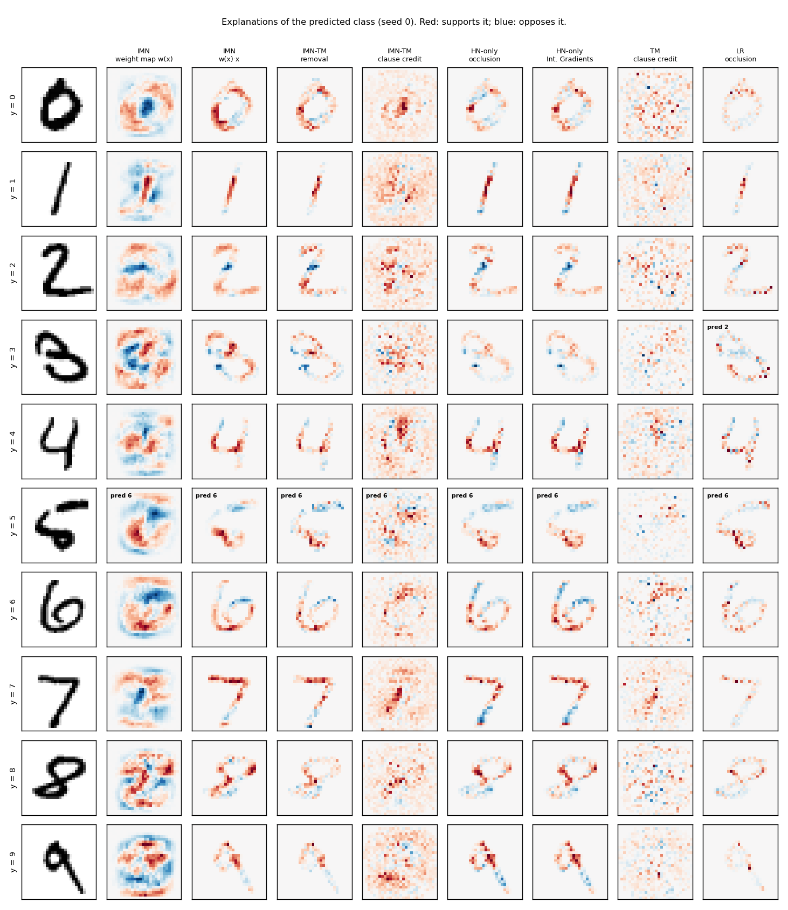
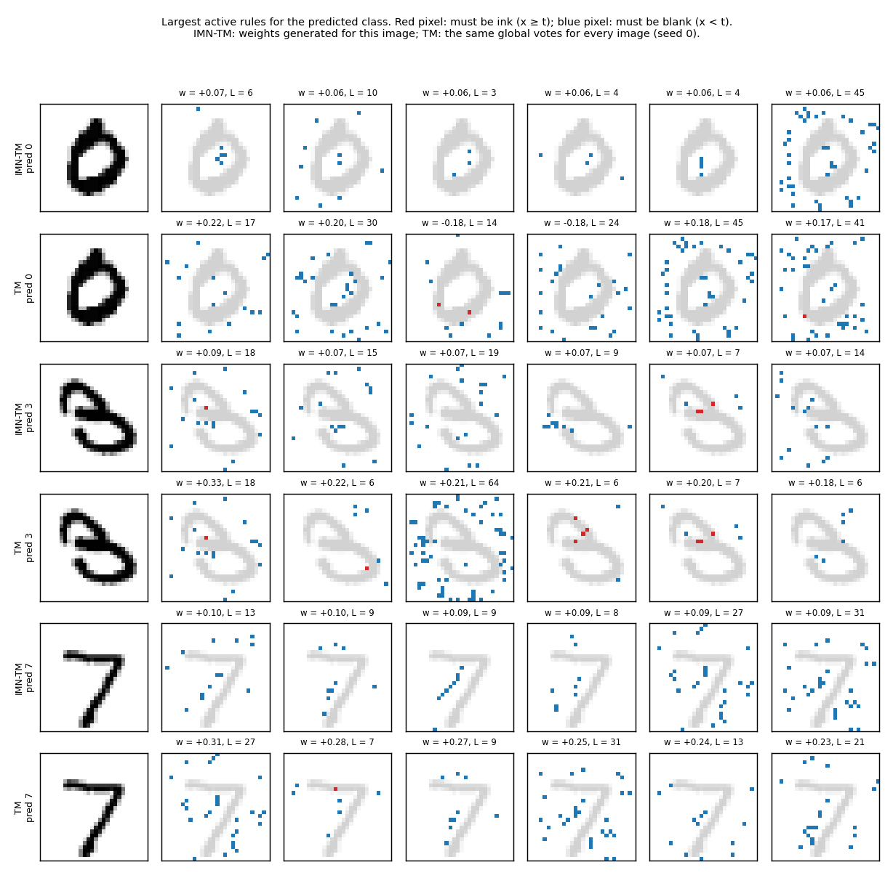
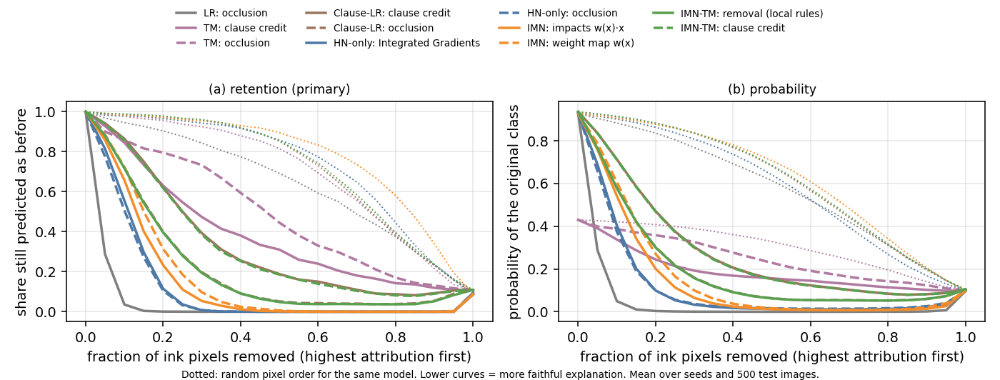
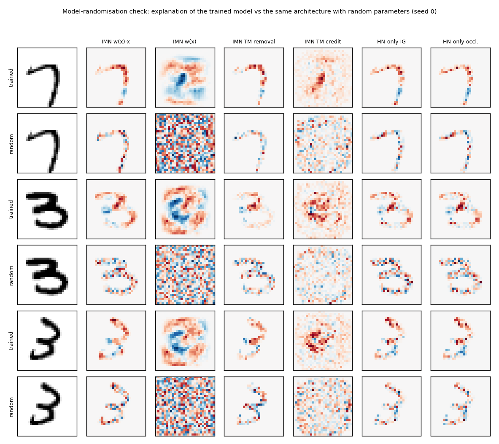
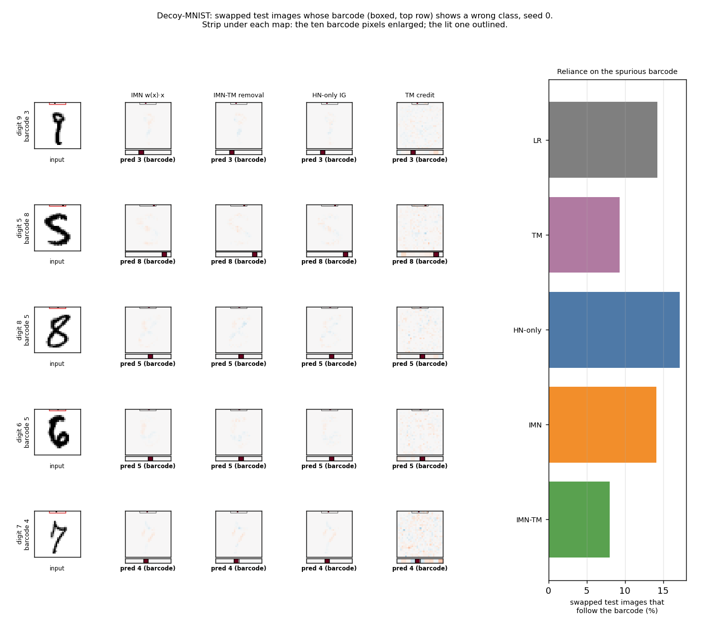

<!-- Generated by `python -m experiments.IMN.code.mnist_report` from report_template.md and results/mnist*/ (rule C2). Edit the template, not this file. -->

# IMN and IMN-TM on MNIST: accuracy and explainability

*IMN × TM research programme, `experiments/IMN/mnist`. Plan: [`PLAN.md`](PLAN.md); decisions MD1–MD6 in
[`../DECISIONS.md`](../DECISIONS.md). Every number below is filled in from `results/mnist*/` by
`python -m experiments.IMN.code.mnist_report` (rule C2).*

## Summary

- **Accuracy.**
  - IMN-TM is the most accurate arm (97.06 ± 0.06 %).
  - It beats the hypernetwork-only reference by +0.68 pp (5/5 seeds) and IMN by +1.89 pp (5/5 seeds).
  - It ties Clause-LR (+0.01 pp (3/5 seeds)). On MNIST, the gain comes from the frozen TM
    clauses, not from making their weights per-image.
  - IMN is *less* accurate than the same network without a local model (-1.21 pp (0/5 seeds)).
- **Faithfulness.** On pixel deletion, IMN's impacts (0.632 ± 0.007) and the post-hoc
  explanations of the black box (0.613 ± 0.009) are the most faithful.
  - IMN-TM's removal attribution is clearly lower (0.507 ± 0.026), but well above the
    source TM (0.310 ± 0.026).
  - The clause models spread their evidence over many redundant rules, and most of it says
    *"this pixel must stay blank"*. Deleting ink cannot remove that kind of evidence.
- **Sanity.** IMN's weight map and IMN-TM's clause credit change completely when the model is
  randomised (ρ = 0.01 ± 0.01 and 0.00 ± 0.01).
  - Every ink-only attribution keeps a sizeable correlation, the hypernetwork-only post-hoc maps
    included (IG 0.39 ± 0.01, IMN impacts 0.42 ± 0.01, IMN-TM removal
    0.47 ± 0.00).
  - Part of what those maps show is the digit's own ink.
- **Spurious cue.** On Decoy-MNIST, every explanation of every arm finds the barcode whenever the
  barcode decided the prediction (hit rate@10 of 100 % for IMN-TM, likewise for
  every other arm and method; Section 7).
  - The test separates the *models* rather than the explanations.
  - IMN-TM relies least on the barcode (8.0 % of swapped images follow it), against
    17.1 % for the hypernetwork-only model and 14.1 % for IMN.
- **Readability.** IMN-TM explains an image with 762.8 active rules,
  and 453.8 of them are needed for 90 % of the logit.
  - Single rules are readable. The full rule set of one prediction is not.
  - IMN-TM's local models are almost global: they predict an image's neighbours at
    97.2 %, against 83.7 % for IMN, and its local and
    full-model attributions coincide (cosine 1.00).

## 1. What is compared

The main report (`../report/report.pdf`) tested IMN-TM on tabular benchmarks. In IMN-TM, a hypernetwork
generates per-example weights for the frozen clauses of a Tsetlin machine. This study asks how IMN-TM
behaves on images, where explanations can be *looked at*. Every arm sees an MNIST image as 784
independent pixel features, exactly as IMN sees a tabular row.

| Arm | What it is | How it is explained here |
|---|---|---|
| **Hypernetwork-only** (`tabresnet`) | The IMN hypernetwork (TabResNet, 2 residual blocks of width 128) with an ordinary output layer. It predicts the class directly, with no local model, so it is a black box. This is the accuracy reference: same network, same training, no interpretability constraint. | Post-hoc only: **Integrated Gradients** (black-image baseline, 64 steps) and **occlusion** (set one pixel to 0 and record the change of the predicted-class logit). |
| **IMN** (`imn`) | The same network outputs, for each image, a linear model over the 784 pixels: `z_k(x) = Σ_m w_km(x) x_m + b_k(x)`. | **Impacts** `w_km(x)·x_m`, which equal the removal attribution exactly, and the generated **weight map** `w_k(x)`, a per-image template. |
| **IMN-TM** (`imn_tm`) | The same network outputs, for each image, one weight per frozen TM clause: `z_k(x) = Σ_j W_kj(x) c_j(x) + b_k(x)`. A clause is a conjunction of pixel tests (`x_m ≥ t` or `x_m < t`). | The **active rules** with their weights; **removal** attribution (clauses re-evaluated with the pixel removed, weights fixed); and **clause credit**, where each active rule spreads its weight evenly over the pixels it tests. Clause credit sums exactly to the clause part of the logit. |
| TM (`tm`) | The source Tsetlin machine whose clauses IMN-TM freezes: one global vote per clause. | Clause credit with the global votes, and occlusion. |
| Clause-LR (`clause_lr`) | The same frozen clauses with one global, re-fitted weight each (no hypernetwork). | Clause credit and occlusion. |
| Logistic regression (`lr`) | Global linear reference. | Occlusion. |

### Data and training

- **Data:** official MNIST. Training uses 50,000 images; 10,000 of the official training images are held
  out for validation by split seed; the test set is the official 10,000 images. Pixels are scaled to
  [0, 1] (MD1), so "removing" a pixel means turning it black.
- **TM input:** pixel `m` becomes the bits `x_m ≥ t` for a few fixed intensity thresholds `t` (MD2).
- **Hyper-parameters:** IMN and the hypernetwork-only model use the paper's defaults. IMN-TM and
  Clause-LR use the setting chosen in Phase 1 of the main study. Only the TM configuration and the
  training budget were chosen here, on validation accuracy of seed 0 (Section 2).
- **Seeds:** 5 seeds. Each seed changes the validation split, the initialisation and the data
  order.

### How explanations are evaluated

1. **Looking at them:** ten showcase test images, the first of each digit, explained by every arm.
2. **Faithfulness (pixel deletion):**
   - Remove the image's ink pixels in the order the explanation ranks them, most important first,
     and track how long the model keeps its original prediction.
   - The area under this *retention* curve is low for a faithful explanation.
   - The **gain** is the random-order area minus the explanation's area, for the same model. Higher is
     better, and it is the primary number (MD4).
   - Each explanation is scored on the model it explains.
3. **Sanity check (model randomisation):**
   - Explain the same images with the same architecture, untrained and with random parameters.
     For IMN-TM, the clauses are random too.
   - Report the Spearman correlation between the two maps over the ink pixels.
   - An explanation that hardly changes when the model is destroyed mostly redraws the input.
     *Lower is better.*
4. **Ground truth (Decoy-MNIST):**
   - A one-hot "barcode" of ten pixels on the always-black top row shows the true class in 90% of
     training images, so the models can learn to use it.
   - On test images where the barcode shows a *wrong* class and the model follows it, the barcode
     decided the prediction. A correct explanation must therefore put the lit barcode pixel in its
     top 10 pixels.
5. **Readability:**
   - how many pixels or rules carry 90% of an explanation;
   - how many rules are active;
   - how well an image's local model still predicts its neighbours (local fidelity).

## 2. Pilot (seed 0, validation only)

**TM configuration** (chosen: thresholds [0.25, 0.5, 0.75], 500 clauses per class, s = 5, T = 250):

| thresholds | clauses/class | s | bits | clauses kept (K) | valid acc % | train min | chosen |
| --- | ---: | ---: | ---: | ---: | ---: | ---: | ---: |
| 0.3 | 200 | 5 | 688 | 1979 | 94.68 | 1.4 |  |
| 0.3 | 200 | 10 | 688 | 1986 | 95.09 | 2.3 |  |
| 0.3 | 500 | 5 | 688 | 4913 | 96.59 | 3.0 |  |
| 0.3 | 500 | 10 | 688 | 4923 | 96.05 | 2.3 |  |
| 0.25 / 0.5 / 0.75 | 200 | 5 | 2013 | 1984 | 95.26 | 3.1 |  |
| 0.25 / 0.5 / 0.75 | 200 | 10 | 2013 | 1990 | 94.70 | 2.7 |  |
| 0.25 / 0.5 / 0.75 | 500 | 5 | 2013 | 4967 | 96.75 | 5.8 | **✓** |
| 0.25 / 0.5 / 0.75 | 500 | 10 | 2013 | 4973 | 96.47 | 3.9 |  |

**Training budget** (chosen: hypernetwork-only 200k, IMN 200k,
IMN-TM 200k; Clause-LR takes IMN-TM's budget):

| arm | max steps | epochs | valid acc % | train min | chosen |
| --- | ---: | ---: | ---: | ---: | ---: |
| Hypernetwork-only (TabResNet) | 50k | 63 | 94.54 | 2.6 |  |
| Hypernetwork-only (TabResNet) | 200k | 255 | 96.30 | 9.7 | **✓** |
| IMN | 50k | 63 | 93.73 | 2.8 |  |
| IMN | 200k | 255 | 94.56 | 9.8 | **✓** |
| IMN-TM | 50k | 63 | 96.33 | 2.7 |  |
| IMN-TM | 200k | 255 | 96.96 | 11.4 | **✓** |

- **TM.** 500 clauses per class beat 200 at every threshold setting. The three-threshold
  encoding with `s = 5` was best. The kept clause count after empty-clause pruning is in the
  table.
- **Budget.** Every arm preferred the larger budget, 200k steps, about 255 epochs. IMN-TM at 50k
  steps already beats the other two networks at 200k.
- **Caveat.** Because all arms picked the upper candidate, their accuracy may still rise with more
  training. The comparison is at an equal, validated budget, not at convergence.

## 3. Accuracy

| arm | test acc % | test log-loss | valid acc % | parameters | clauses K | train min | seeds |
| --- | ---: | ---: | ---: | ---: | ---: | ---: | ---: |
| Logistic regression | 92.41 ± 0.03 | 0.277 ± 0.001 | 92.28 ± 0.37 | – | – | 0.3 | 5 |
| TM (source) | 96.72 ± 0.25 | 0.876 ± 0.008 | 96.54 ± 0.35 | – | 4967 | 5.1 | 5 |
| Clause-LR | 97.05 ± 0.07 | 0.117 ± 0.003 | 96.85 ± 0.29 | 0.05 M | 4967 | 6.0 | 5 |
| Hypernetwork-only (TabResNet) | 96.38 ± 0.09 | 0.143 ± 0.001 | 96.13 ± 0.18 | 0.17 M | – | 11.2 | 5 |
| IMN | 95.17 ± 0.25 | 0.171 ± 0.006 | 95.06 ± 0.28 | 1.18 M | – | 12.3 | 5 |
| IMN-TM | 97.06 ± 0.06 | 0.117 ± 0.002 | 96.87 ± 0.29 | 6.58 M | 4967 | 13.1 | 5 |

Paired by seed: IMN-TM − IMN +1.89 pp (5/5 seeds); IMN-TM − hypernetwork-only +0.68 pp (5/5 seeds);
IMN − hypernetwork-only -1.21 pp (0/5 seeds); IMN-TM − TM +0.34 pp (5/5 seeds);
IMN-TM − Clause-LR +0.01 pp (3/5 seeds).

- **Ranking.** The clause models lead, ahead of the black-box reference.
  - IMN-TM and Clause-LR are statistically indistinguishable. Both improve on the source TM
    (+0.34 pp (5/5 seeds)) and on the hypernetwork-only network (+0.68 pp (5/5 seeds)).
  - The frozen clauses act as a good fixed feature map of binarised pixel patterns. A linear layer
    on top of them is already enough.
  - On MNIST, the per-image re-weighting adds no accuracy.
- **IMN** pays an accuracy cost for its interpretability on images (-1.21 pp (0/5 seeds) against
  the same network without a local model). A per-image linear model over 784 pixels is a harder
  output than ten logits.
- **Log-loss.** The TM's high log-loss is not a modelling failure. Its probabilities are
  `softmax(votes / T)`, which is very flat. This is why the deletion analysis uses retention of the
  prediction rather than probability (MD4).
- **Absolute level.** These are tabular models given the preregistered tabular defaults, with no
  convolution or augmentation. None comes close to a CNN's ~99.5 %, and none was meant to.

## 4. What the explanations look like

The gallery reads column by column:

- **IMN weight map.** A smooth, digit-shaped *template*: red where ink supports the prediction,
  blue where it would oppose it.
  - It covers the background too, because it shows what the local model *would* do with ink there.
  - It is the most informative IMN view: for the 5 that IMN misreads as a 6, the template is
    shaped like a 6.
- **Ink-pixel attributions.** IMN's impacts, IMN-TM's removal and the hypernetwork-only occlusion
  and Integrated Gradients look alike: they highlight the strokes that distinguish the digit.
  - These maps can only be non-zero on ink, because removing a black pixel changes nothing.
- **Clause credit.** IMN-TM and the TM spread credit over the whole image, including the
  background.
  - This is the "must stay blank" evidence of the clauses: for the 0, the empty centre carries
    credit, and for the 7, the blank space left of the stem.
  - The TM's credit is noisier: its global votes are large and unevenly spread across clauses.
- **LR occlusion.** Sparse and dominated by a few pixels.

### The rules behind an IMN-TM prediction

- **What the rules test.**
  - Most of the top active rules for the predicted class test that pixels are *blank* (blue);
    few test that a pixel is ink (red).
  - A rule like "all of these few pixels are empty" is readable on its own: it says where the
    digit is *not*. Combined, such rules carve out the digit's shape.
- **How the weights differ.**
  - IMN-TM's generated weights are smaller and more even than the TM's global votes, the effect of
    the L1 `prior` penalty and of training all weights jointly.
  - So no single rule dominates. This matches the readability numbers (Section 8): hundreds of
    rules are needed to cover most of a logit.

## 5. Faithfulness: pixel deletion

| arm | explanation | retention AUC ↓ | random-order AUC | gain ↑ | prob. AUC ↓ | prob. gain ↑ |
| --- | ---: | ---: | ---: | ---: | ---: | ---: |
| Logistic regression | occlusion | 0.044 ± 0.001 | 0.640 ± 0.010 | **0.596 ± 0.009** | 0.044 ± 0.001 | 0.532 ± 0.008 |
| TM (source) | clause credit | 0.386 ± 0.023 | 0.696 ± 0.021 | **0.310 ± 0.026** | 0.185 ± 0.008 | 0.119 ± 0.007 |
| TM (source) | occlusion | 0.485 ± 0.019 | 0.696 ± 0.021 | **0.211 ± 0.011** | 0.246 ± 0.008 | 0.058 ± 0.004 |
| Clause-LR | clause credit | 0.331 ± 0.016 | 0.716 ± 0.012 | **0.385 ± 0.012** | 0.274 ± 0.011 | 0.337 ± 0.007 |
| Clause-LR | occlusion | 0.218 ± 0.014 | 0.716 ± 0.012 | **0.497 ± 0.007** | 0.191 ± 0.008 | 0.420 ± 0.006 |
| Hypernetwork-only (TabResNet) | Integrated Gradients | 0.119 ± 0.005 | 0.732 ± 0.014 | **0.613 ± 0.009** | 0.110 ± 0.005 | 0.472 ± 0.005 |
| Hypernetwork-only (TabResNet) | occlusion | 0.113 ± 0.005 | 0.732 ± 0.014 | **0.619 ± 0.009** | 0.109 ± 0.004 | 0.473 ± 0.005 |
| IMN | impacts w(x)·x | 0.145 ± 0.007 | 0.777 ± 0.012 | **0.632 ± 0.007** | 0.136 ± 0.005 | 0.490 ± 0.004 |
| IMN | weight map w(x) | 0.168 ± 0.007 | 0.777 ± 0.012 | **0.610 ± 0.007** | 0.156 ± 0.006 | 0.470 ± 0.003 |
| IMN-TM | removal (local rules) | 0.215 ± 0.017 | 0.722 ± 0.015 | **0.507 ± 0.026** | 0.190 ± 0.011 | 0.425 ± 0.011 |
| IMN-TM | clause credit | 0.326 ± 0.019 | 0.722 ± 0.015 | **0.396 ± 0.026** | 0.273 ± 0.012 | 0.342 ± 0.011 |

Paired per image (same 500 test images per seed; gain of A minus gain of B):

| A | B | mean gain A − B | seeds A > B | largest per-seed Wilcoxon p |
| --- | --- | ---: | ---: | ---: |
| IMN-TM removal (local rules) | IMN impacts w(x)·x | -0.126 | 0/5 | 1e-36 |
| IMN-TM removal (local rules) | HN-only Integrated Gradients | -0.107 | 0/5 | 2e-18 |
| IMN impacts w(x)·x | HN-only Integrated Gradients | +0.019 | 5/5 | 0.3 |
| IMN-TM clause credit | IMN-TM removal (local rules) | -0.110 | 0/5 | 2e-58 |
| IMN-TM removal (local rules) | TM clause credit | +0.196 | 5/5 | 8e-40 |

- **Ranking.** IMN's impacts and the hypernetwork-only explanations (occlusion or IG) are the most
  faithful, and IMN's impacts are slightly ahead of IG (+0.019 (5/5 seeds, max p = 0.3)). IMN-TM's
  removal attribution follows (-0.126 (0/5 seeds, max p = 1e-36) against IMN). It is still far
  better than the TM's own explanation (+0.196 (5/5 seeds, max p = 8e-40)).
- **Why IMN-TM scores lower.** The clause curves level off above zero: some images keep their
  prediction even with all ink removed. Ink deletion cannot reach the evidence of a clause model.
  - 72.1 % of IMN-TM's clause credit lies on background pixels,
    which deletion never touches.
  - Removing ink can make "must be blank" literals *true* and so switch clauses *on*.
  - About 762.8 active clauses overlap heavily, so removing any one
    pixel changes little. Single-pixel removal scores then rank pixels poorly for multi-pixel
    deletion.
  - This is an interaction effect between conjunctions and the deletion protocol. It is not
    evidence that IMN-TM's *rules* are unfaithful: they are its exact computation.
- **Clause credit.** It ranks ink pixels less well than removal does
  (-0.110 (0/5 seeds, max p = 2e-58)). It describes how the logit is composed, not what happens
  when a pixel is removed.
- **LR.** It has the lowest deletion AUC of all, because one removed stroke flips it. Its large
  gain reflects that fragility as much as the explanation.
- **Comparing gains.** The random-order area itself differs between models: IMN is the most robust
  to random deletion and the TM the least. Gains are therefore best compared within a model, or
  between models of similar robustness.

## 6. Sanity check: do the explanations depend on the model?

| arm | explanation | Spearman ρ, trained vs random model ↓ |
| --- | ---: | ---: |
| Hypernetwork-only (TabResNet) | Integrated Gradients | 0.39 ± 0.01 |
| Hypernetwork-only (TabResNet) | occlusion | 0.39 ± 0.01 |
| IMN | impacts w(x)·x | 0.42 ± 0.01 |
| IMN | weight map w(x) | 0.01 ± 0.01 |
| IMN-TM | removal (local rules) | 0.47 ± 0.00 |
| IMN-TM | clause credit | 0.00 ± 0.01 |

- **Ink-confined maps.** For removal-type explanations, the trained and random maps still
  correlate: IMN's impacts 0.42 ± 0.01, IMN-TM's removal 0.47 ± 0.00,
  hypernetwork-only occlusion 0.39 ± 0.01 and IG 0.39 ± 0.01.
  - These maps are confined to ink and scale with pixel intensity, so part of every such map is
    the input itself.
  - The figure shows the effect: the random model's maps still trace the digit.
  - The black-box reference does not do better than the interpretable models here.
- **Maps that pass clearly.** IMN's weight map (0.01 ± 0.01) and IMN-TM's clause credit
  (0.00 ± 0.01) are uncorrelated with their randomised versions: what they show was
  learned.
  - Caveat for clause credit: for IMN-TM, randomisation replaces the clauses as well as the
    weights. Its near-zero ρ therefore tests the whole model, not the hypernetwork alone.

## 7. Ground truth: Decoy-MNIST

| arm | consistent acc % | clean acc % | swapped acc % | reliance % (follows barcode) | explained swapped images that follow |
| --- | ---: | ---: | ---: | ---: | ---: |
| Logistic regression | 99.1 ± 0.0 | 90.0 ± 0.1 | 79.2 ± 0.4 | **14.2 ± 0.5** | 76 ± 1 |
| TM (source) | 99.7 ± 0.0 | 94.7 ± 0.2 | 87.4 ± 1.2 | **9.3 ± 1.4** | 54 ± 7 |
| Hypernetwork-only (TabResNet) | 99.6 ± 0.0 | 92.9 ± 0.2 | 78.9 ± 1.2 | **17.1 ± 1.2** | 83 ± 3 |
| IMN | 99.2 ± 0.1 | 90.9 ± 0.1 | 80.3 ± 0.5 | **14.1 ± 0.8** | 69 ± 2 |
| IMN-TM | 99.6 ± 0.0 | 95.1 ± 0.1 | 88.8 ± 0.6 | **8.0 ± 0.7** | 42 ± 5 |

| arm | explanation | barcode in top-10, follows ↑ (%) | barcode in top-10, does not follow (%) | |attr.| on barcode, consistent (%) |
| --- | --- | ---: | ---: | ---: |
| Logistic regression | occlusion | 100 ± 0 | 3 ± 1 | 74.3 ± 1.9 |
| TM (source) | clause credit | 100 ± 0 | 1 ± 1 | 6.3 ± 0.5 |
| TM (source) | occlusion | 100 ± 0 | 3 ± 1 | 25.9 ± 3.7 |
| Hypernetwork-only (TabResNet) | Integrated Gradients | 100 ± 0 | 0 ± 0 | 21.5 ± 0.4 |
| Hypernetwork-only (TabResNet) | occlusion | 100 ± 0 | 2 ± 0 | 23.1 ± 0.4 |
| IMN | impacts w(x)·x | 100 ± 0 | 0 ± 0 | 21.8 ± 0.3 |
| IMN | weight map w(x) | 100 ± 0 | 0 ± 0 | 11.5 ± 0.1 |
| IMN-TM | removal (local rules) | 100 ± 0 | 0 ± 0 | 21.2 ± 0.3 |
| IMN-TM | clause credit | 100 ± 0 | 0 ± 0 | 10.5 ± 0.2 |

- **Reliance.** All arms learned to use the barcode a little, but none mainly.
  - Consistent accuracy is near 100 %, and swapped accuracy stays far above chance.
  - IMN-TM (8.0 %) and the TM (9.3 %) rely on it least. The hypernetwork-only
    model relies on it most (17.1 %).
  - The clause models' "must be blank" rules on the always-black top row may explain the
    difference: a lit barcode pixel breaks those rules for every class, not just one. This is an
    interpretation, not tested here.
- **Ground truth.** Whenever a prediction followed the barcode, *every* explanation placed the lit
  barcode pixel in its top 10, and almost never did so when the prediction did not follow.
  - This is a ceiling effect: a single isolated pixel that decides the class is easy for every
    method to find. The test confirms that none of the explanations hides a spurious cue.
  - It cannot rank the methods.
- **Barcode share in consistent images.** Removal-type maps put a sizeable part of their mass on
  the barcode (21.2 % for IMN-TM's removal, 21.5 % for IG),
  while clause credit puts less (10.5 % for IMN-TM). Credit spreads over
  the many blank-pixel literals.
- **Figure.** It shows swapped images whose prediction follows the barcode (bold labels).
  - The strip under each map enlarges the ten barcode pixels on the map's own colour scale.
  - In every method, the lit pixel (outlined) is the strongest attribution of the whole image. It
    is so strong that the digit itself fades to near-white.

## 8. How much has a reader to read?

| arm | pixels for 90% (primary) | clauses for 90% | active clauses | active clause length | local acc k=10 % | local acc k=50 % | local vs full corr | credit on background % |
| --- | ---: | ---: | ---: | ---: | ---: | ---: | ---: | ---: |
| Logistic regression | 81.7 ± 1.1 | – | – | – | – | – | – | – |
| TM (source) | 314.6 ± 2.5 | – | – | – | – | – | – | 76 ± 1 |
| Clause-LR | 407.8 ± 2.7 | 454.0 ± 2.5 | 762.8 ± 3.9 | 9.5 ± 0.1 | 96.8 ± 1.0 | 97.5 ± 1.1 | 1.00 ± 0.00 | 72 ± 0 |
| Hypernetwork-only (TabResNet) | 85.0 ± 0.8 | – | – | – | – | – | – | – |
| IMN | 84.4 ± 1.5 | – | – | – | 85.7 ± 0.5 | 83.7 ± 1.2 | 0.85 ± 0.01 | – |
| IMN-TM | 76.3 ± 0.9 | 453.8 ± 2.3 | 762.8 ± 3.9 | 9.5 ± 0.1 | 96.3 ± 1.3 | 97.2 ± 0.9 | 1.00 ± 0.00 | 72 ± 0 |

- **Pixel maps.** To cover 90 % of an attribution, every pixel map needs about half of the
  digit's ~152.2 ink pixels. IMN-TM's removal map is the most concentrated
  (76.3), IMN (84.4) and the hypernetwork-only IG
  (85.0) are close.
- **Rules.** IMN-TM's native explanation is not small: 762.8 active
  rules of about 9.5 literals each, and
  453.8 rules for 90 % of the logit.
  - A reader can inspect the top rules (Section 4) but not the whole decision.
  - A smaller, sparser clause set is the obvious lever: fewer clauses per class, or a stronger L1
    on the generated weights. It was not tuned here.
- **Locality.** IMN-TM's per-image model behaves almost like a global one.
  - Applied to an image's 50 nearest neighbours per class, it is right
    97.2 % of the time, the same as the global Clause-LR
    (97.5 %).
  - Its local attributions agree perfectly with the full model's.
  - IMN's local models are genuinely local (83.7 %,
    cosine 0.85). IMN-TM's are stable and transferable, which
    matches the tie with Clause-LR in accuracy.

## 9. Conclusions and limitations

**What the study shows.**

1. **IMN-TM is the most accurate interpretable model on MNIST**, and more accurate than the black
   box it is built on. The frozen TM clauses carry this gain, and a global linear layer over them
   (Clause-LR) does as well.
2. **Its explanations differ in kind from pixel maps.**
   - They are rules, mostly about where the digit is *not*.
   - Clause credit passes the randomisation sanity check cleanly and shows absence evidence that no
     ink-based map can show.
   - On ink-deletion faithfulness, it trails IMN and the post-hoc explanations of the black box.
     The main reason is that clause evidence on the background cannot be deleted.
3. **IMN keeps per-image locality and the best deletion faithfulness**, at an accuracy cost
   against the same network without a local model. Its weight map is the most informative single
   picture in the gallery.
4. **The hypernetwork-only reference is not more explainable post hoc.** IG and occlusion on the
   black box are about as faithful as IMN's built-in impacts. They fail the randomisation check to
   the same degree as the other ink-only maps. They need a separate, approximate method, where IMN
   and IMN-TM are explained by their own computation.
5. **On a spurious cue**, all explanations reveal it when it is used. IMN-TM uses it least.

**Limitations.**

- **Training settings.** Tabular defaults were used, with no tuning beyond the TM configuration
  and the budget. All arms chose the largest budget offered, so the accuracies may not be
  converged.
- **Input representation.** Pixels are independent features with no spatial prior. A
  convolutional TM would be the natural clause source for images and is out of scope.
- **Deletion.** It produces off-manifold images and only removes ink. It therefore systematically
  under-credits explanations built on absence evidence. ROAR, which retrains, or an insertion
  metric on the background would be complementary.
- **Decoy.** The one-hot barcode is too easy to find to rank explanation methods. A distributed or
  texture cue would be harder.
- **Seeds and statistics.** Five seeds for the main study and three for Decoy-MNIST. The per-image
  Wilcoxon tests are within seeds, and no seed-level significance is claimed.
- **Decoy seed-0 runs.** The four decoy runs shown in the figure (IMN, IMN-TM, hypernetwork-only,
  TM; seed 0) were re-run after the main phase only to store maps for all explained swapped
  images. Their records were rewritten by the same code path.
