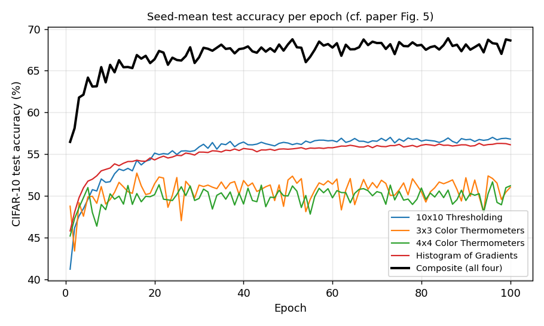

# multi_convtm — TM Composites reproduction report

<!-- Generated by code/report.py from results/*.json; do not hand-edit. -->

Paper: Granmo (2023), *TMComposites: Plug-and-Play Collaboration Between Specialized Tsetlin Machines*, arXiv:2309.04801, CIFAR-10. Protocol, deviations and the pass criterion are fixed in `README.md`.

**Runs finished:** C3/s0, C3/s1, C3/s2, C4/s0, C4/s1, C4/s2, HoG/s0, HoG/s1, HoG/s2, T10/s0, T10/s1, T10/s2  
**Runs in progress:** none

## 1. Table 2 (CIFAR-10): paper, authors' class sums, ours

| Row | Paper | Authors' class sums (ep. 99) | Ours, epoch 100 (mean ± sd) | Per seed | Δ vs paper | Verdict |
|---|---|---|---|---|---|---|
| 10x10 Thresholding | 57.0 | 57.01 | 56.81 ± 0.13 | 56.70, 56.79, 56.95 | -0.19 | REPRODUCED |
| 3x3 Color Thermometers | 62.1 | 62.12 | 51.04 ± 0.93 | 50.45, 50.55, 52.11 | -11.06 | GAP |
| 4x4 Color Thermometers | 62.7 | 62.72 | 51.21 ± 1.13 | 52.51, 50.69, 50.44 | -11.49 | GAP |
| Histogram of Gradients | 63.5 | 63.53 | 56.13 ± 0.09 | 56.23, 56.06, 56.10 | -7.37 | GAP |
| 10x10T + HoG | 68.0 | 68.03 | 64.29 ± 0.50 | 63.88, 64.14, 64.85 | -3.71 | GAP |
| 10x10T + 3x3C | 68.6 | 68.56 | 63.97 ± 0.99 | 63.34, 63.46, 65.12 | -4.63 | GAP |
| 10x10T + 4x4C | 68.7 | 68.70 | 64.19 ± 0.58 | 64.75, 64.21, 63.60 | -4.51 | GAP |
| 10x10T + 3x3C + 4x4C | 71.7 | 71.74 | 65.03 ± 0.26 | 65.00, 65.31, 64.79 | -6.67 | GAP |
| 10x10T + 3x3C + 4x4C + HoG | 75.1 | 75.12 | 68.62 ± 0.27 | 68.48, 68.94, 68.45 | -6.48 | GAP |

The combining rule alone is verified on the authors' released class sums: the largest difference from Table 2 is 0.04 pp (rounding) (`results/reference_check.json`).

## 2. The paper's claims

- **C-A: composite vs best single specialist.** The paper reports +11.6 pp (75.1 vs 63.5). Ours: 11.81 ± 0.33 pp over 3 seed(s) (11.78, 12.15, 11.50).
- **C-B: each added specialist helps** (Table 2 chain, mean over seeds): 3x3C: 7.16 pp (paper +11.6); 4x4C: 1.06 pp (paper +3.1); HoG: 3.59 pp (paper +3.4).

## 3. Specialists

| Specialist | Seed | Status | Epoch 100 | Epoch 99 | Best epoch (not used) | Epoch 100, clamped votes (library `predict`) | Train s/epoch (mean) |
|---|---|---|---|---|---|---|---|
| 10x10 Thresholding | 0 | done (100 ep) | 56.70 | 57.09 | 57.38 @40 | 55.13 | 65 |
| 10x10 Thresholding | 1 | done (100 ep) | 56.79 | 56.22 | 57.61 @90 | 54.42 | 51 |
| 10x10 Thresholding | 2 | done (100 ep) | 56.95 | 57.41 | 57.52 @62 | 54.24 | 65 |
| 3x3 Color Thermometers | 0 | done (100 ep) | 50.45 | 48.58 | 53.87 @69 | 45.44 | 71 |
| 3x3 Color Thermometers | 1 | done (100 ep) | 50.55 | 52.36 | 54.28 @16 | 47.48 | 71 |
| 3x3 Color Thermometers | 2 | done (100 ep) | 52.11 | 50.43 | 53.40 @58 | 48.48 | 71 |
| 4x4 Color Thermometers | 0 | done (100 ep) | 52.51 | 51.99 | 52.84 @19 | 50.69 | 127 |
| 4x4 Color Thermometers | 1 | done (100 ep) | 50.69 | 51.14 | 52.72 @21 | 48.61 | 129 |
| 4x4 Color Thermometers | 2 | done (100 ep) | 50.44 | 49.84 | 52.78 @54 | 46.76 | 128 |
| Histogram of Gradients | 0 | done (100 ep) | 56.23 | 56.46 | 56.72 @97 | 55.68 | 84 |
| Histogram of Gradients | 1 | done (100 ep) | 56.06 | 56.08 | 56.45 @75 | 55.56 | 85 |
| Histogram of Gradients | 2 | done (100 ep) | 56.10 | 56.25 | 56.25 @90 | 55.39 | 85 |

The *best epoch* column is for information only. Per R4, it is never used for a headline number.

## 4. Diagnostics

Zero-weight clauses at the end of training (deviation D2, `results/diagnostics.json`):

| Run | Zero-weight fraction | Mean weight | Max weight |
|---|---|---|---|
| C3_seed0 | 0.0170 | 56.95 | 706 |
| C3_seed1 | 0.0174 | 56.37 | 725 |
| C3_seed2 | 0.0174 | 56.71 | 598 |
| C4_seed0 | 0.0162 | 55.64 | 1069 |
| C4_seed1 | 0.0189 | 54.90 | 1135 |
| C4_seed2 | 0.0171 | 54.94 | 790 |
| T10_seed0 | 0.0027 | 47.42 | 190 |
| T10_seed1 | 0.0024 | 47.13 | 169 |
| T10_seed2 | 0.0026 | 47.32 | 191 |

Library gap MC-1 (`LIBRARY_GAPS.md`): accuracy of the library's clamped `predict()` versus the unclamped class sums, at epoch 100 (mean over seeds):

| Specialist | Unclamped (reported) | Clamped `predict()` | Cost of the clamp (pp) |
|---|---|---|---|
| 10x10 Thresholding | 56.81 | 54.60 | 2.22 |
| 3x3 Color Thermometers | 51.04 | 47.13 | 3.90 |
| 4x4 Color Thermometers | 51.21 | 48.69 | 2.53 |
| Histogram of Gradients | 56.13 | 55.54 | 0.59 |

## 5. Interpretation

- **The method reproduces.** On the authors' own class sums, Eqs. 7-8 give Table 2 exactly. On our specialists, the composite's gain over its best member matches the paper (claim C-A).
- **The authors' code reproduces the paper on this machine** (section 6). The torchtsetlin shortfall is therefore a property of the library, not of the paper.
- **Cause: the hard clause budget (gap MC-2), not batching** (sections 7-8). torchtsetlin 0.3.x reverts every inclusion beyond `max_included_literals`, so no clause ever exceeds it and the budget's own Type Ia -> Type Ib switch (`include_count > budget`) never fires. Every clause freezes at exactly 32 literals. tmu lets a clause overshoot, prunes it by Type Ib, and regrows it. torchtsetlin's opt-in `budget_mode="soft"` reproduces tmu's clause-size distribution and its accuracy. Exact per-example updates with the hard budget do not, and batching costs only the remaining 1-2 pp.
- **Library fixes**: MC-1 (unclamped prediction votes) is applied, and MC-2 is available as `budget_mode="soft"`. Proposed changes to the defaults are in `PROPOSAL.md`.

## 6. The authors' code (tmu) vs torchtsetlin

Every Table 2 row at epoch 100. Columns: our tmu run of the authors' scripts (`reference_code/`, tmu 0.8.3, one run); torchtsetlin with the 0.3.x hard clause budget (sections 1-3); torchtsetlin with `budget_mode="soft"`, tmu's rule (gap MC-2). Both torchtsetlin columns are 3-seed means where finished. ✓ / GAP apply the pass criterion fixed in README.md: within max(3 pp, 2 sd) of the paper.

| Row | Paper | Authors' class sums | tmu, our run | torchtsetlin, hard budget | torchtsetlin, soft budget |
|---|---|---|---|---|---|
| 10x10 Thresholding | 57.0 | 57.01 | 56.70 | 56.81 ± 0.13 (n=3) ✓ | 57.64 ± 0.09 (n=3) ✓ |
| 3x3 Color Thermometers | 62.1 | 62.12 | 61.72 | 51.04 ± 0.93 (n=3) GAP | 61.67 ± 1.05 (n=3) ✓ |
| 4x4 Color Thermometers | 62.7 | 62.72 | 61.98 | 51.21 ± 1.13 (n=3) GAP | 61.48 ± 0.80 (n=3) ✓ |
| Histogram of Gradients | 63.5 | 63.53 | 63.67 | 56.13 ± 0.09 (n=3) GAP | 59.99 ± 0.23 (n=3) GAP |
| 10x10T + HoG | 68.0 | 68.03 | 67.84 | 64.29 ± 0.50 (n=3) GAP | 65.95 ± 0.28 (n=3) ✓ |
| 10x10T + 3x3C | 68.6 | 68.56 | 68.79 | 63.97 ± 0.99 (n=3) GAP | 68.80 ± 0.51 (n=3) ✓ |
| 10x10T + 4x4C | 68.7 | 68.70 | 69.35 | 64.19 ± 0.58 (n=3) GAP | 68.69 ± 0.83 (n=3) ✓ |
| 10x10T + 3x3C + 4x4C | 71.7 | 71.74 | 72.16 | 65.03 ± 0.26 (n=3) GAP | 71.30 ± 0.73 (n=3) ✓ |
| 10x10T + 3x3C + 4x4C + HoG | 75.1 | 75.12 | 75.09 | 68.62 ± 0.27 (n=3) GAP | 73.28 ± 0.35 (n=3) ✓ |

## 7. Diagnostics: what closes the gap (3x3 colour thermometers, seed 0)

Test accuracy at matching epochs. Each torchtsetlin run changes one thing relative to the reproduction run. Records: `results/C3_seed0*.json`, `results/tmu_C3_run0.json`.

| Run | What differs | Ep 1 | Ep 5 | Ep 10 | Ep 20 |
|---|---|---|---|---|---|
| tmu (authors' code) | per-example updates, soft budget | 51.48 | 58.56 | 58.37 | 59.75 |
| torchtsetlin, reproduction | batch 50, hard budget | 47.68 | 50.77 | 45.14 | 51.45 |
| torchtsetlin `bs10` | batch 10 | 51.39 | 52.80 | 52.52 | 51.44 |
| torchtsetlin `seq` | exact per-example updates (5 epochs) | 50.92 | 50.84 | – | – |
| torchtsetlin `nocap` | no budget | 52.94 | 55.17 | 54.75 | 54.52 |
| torchtsetlin `seq_nocap` | per-example, no budget (5 epochs) | 52.71 | 56.61 | – | – |
| torchtsetlin `soft` | **soft budget** (tmu's rule), batch 50 | 50.97 | 59.40 | 60.45 | 59.06 |

## 8. Clause sizes (included literals per clause, 3x3 colour thermometers)

| Model | Epoch | Median | Mean | Share above 32 | Max | Test acc. |
|---|---|---|---|---|---|---|
| tmu (authors' code) | 5 | 31 | 29.7 | 20.2% | 39 | 58.19 |
| torchtsetlin `C3_seed0` (batch, batch 50, budget 32) | 100 | 32 | 32.0 | 0.0% | 32 | 50.45 |
| torchtsetlin `C3_seed0_soft` (batch, batch 50, budget 32) | 20 | 31 | 30.7 | 22.1% | 41 | 59.06 |
| torchtsetlin `C3_seed0_seq_nocap` (sequential, batch 50, budget None) | 5 | 140 | 138.3 | 99.8% | 234 | 56.61 |
| torchtsetlin `C3_seed0_nocap` (batch, batch 50, budget None) | 20 | 177 | 172.9 | 100.0% | 242 | 54.52 |

## 9. Not reproduced (published values only)

Fashion-MNIST and CIFAR-100 columns of Table 2, and the 22-specialist Optimized-Toolbox composite (arXiv:2406.00704). See README.md *Scope* for the reasons.
