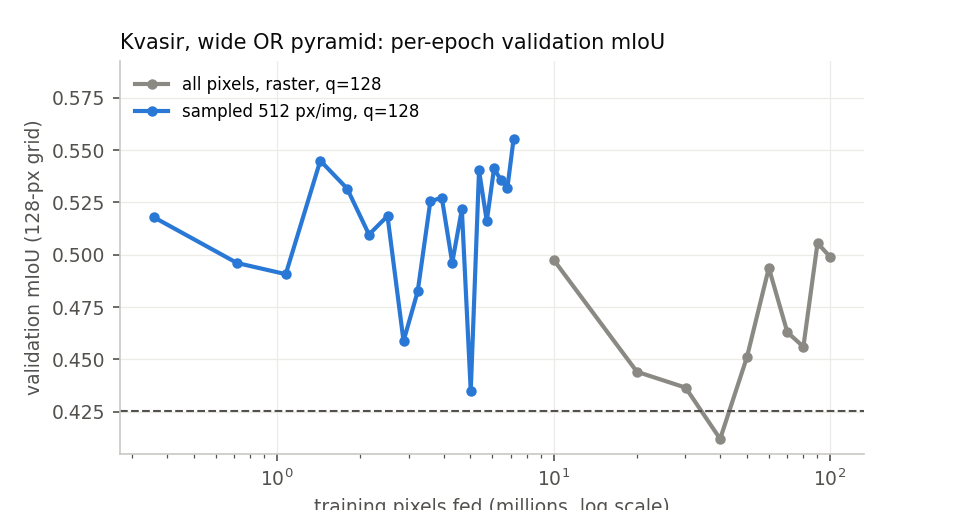
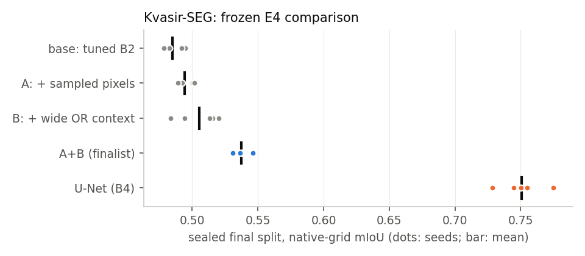
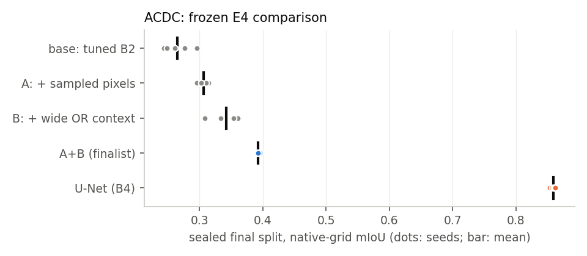
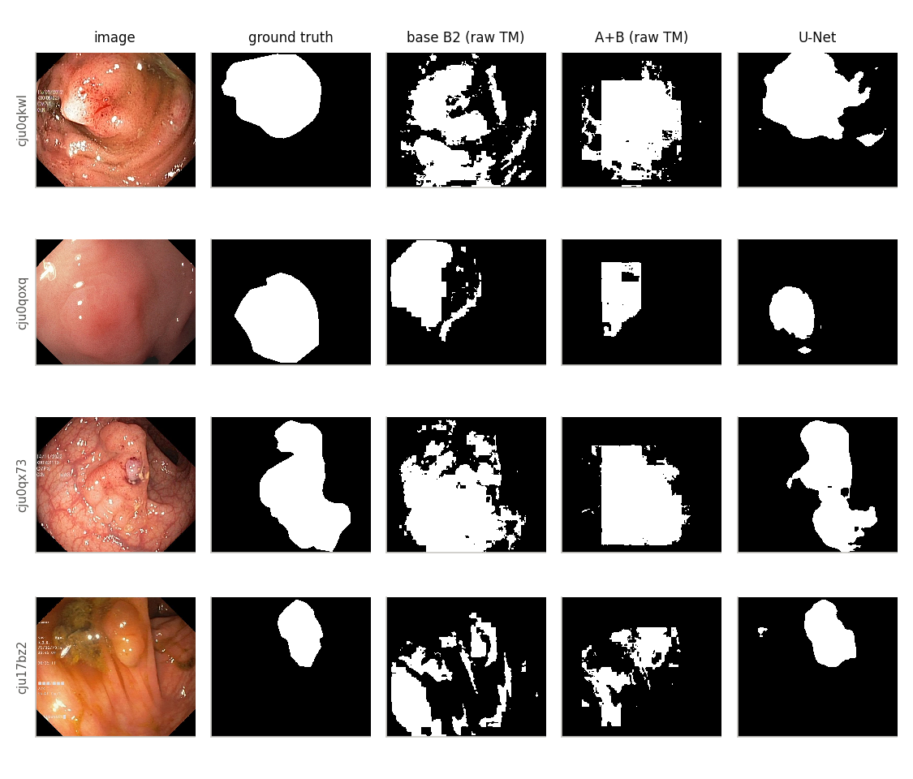

# Dense Tsetlin-machine segmentation: what helps, what does not

*Segmentation improvement programme (`experiments/segmentation/`), executed 2026-10-13 against
`torchtsetlin` 0.3.1 (`f5168bd`, `src/` unchanged — hash in every record). Generated by
`code/report.py` from 358 completed run records (26 OOM/failed attempts kept as outcomes;
125 device-hours of recorded wall time, much of it concurrent). Every number below is read
from `results/*.json`; plan: [PLAN.md](../PLAN.md); dated choices: [DECISIONS.md](../DECISIONS.md).*

## Summary

* **The binding limitation of the current dense TM on real images is spatial context, then the
  dense learning schedule — not the clause algebra.** A local CNN with the TM's 3×3 receptive
  field, trained on the same Boolean planes, collapses to the all-background floor on Kvasir-SEG
  (0.426 vs 0.425) and on ACDC
  (0.241 vs 0.241); per-pixel learners on fixed wide-context Boolean
  features (logistic regression, gradient boosting, a flat TM) all sit near 0.53–0.57 validation
  mIoU, whereas a U-Net *on the same Boolean planes* reaches 0.686 —
  learned spatial composition, which a single-layer TM does not have.
* **H1 (feedback order / sampling) — supported where commits mix images, and the cheapest win.**
  On D0 scenes (where an 8-image batch shares a chunk), raster commits of 512 pixels lose
  0.107 mIoU against permuted ones. On the sealed splits, sampling 512 pixels per image from
  a 16-image pool adds +0.042 (95% CI +0.025 to +0.060, 5 seeds × 50 groups) on ACDC but is inconclusive alone on Kvasir
  (+0.009 (95% CI -0.005 to +0.022, 5 seeds × 150 groups)); together with wide context it adds +0.032 (95% CI +0.018 to +0.048, 5 seeds × 150 groups) on Kvasir
  (interaction +0.023 (95% CI +0.003 to +0.048, 5 seeds × 150 groups)), while feeding
  14× fewer pixels. At 128 px the library
  cannot mix images inside a commit at all (LIBRARY_GAPS LG-001).
* **Wide fixed context (OR pyramid to 1/32 of the image) — supported on ACDC, borderline alone on Kvasir.** B − base on the sealed
  splits: Kvasir +0.020 (95% CI -0.001 to +0.040, 5 seeds × 150 groups); ACDC +0.077 (95% CI +0.049 to +0.104, 5 seeds × 50 groups). On D1 it solves most of
  the long-range task (0.842 vs B2 0.544). Visible cost: blocky masks from the
  nearest-upsampled coarsest level (§8 figure).
* **H2 (occupancy / contrast literals) — occupancy rejected; contrast promising on synthetic data only.**
  Occupancy never beat OR at equal feature count and fails on the sparse long-range cue
  (D1: 0.536 vs OR 0.842). Contrast literals give a large gain under illumination
  jitter on scenes that survives an equal-state-budget control (0.993 vs 0.974),
  but +0.006 on Kvasir (1 seed): keep experimental.
* **H3 (coarse-to-fine stack) — learns real context but loses to the fixed wide pyramid.**
  D1: 0.791 vs shuffled control 0.539 vs fixed wide pyramid 0.842;
  Kvasir (sampled, 1 seed): 0.548 vs 0.530 vs 0.568.
  Not expanded to three scales (plan's gate).
* **H4 (Potts) — reject**: it never moved mIoU by more than ±0.003 and usually lowered TM boundary F1.
  **H5 (anchored diffusion) — keep experimental, ACDC-specific**: on ACDC TM unaries λ = 1 gave
  +0.013 mIoU and
  +0.024 boundary F1 (validation,
  1 seed, selected on that same set), but on Kvasir it traded ≤ +0.007 mIoU for lower boundary F1,
  and λ = 10 *hurt* the ACDC U-Net (-0.069). Not in the finalist.
* **H6/H7 — not run** (their triggering diagnostics were not built; see §1).
* **Frozen comparison on sealed data (5 seeds):** finalist A+B (sampled pixels + wide OR pyramid)
  vs tuned B2 — Kvasir-SEG pre-registered quality route: **PASS** (quality criterion met; guardrail met).
  ACDC sign confirmation: **PASS** (quality criterion met; guardrail met).
  Kvasir final mIoU base 0.485 → A+B 0.538; U-Net 0.751.
  ACDC final mIoU base 0.265 → A+B 0.392; U-Net 0.859.
  **The TM remains far from CNN quality** on both datasets, and in this implementation it is
  also *slower* at inference than the compact U-Net (§9), so there is no efficiency route either.

## 1. Scope: what was run and what was not

The plan budgets 4–6 weeks and 112 device-hours; it was executed in one working day on two GPUs
(RTX 3090 24 GB, RTX 3080 10 GB) with 5–20 concurrent jobs. The gate structure, baselines,
sealed final splits, pre-registration and paired bootstrap were kept; the following were cut or
changed, each recorded in DECISIONS with its reason:

* **Not run:** H6 (relational messages) and H7 (topology feedback) — their D1 trigger datasets
  (thin curves, rings, rare objects, layout shift) were not built; this is *not* a negative result
  for them. Kvasir 256-px finalists; the plan's "best two on three seeds" re-screen; five of six B3
  (coalesced) configurations (D-009); six of twelve U-Net configurations on ACDC (D-012).
* **Changed:** the E1 Kvasir H1 arms were re-designed after discovering that the library commits
  pixels of one image at a time (D-006/D-007, LG-001); ACDC all-pixel arms train 4 epochs, not 10
  (D-012); no data augmentation for any family; training times are *contended* wall times (only the
  latency bench ran on an idle GPU).
* **Reproducibility caveat:** results are bit-reproducible per GPU model, not across models (D-013).
* Several cross-image runs ended in CUDA OOM under contention; they are kept as `oom` records and
  were re-run under new IDs (`_r2`, `_r3`; D-008, D-010).

## 2. Data and evaluation

* **Kvasir-SEG** (`/work/vajira/DATA/Kvasir_seg_original/Kvasir-SEG`): JPEG masks thresholded at
  ≥ 128; duplicate/near-duplicate groups by SHA-256 + 256-bit dHash ≤ 12 (4 pairs, visually
  confirmed); 700/150/150 group-held-out split, `split_seed = 1234`. No patient IDs exist, so this
  is image/group-held-out, not patient-independent. Bounding boxes are never used.
* **ACDC** (`/work/vajira/DATA/ACDC`): ED/ES frames, 80/20 training patients stratified 16/4 per
  pathology group; the 50 testing patients are the sealed final set. Per-volume 1st/99th-percentile
  normalisation; slices letterboxed in-plane; predictions restored to the native grid and stacked
  into volumes for 3D Dice and HD95 (mm, symmetric surface distances, 95th percentile).
* Models train on 128-px letterboxed inputs (padding = ignore). Reported "native" metrics restore
  score maps to the original grid (crop + bilinear) before argmax. mIoU includes background and is
  computed from the accumulated confusion matrix. Boundary F1 is class-aware; "norm-tol" uses a
  tolerance of two 128-grid pixels expressed in native pixels.
* Final splits were opened once, after D-011/D-012 froze configurations, checkpoint rule, acceptance
  route and thresholds (`code/final_eval.py` refuses otherwise).

## 3. Why the dense TM fails on real images

| model | record | val mIoU (128 grid) | val mIoU (native) |
|---|---|---|---|
| B0 all-background | `E0_kvasir_B0_majority` | 0.425 | 0.427 |
| B5 local CNN, 3×3 RF, B1 planes | `E2_kvasir_B5_local_bool_t0` | 0.426 | 0.427 |
| B1 dense TM, 3×3 patch | `E0_kvasir_B1` | 0.483 | 0.489 |
| B2 dense TM, pyramid (1,2,4) | `E2_kvasir_B2_t07` | 0.504 | 0.512 |
| dense TM, wide OR pyramid (1…32) | `E2_kvasir_CTX_or_wide` | 0.506 | 0.516 |
| linear, wide OR planes | `E2_kvasir_CTX_linear_or_wide` | 0.544 | – |
| dense TM, wide OR, sampled pixels | `E1_kvasir_S_or_wide` | 0.555 | 0.568 |
| U-Net on wide OR Boolean planes | `E2_kvasir_CTX_unet_bool_or_wide` | 0.687 | 0.686 |
| U-Net on RGB (best of 12) | `E2_kvasir_B4_t11` | 0.776 | 0.789 |

Pixel-level check on the same wide-OR Boolean vectors (`DIAG_pixels_or_wide`, 60000 sampled training pixels, 648 features): logistic regression val mIoU 0.529, gradient boosting 0.560 (train 0.746), flat TM best epoch 0.571.

Vote clipping at prediction time changes 0.000–0.016 of pixel decisions; |mIoU(clipped) − mIoU(unclipped)| ≤ 0.003 (`DIAG_ties_*`).



*All-pixel training oscillates between near-floor and partial-polyp solutions from epoch to epoch; sampled-pixel training reaches a higher plateau after feeding far fewer pixels. Checkpoint = best validation epoch for both.*

Reading: a 3×3 neighbourhood of thermometer bits is so weakly informative that a
cross-entropy-trained local CNN predicts background everywhere; the dense TM, whose class votes are
not calibrated to the class prior, does predict polyp pixels and lands somewhat above the floor.
Widening fixed context helps every learner, but per-pixel classifiers on fixed features saturate
together, while a U-Net on the very same bits does far better. Vote clipping and ties are not the
problem.

## 4. H1 — commit order, commit size and pixel sampling

D0 scenes, 3 seeds, B2 features (32-px images, so an 8-image batch *does* share a chunk):

| order (8-image chunk) | q = 32 | q = 128 | q = 512 |
|---|---|---|---|
| raster | 0.968 ± 0.004 | 0.919 ± 0.005 | 0.825 ± 0.008 |
| perm | 0.974 ± 0.001 | 0.974 ± 0.001 | 0.932 ± 0.012 |
| disperse | 0.972 ± 0.002 | 0.975 ± 0.003 | 0.902 ± 0.005 |

| H1 sampling arm (D0 scenes, 3 seeds) | val mIoU | train min (contended) |
|---|---|---|
| sample 256 px/img, a=0.0, b=0.0 | 0.971 ± 0.001 | 4.0 ± 0.0 |
| sample 256 px/img, a=0.5, b=0.0 | 0.970 ± 0.004 | 3.9 ± 0.0 |
| sample 256 px/img, a=0.0, b=0.5 | 0.971 ± 0.002 | 3.9 ± 0.0 |
| sample 256 px/img, a=0.25, b=0.25 | 0.972 ± 0.001 | 4.0 ± 0.0 |
| all pixels, perm, q=128 | 0.974 ± 0.001 | 10.2 ± 0.0 |
| all pixels + class_feedback_p (balanced) | 0.952 ± 0.003 | 14.0 ± 0.0 |

Kvasir, 1 seed. At 128 px the library chunk holds one image (LG-001), so `perm` in the first block only shuffles within an image; the cross-image arms use the experiment adapter (`cross_image=True`, literals gathered per commit, bit-identical to full encoding — `tests/test_adapter.py`):

| arm (Kvasir, 1 seed) | record | val mIoU 128 | val mIoU native | pixels fed (M) | train min |
|---|---|---|---|---|---|
| all pixels, raster, q=128 (B2 features) | `E1_kvasir_H1_raster_q128` | 0.464 | – | 100.1 | 58 |
| all pixels, perm within 1 image, q=128 | `E1_kvasir_H1_perm_q128` | 0.486 | – | 100.1 | 58 |
| all pixels, raster, q=512 | `E1_kvasir_H1_raster_q512` | 0.497 | – | 100.1 | 25 |
| all pixels, perm within 1 image, q=512 | `E1_kvasir_H1_perm_q512` | 0.483 | – | 100.1 | 25 |
| all pixels, raster, q=128 (wide OR) | `E2_kvasir_CTX_or_wide` | 0.506 | 0.516 | 100.1 | 109 |
| all pixels, perm across 8 images, q=128 (wide OR) | `E1_kvasir_H1x_xperm8_q128_r3` | 0.526 | 0.532 | 100.1 | 166 |
| all pixels, dispersed across 8 images (wide OR) | `E1_kvasir_H1x_disperse8_q128_r3` | 0.519 | 0.524 | 100.1 | 166 |
| sampled 512/img, a=b=0, q=32, 16-img pool | `E1_kvasir_H1x_samp512_a0.0_b0.0_q32` | 0.556 | 0.569 | 7.2 | 38 |
| sampled 512/img, a=b=0, q=32, 1-img pool | `E1_kvasir_H1x_samp512_a0.0_b0.0_q32_1img` | 0.552 | 0.561 | 7.2 | 40 |
| sampled 512/img, a=b=0, q=128 | `E1_kvasir_H1x_samp512_a0.0_b0.0_q128_r2` | 0.552 | 0.563 | 7.2 | 11 |
| sampled 512/img, a=b=0.25, q=32 | `E1_kvasir_H1x_samp512_a0.25_b0.25_q32_r2` | 0.551 | 0.562 | 7.2 | 44 |
| sampled 512/img, a=b=0.25, q=128 | `E1_kvasir_H1x_samp512_a0.25_b0.25_q128_r2` | 0.555 | 0.568 | 7.2 | 10 |
| sampled 512/img, class mix a=0.5, q=32 | `E1_kvasir_H1x_samp512_a0.5_b0.0_q32_r2` | 0.566 | 0.576 | 7.2 | 55 |
| sampled 512/img, boundary mix b=0.5, q=32 | `E1_kvasir_H1x_samp512_a0.0_b0.5_q32_r2` | 0.558 | 0.567 | 7.2 | 59 |
| sampled 2048/img, a=b=0, q=128 | `E1_kvasir_H1x_samp2048_a0.0_b0.0_q128_r2` | 0.535 | 0.548 | 14.3 | 40 |

Reading: on scenes, order matters as soon as commits are large — raster order with q = 512 is the worst arm, and permutation across images recovers it; on real images, sampling a few hundred pixels per image from a pool of images is both better and far cheaper than feeding all pixels. Class/boundary mixtures change little at one seed. `class_feedback_p` (the existing imbalance lever) is worse than plain permutation on scenes.

## 5. H2 — occupancy and contrast literals

| D0 scenes arm (perm, q=128) | val mIoU | seeds |
|---|---|---|
| OR pyramid (1,2,4) [B2 features] | 0.974 ± 0.001 | 3 |
| AND pyramid | 0.969 ± 0.001 | 3 |
| occupancy ≥ 0.5 | 0.967 ± 0.002 | 3 |
| occupancy {0.25, 0.5, 0.75} | 0.973 ± 0.004 | 3 |
| occupancy ×3, clauses cut to equal 2FC | 0.955 ± 0.005 | 3 |
| OR pyramid + contrast literals | 0.995 ± 0.000 | 3 |
| … contrast, clauses cut to equal 2FC | 0.993 ± 0.000 | 3 |
| single 5×5 patch (no pyramid) | 0.950 ± 0.004 | 3 |
| 3×3 patch + extra thermometer levels (= B2 F) | 0.957 ± 0.002 | 3 |
| linear on OR pyramid planes | 0.901 ± 0.003 | 3 |
| linear on occupancy planes | 0.933 ± 0.002 | 3 |
| linear on OR + contrast planes | 0.984 ± 0.001 | 3 |

| Kvasir arm (sampled recipe, 1 seed) | val mIoU 128 | val mIoU native | F |
|---|---|---|---|
| OR (1,2,4) [B2 features] | 0.501 | 0.510 | 324 |
| OR (1…32) | 0.555 | 0.568 | 648 |
| AND (1…32) | 0.535 | 0.545 | 648 |
| occupancy ≥ 0.5 (1…32), same F as OR | 0.537 | 0.540 | 648 |
| occupancy ×3 (1…32) | 0.536 | 0.549 | 1728 |
| OR (1…32) + contrast | 0.565 | 0.574 | 1620 |
| occupancy (1…32) + contrast | 0.544 | 0.556 | 1620 |

Long-range diagnostic D1 (64 px; identical local patches whose label depends on a distant cue; the plan's H3 trigger):

| D1 long-range arm (all pixels, raster) | val mIoU | seeds |
|---|---|---|
| B1 3×3 patch | 0.520 | 1 |
| B2 OR (1,2,4) | 0.544 ± 0.013 | 3 |
| OR (1…32) | 0.842 ± 0.029 | 3 |
| AND (1…32) | 0.545 | 1 |
| occupancy ≥ 0.5 (1…32) | 0.536 ± 0.011 | 3 |
| occupancy ×3 (1…32) | 0.547 | 1 |
| linear, OR (1…32) | 0.696 | 1 |
| linear, occupancy (1…32) | 0.522 | 1 |
| H3 stack, out-of-fold coarse votes | 0.791 ± 0.024 | 3 |
| H3, in-sample coarse votes (mismatch ablation) | 0.815 | 1 |
| H3, bilinear-upsampled votes | 0.869 | 1 |
| H3, shuffled coarse maps (control) | 0.539 ± 0.005 | 3 |
| H3, ground-truth coarse maps (ORACLE diagnostic) | 0.928 | 1 |
| U-Net on OR (1…32) planes | 1.000 | 1 |
| U-Net on raw image | 0.990 ± 0.006 | 3 |

## 6. H3 — supervised coarse-to-fine stack (out-of-fold coarse votes)

| Kvasir H3 arm (1 seed) | val mIoU native | coarse mIoU on train features | coarse mIoU val (deploy) | vote-bit rate train | vote-bit rate val |
|---|---|---|---|---|---|
| fine only (B2 features), sampled | 0.510 | – | – | – | – |
| fixed wide OR pyramid, sampled | 0.568 | – | – | – | – |
| H3: fine + OOF coarse votes, sampled | 0.548 | 0.511 | 0.524 | 0.538 | 0.498 |
| H3 shuffled coarse maps, sampled | 0.530 | 0.511 | 0.524 | 0.538 | 0.498 |
| H3 ORACLE coarse maps, sampled | 0.957 | – | – | – | – |
| H3 OOF, all pixels (fine = B1 patch) | 0.499 | 0.530 | 0.500 | 0.504 | 0.502 |
| H3 in-sample, all pixels | 0.537 | 0.511 | 0.500 | 0.503 | 0.502 |
| H3 bilinear, all pixels | 0.507 | 0.530 | 0.500 | 0.503 | 0.501 |
| H3 shuffled, all pixels | 0.500 | 0.530 | 0.500 | 0.504 | 0.502 |

The ORACLE rows (ground-truth coarse maps) only show that the fine TM can use coarse context when it is right; they are not a competitive arm. The learned coarse TM is the weak link: its own mIoU on its training features is barely above the floor on Kvasir, so its votes add little beyond what a fixed wide pyramid already provides. Out-of-fold vs deployment vote-bit rates are close, so train/inference feature shift is not the explanation.

## 7. H4/H5 — Potts refinement and anchored diffusion (frozen unaries, model grid)

| unaries | refinement | raw mIoU | Δ mIoU | Δ BF1 (norm-tol, fg) | changed px | ms/img |
|---|---|---|---|---|---|---|
| Kvasir TM sampled wide | majority3 | 0.568 | +0.000 | -0.010 | 0.0118 | 60 |
| Kvasir TM sampled wide | potts_l1.0_s0.15 | 0.568 | +0.000 | -0.013 | 0.0116 | 76 |
| Kvasir TM sampled wide | potts_unw_l1.0 | 0.568 | -0.000 | -0.008 | 0.0099 | 74 |
| Kvasir TM sampled wide | diff_l1.0_t1.0 | 0.568 | +0.003 | -0.014 | 0.0135 | 67 |
| Kvasir TM sampled wide | diff_l10.0_t1.0 | 0.568 | +0.007 | -0.020 | 0.0332 | 87 |
| Kvasir TM sampled wide | diff_unw_l10.0 | 0.568 | +0.006 | -0.034 | 0.0352 | 88 |
| Kvasir TM sampled wide | diff_l1.0_t1.0_explicit100 | 0.568 | +0.003 | -0.014 | 0.0135 | 93 |
| Kvasir TM all-pixel wide | majority3 | 0.516 | -0.001 | -0.006 | 0.0090 | 69 |
| Kvasir TM all-pixel wide | potts_l1.0_s0.15 | 0.516 | -0.001 | -0.003 | 0.0083 | 148 |
| Kvasir TM all-pixel wide | potts_unw_l1.0 | 0.516 | -0.001 | -0.003 | 0.0078 | 135 |
| Kvasir TM all-pixel wide | diff_l1.0_t1.0 | 0.516 | +0.003 | -0.006 | 0.0128 | 110 |
| Kvasir TM all-pixel wide | diff_l10.0_t1.0 | 0.516 | -0.001 | -0.020 | 0.0264 | 224 |
| Kvasir TM all-pixel wide | diff_unw_l10.0 | 0.516 | -0.002 | -0.032 | 0.0278 | 228 |
| Kvasir TM all-pixel wide | diff_l1.0_t1.0_explicit100 | 0.516 | +0.003 | -0.006 | 0.0128 | 225 |
| Kvasir U-Net | majority3 | 0.789 | -0.000 | +0.012 | 0.0031 | 66 |
| Kvasir U-Net | potts_l1.0_s0.15 | 0.789 | -0.001 | +0.006 | 0.0034 | 124 |
| Kvasir U-Net | potts_unw_l1.0 | 0.789 | -0.000 | +0.007 | 0.0030 | 117 |
| Kvasir U-Net | diff_l1.0_t1.0 | 0.789 | +0.000 | +0.012 | 0.0020 | 106 |
| Kvasir U-Net | diff_l10.0_t1.0 | 0.789 | +0.000 | +0.022 | 0.0068 | 231 |
| Kvasir U-Net | diff_unw_l10.0 | 0.789 | +0.000 | +0.019 | 0.0074 | 236 |
| Kvasir U-Net | diff_l1.0_t1.0_explicit100 | 0.789 | +0.000 | +0.012 | 0.0019 | 233 |
| ACDC TM sampled wide | majority3 | 0.396 | +0.001 | +0.009 | 0.0111 | 9 |
| ACDC TM sampled wide | potts_l1.0_s0.15 | 0.396 | -0.002 | +0.001 | 0.0116 | 46 |
| ACDC TM sampled wide | potts_unw_l1.0 | 0.396 | -0.003 | +0.003 | 0.0105 | 45 |
| ACDC TM sampled wide | diff_l1.0_t1.0 | 0.396 | +0.013 | +0.024 | 0.0123 | 27 |
| ACDC TM sampled wide | diff_l10.0_t1.0 | 0.396 | +0.010 | +0.006 | 0.0308 | 78 |
| ACDC TM sampled wide | diff_unw_l10.0 | 0.396 | -0.002 | -0.024 | 0.0342 | 80 |
| ACDC TM sampled wide | diff_l1.0_t1.0_explicit100 | 0.396 | +0.013 | +0.024 | 0.0123 | 78 |
| ACDC U-Net | majority3 | 0.863 | -0.010 | -0.001 | 0.0023 | 9 |
| ACDC U-Net | potts_l1.0_s0.15 | 0.863 | -0.009 | -0.002 | 0.0023 | 31 |
| ACDC U-Net | potts_unw_l1.0 | 0.863 | -0.010 | -0.002 | 0.0022 | 28 |
| ACDC U-Net | diff_l1.0_t1.0 | 0.863 | -0.001 | -0.002 | 0.0010 | 26 |
| ACDC U-Net | diff_l10.0_t1.0 | 0.863 | -0.069 | -0.046 | 0.0062 | 79 |
| ACDC U-Net | diff_unw_l10.0 | 0.863 | -0.116 | -0.080 | 0.0085 | 81 |
| ACDC U-Net | diff_l1.0_t1.0_explicit100 | 0.863 | -0.001 | -0.002 | 0.0010 | 81 |

Refinement runs on the 128-px grid (refining at the native grid changes < 1% of pixels because the restored maps are already smooth; `E3_refine_*` without `_modelgrid`). λ, σ and the temperature were chosen on the same validation images they are scored on, so positive rows are optimistic. Potts never helps; diffusion helps the weak ACDC TM unaries but not Kvasir's, and strong diffusion (λ = 10) erodes the thin myocardium ring in the ACDC U-Net output (MYO IoU 0.759 → 0.575), the plan's stated failure mode for smoothing. It costs tens of milliseconds per image.

## 8. Frozen comparison on the sealed splits (E4)

### Kvasir-SEG

| arm | seeds val/final | val mIoU | FINAL mIoU | FINAL fg Dice (pooled) | FINAL mean img fg Dice | FINAL BF1 norm-tol fg | train min (contended) |
|---|---|---|---|---|---|---|---|
| base: tuned B2 (all pixels, raster, pyramid 1–4) | 5/5 | 0.491 ± 0.008 | 0.485 ± 0.008 | 0.374 ± 0.048 | 0.316 ± 0.049 | 0.151 ± 0.015 | 70 ± 30 |
| A: base + sampled pixels | 5/5 | 0.505 ± 0.007 | 0.494 ± 0.006 | 0.386 ± 0.024 | 0.323 ± 0.022 | 0.175 ± 0.015 | 11 ± 3 |
| B: base + wide OR pyramid (1–32) | 5/5 | 0.532 ± 0.012 | 0.505 ± 0.016 | 0.357 ± 0.053 | 0.309 ± 0.048 | 0.134 ± 0.020 | 70 ± 30 |
| A+B: finalist | 5/5 | 0.561 ± 0.007 | 0.538 ± 0.005 | 0.431 ± 0.009 | 0.387 ± 0.011 | 0.191 ± 0.007 | 15 ± 3 |
| U-Net (B4, tuned) | 5/5 | 0.787 ± 0.007 | 0.751 ± 0.017 | 0.742 ± 0.022 | 0.738 ± 0.019 | 0.577 ± 0.014 | 3 ± 0 |

| paired contrast on the sealed split (Δ, 95% hierarchical bootstrap) | estimate [CI] | seeds | groups |
|---|---|---|---|
| AB_vs_base | +0.052 [+0.030, +0.071] | 5 | 150 |
| AB_vs_base_fgdice | +0.057 [+0.005, +0.113] | 5 | 150 |
| AB_vs_base_bf1 | +0.041 [+0.020, +0.059] | 5 | 150 |
| A_vs_base | +0.009 [-0.005, +0.022] | 5 | 150 |
| B_vs_base | +0.020 [-0.001, +0.040] | 5 | 150 |
| interaction | +0.023 [+0.003, +0.048] | 5 | 150 |
| AB_vs_A | +0.043 [+0.016, +0.068] | 5 | 150 |
| AB_vs_B | +0.032 [+0.018, +0.048] | 5 | 150 |
| unet_vs_AB | +0.213 [+0.173, +0.254] | 5 | 150 |



### ACDC

| arm | seeds val/final | val mIoU | FINAL mIoU | FINAL fg Dice (pooled) | FINAL mean img fg Dice | FINAL BF1 norm-tol fg | 3D Dice RV | 3D Dice MYO | 3D Dice LV | 3D fg Dice | train min (contended) |
|---|---|---|---|---|---|---|---|---|---|---|---|
| base: tuned B2 (all pixels, raster, pyramid 1–4) | 5/5 | 0.265 ± 0.019 | 0.265 ± 0.021 | 0.091 ± 0.068 | 0.080 ± 0.063 | 0.119 ± 0.050 | 0.087 ± 0.063 | 0.085 ± 0.060 | 0.095 ± 0.087 | 0.089 ± 0.068 | 41 ± 2 |
| A: base + sampled pixels | 5/5 | 0.305 ± 0.006 | 0.307 ± 0.008 | 0.188 ± 0.011 | 0.165 ± 0.011 | 0.201 ± 0.018 | 0.151 ± 0.022 | 0.178 ± 0.028 | 0.214 ± 0.010 | 0.181 ± 0.010 | 14 ± 5 |
| B: base + wide OR pyramid (1–32) | 5/5 | 0.339 ± 0.016 | 0.342 ± 0.021 | 0.235 ± 0.049 | 0.164 ± 0.036 | 0.269 ± 0.050 | 0.139 ± 0.076 | 0.168 ± 0.042 | 0.305 ± 0.023 | 0.204 ± 0.042 | 41 ± 2 |
| A+B: finalist | 5/5 | 0.394 ± 0.004 | 0.392 ± 0.002 | 0.342 ± 0.006 | 0.282 ± 0.014 | 0.344 ± 0.018 | 0.265 ± 0.038 | 0.308 ± 0.016 | 0.394 ± 0.016 | 0.323 ± 0.009 | 16 ± 7 |
| U-Net (B4, tuned) | 5/5 | 0.868 ± 0.003 | 0.859 ± 0.003 | 0.896 ± 0.003 | 0.799 ± 0.005 | 0.962 ± 0.002 | 0.868 ± 0.004 | 0.858 ± 0.004 | 0.917 ± 0.005 | 0.881 ± 0.002 | 7 ± 2 |

| paired contrast on the sealed split (Δ, 95% hierarchical bootstrap) | estimate [CI] | seeds | groups |
|---|---|---|---|
| AB_vs_base | +0.127 [+0.105, +0.146] | 5 | 50 |
| AB_vs_base_fgdice | +0.251 [+0.190, +0.311] | 5 | 50 |
| AB_vs_base_bf1 | +0.225 [+0.190, +0.258] | 5 | 50 |
| A_vs_base | +0.042 [+0.025, +0.060] | 5 | 50 |
| B_vs_base | +0.077 [+0.049, +0.104] | 5 | 50 |
| interaction | +0.009 [-0.022, +0.034] | 5 | 50 |
| AB_vs_A | +0.085 [+0.073, +0.098] | 5 | 50 |
| AB_vs_B | +0.050 [+0.029, +0.070] | 5 | 50 |
| unet_vs_AB | +0.466 [+0.453, +0.481] | 5 | 50 |



Per-phase 3D results on the 50 ACDC test patients (mean over seeds of the patient mean; HD95 undefined when a structure is missing from the prediction — counted, not hidden):

| arm | phase | RV Dice / HD95 | MYO Dice / HD95 | LV Dice / HD95 |
|---|---|---|---|---|
| base | ED | 0.111 / 142.2 mm (2.2 undef.) | 0.097 / 119.7 mm (0.4 undef.) | 0.129 / 115.0 mm (0.4 undef.) |
| base | ES | 0.063 / 147.6 mm (3.4 undef.) | 0.073 / 125.3 mm (0.2 undef.) | 0.061 / 129.7 mm (0.8 undef.) |
| A+B | ED | 0.325 / 97.2 mm | 0.340 / 77.6 mm | 0.501 / 88.5 mm |
| A+B | ES | 0.206 / 105.6 mm | 0.277 / 83.2 mm | 0.287 / 99.1 mm |
| U-Net | ED | 0.904 / 6.6 mm | 0.852 / 2.8 mm | 0.951 / 3.7 mm |
| U-Net | ES | 0.831 / 8.6 mm | 0.863 / 4.6 mm | 0.884 / 6.7 mm |



*Fixed IDs (first four final-split IDs in manifest order), seed 0, raw TM decisions (no refinement), native grid.*

### Pre-registered acceptance (D-011 / D-012)

* Kvasir-SEG, quality route (A+B − base ≥ +0.02 mIoU, CI lower bound > 0, BF1 decline ≤ 0.01): **PASS** (quality criterion met; guardrail met).
  Estimate: +0.052 (95% CI +0.030 to +0.071, 5 seeds × 150 groups); boundary F1 (norm-tol, fg): +0.041 (95% CI +0.020 to +0.059, 5 seeds × 150 groups).
* ACDC confirmation (sign of A+B − base, foreground-Dice guardrail): **PASS** (quality criterion met; guardrail met).
  Estimate: +0.127 (95% CI +0.105 to +0.146, 5 seeds × 50 groups); foreground Dice: +0.251 (95% CI +0.190 to +0.311, 5 seeds × 50 groups).
* Factorial (Kvasir): A − base +0.009 (95% CI -0.005 to +0.022, 5 seeds × 150 groups); B − base +0.020 (95% CI -0.001 to +0.040, 5 seeds × 150 groups);
  interaction +0.023 (95% CI +0.003 to +0.048, 5 seeds × 150 groups).
* Factorial (ACDC): A − base +0.042 (95% CI +0.025 to +0.060, 5 seeds × 50 groups); B − base +0.077 (95% CI +0.049 to +0.104, 5 seeds × 50 groups);
  interaction +0.009 (95% CI -0.022 to +0.034, 5 seeds × 50 groups).
* CNN gap (U-Net − A+B): Kvasir +0.213 (95% CI +0.173 to +0.254, 5 seeds × 150 groups); ACDC +0.466 (95% CI +0.453 to +0.481, 5 seeds × 50 groups).
  No parity claim was pre-registered and none is made.

## 9. Cost and efficiency

Idle-GPU profile (E0 feasibility, `BENCH_profile_*`, RTX 3090, synthetic inputs):

| model (all-pixel TM, q=128; RGB, 2 classes) | px | train step, 8 images (s) | inference 1 image (ms) | inference 8 images (ms) | peak GPU MiB |
|---|---|---|---|---|---|
| B1 | 32 | 0.082 | 0.5 | 0.6 | 51 |
| B2 | 32 | 0.084 | 0.8 | 1.4 | 73 |
| B4_unet16 | 32 | 0.006 | 1.6 | 1.6 | 29 |
| B1 | 64 | 0.326 | 0.5 | 1.6 | 143 |
| B2 | 64 | 0.327 | 0.9 | 3.6 | 177 |
| B4_unet16 | 64 | 0.006 | 1.5 | 1.6 | 60 |
| B1 | 128 | 1.297 | 0.9 | 5.7 | 104 |
| B2 | 128 | 1.302 | 2.1 | 13.1 | 188 |
| B4_unet16 | 128 | 0.007 | 1.6 | 1.8 | 402 |
| B1 | 256 | 5.226 | 2.8 | 20.8 | 364 |
| B2 | 256 | 5.192 | 8.6 | 67.2 | 696 |
| B4_unet16 | 256 | 0.020 | 1.6 | 4.7 | 707 |

E4 models (seed 0):

| dataset | arm | pixels fed, seed 0 (M) | train min (contended) | automaton states / CNN params | checkpoint MiB | peak GPU MiB (train) | latency b=1 ms (idle) | images/s b=16 (idle) |
|---|---|---|---|---|---|---|---|---|
| kvasir | F_base_B2 | 100.1 | 70 ± 30 | 777600 | 3.0 | 211 | 2.9 | 401 |
| kvasir | F_A_sampled | 7.2 | 11 ± 3 | 777600 | 3.0 | 710 | 2.8 | 413 |
| kvasir | F_B_wide | 100.1 | 70 ± 30 | 1555200 | 5.9 | 366 | 5.1 | 217 |
| kvasir | F_AB_sampled_wide | 7.2 | 15 ± 3 | 1555200 | 5.9 | 1009 | 5.1 | 236 |
| kvasir | F_unet | – | 3 ± 0 | 1927042 | 7.4 | 712 | 1.6 | 2991 |
| acdc | F_base_B2 | 83.9 | 41 ± 2 | 1036800 | 4.0 | 370 | 3.5 | 316 |
| acdc | F_A_sampled | 15.9 | 14 ± 5 | 1036800 | 4.0 | 1381 | – | – |
| acdc | F_B_wide | 83.9 | 41 ± 2 | 2073600 | 7.9 | 391 | – | – |
| acdc | F_AB_sampled_wide | 15.9 | 16 ± 7 | 2073600 | 7.9 | 1402 | 5.8 | 190 |
| acdc | F_unet | – | 7 ± 2 | 1926532 | 7.4 | 1134 | 1.6 | 2991 |

Training minutes are contended wall times (5–20 jobs per GPU) and only comparable within a wave. Inference latency was measured afterwards on an idle RTX 3090 including Boolean encoding. In this implementation the TM evaluates clauses as dense float matrix products over literals; Boolean inputs do not imply bit-packed execution, which is why the TM is not faster than the U-Net here.

## 10. Robustness (frozen validation stress sets, seed 0)

| model (seed 0) | stress (validation) | clean mIoU | Δ mIoU |
|---|---|---|---|
| E4_acdc_F_AB_sampled_wide_s0 | bias0.8-1.2 | 0.389 | -0.010 |
| E4_acdc_F_AB_sampled_wide_s0 | noise0.05 | 0.389 | -0.002 |
| E4_acdc_F_AB_sampled_wide_s0 | gamma0.7 | 0.389 | -0.036 |
| E4_acdc_F_AB_sampled_wide_s0 | gamma1.4 | 0.389 | -0.016 |
| E4_acdc_F_AB_sampled_wide_s0 | zoom0.75 | 0.389 | -0.048 |
| E4_acdc_F_base_B2_s0 | bias0.8-1.2 | 0.290 | -0.006 |
| E4_acdc_F_base_B2_s0 | noise0.05 | 0.290 | -0.006 |
| E4_acdc_F_base_B2_s0 | gamma0.7 | 0.290 | -0.021 |
| E4_acdc_F_base_B2_s0 | gamma1.4 | 0.290 | -0.003 |
| E4_acdc_F_base_B2_s0 | zoom0.75 | 0.290 | +0.004 |
| E4_acdc_F_unet_s0 | bias0.8-1.2 | 0.872 | -0.000 |
| E4_acdc_F_unet_s0 | noise0.05 | 0.872 | -0.318 |
| E4_acdc_F_unet_s0 | gamma0.7 | 0.872 | -0.011 |
| E4_acdc_F_unet_s0 | gamma1.4 | 0.872 | -0.049 |
| E4_acdc_F_unet_s0 | zoom0.75 | 0.872 | -0.102 |
| E4_kvasir_F_AB_sampled_wide_s0 | bright+0.1 | 0.555 | -0.009 |
| E4_kvasir_F_AB_sampled_wide_s0 | bright-0.1 | 0.555 | -0.017 |
| E4_kvasir_F_AB_sampled_wide_s0 | gamma0.7 | 0.555 | -0.005 |
| E4_kvasir_F_AB_sampled_wide_s0 | gamma1.4 | 0.555 | -0.009 |
| E4_kvasir_F_AB_sampled_wide_s0 | noise0.05 | 0.555 | -0.006 |
| E4_kvasir_F_AB_sampled_wide_s0 | zoom0.75 | 0.555 | -0.025 |
| E4_kvasir_F_base_B2_s0 | bright+0.1 | 0.490 | -0.034 |
| E4_kvasir_F_base_B2_s0 | bright-0.1 | 0.490 | -0.001 |
| E4_kvasir_F_base_B2_s0 | gamma0.7 | 0.490 | -0.034 |
| E4_kvasir_F_base_B2_s0 | gamma1.4 | 0.490 | -0.001 |
| E4_kvasir_F_base_B2_s0 | noise0.05 | 0.490 | -0.019 |
| E4_kvasir_F_base_B2_s0 | zoom0.75 | 0.490 | +0.005 |
| E4_kvasir_F_unet_s0 | bright+0.1 | 0.784 | -0.022 |
| E4_kvasir_F_unet_s0 | bright-0.1 | 0.784 | -0.016 |
| E4_kvasir_F_unet_s0 | gamma0.7 | 0.784 | -0.020 |
| E4_kvasir_F_unet_s0 | gamma1.4 | 0.784 | -0.019 |
| E4_kvasir_F_unet_s0 | noise0.05 | 0.784 | -0.056 |
| E4_kvasir_F_unet_s0 | zoom0.75 | 0.784 | -0.027 |

Severities were fixed before inspection; every severity is reported. Additive Gaussian noise (σ = 0.05) changes U-Net mIoU by -0.056 on Kvasir and -0.318 on ACDC, against -0.006 and -0.002 for the TM finalist: thermometer Booleanisation and OR pooling make the TM nearly insensitive to small pixel noise, a real (single-seed, exploratory) robustness difference — though the TM's absolute accuracy stays far lower.

## 11. What the finalist's clauses say

Highest-weight polyp-voting clauses of the Kvasir A+B model (seed 0), with feature provenance (`s<scale>:<statistic>(<channel> ≥ level)@<dy>,<dx>`, offsets in units of the pooled level):

- weight 36, 9 literals: s1:raw(ch0>=3/5)@+0,+0 AND s1:raw(ch0>=4/5)@-1,+1 AND s2:or(ch0>=4/5)@+0,+1 AND s32:or(ch0>=2/5)@-1,+1 AND s32:or(ch0>=4/5)@-1,+0 AND s32:or(ch1>=1/5)@-1,-1 AND s32:or(ch1>=1/5)@+1,+1 AND s32:or(ch1>=3/5)@-1,+1 AND NOT s1:raw(ch2>=3/5)@-1,+0
- weight 35, 9 literals: s1:raw(ch0>=3/5)@+1,+0 AND s2:or(ch0>=3/5)@+1,+1 AND s32:or(ch2>=3/5)@-1,+1 AND s32:or(ch2>=3/5)@+0,-1 AND NOT s1:raw(ch2>=1/5)@-1,+1 AND NOT s2:or(ch1>=2/5)@-1,+1 AND NOT s8:or(ch0>=4/5)@-1,+0 AND NOT s8:or(ch2>=2/5)@+0,+0 AND NOT s16:or(ch2>=3/5)@+0,+0
- weight 35, 20 literals: s32:or(ch2>=1/5)@+1,-1 AND NOT s1:raw(ch2>=1/5)@-1,-1 AND NOT s1:raw(ch2>=1/5)@+0,-1 AND NOT s2:or(ch1>=2/5)@+1,+0 AND NOT s2:or(ch2>=1/5)@+0,-1 AND NOT s4:or(ch0>=4/5)@-1,+1 AND NOT s4:or(ch0>=4/5)@+0,-1 AND NOT s8:or(ch0>=4/5)@-1,-1 AND NOT s8:or(ch0>=4/5)@+0,+1 AND NOT s8:or(ch2>=2/5)@+0,+0 AND NOT s16:or(ch0>=4/5)@+0,+1 AND NOT s16:or(ch1>=4/5)@+1,-1 AND …

These explain the raw TM label; any refined label would need its own explanation.

## 12. Recommendations

| candidate | evidence | recommendation |
|---|---|---|
| Cross-image pixel sampling / permuted commits (H1) | D0 order×q table; Kvasir/ACDC sampled arms; E4 factorial | **Propose integration** as an opt-in `update` option — first fix the chunk budget (LG-001) so commits can mix images at all. |
| Wide OR pyramid to 1/32 of the image | D1, Kvasir/ACDC context arms, E4 factorial | **Propose a documentation/default change**: `PyramidEncoder(scales=(1,2,4,8,16,32))` as the recommended dense recipe; no new code needed. |
| Occupancy literals (H2) | scenes, D1, Kvasir | **Reject.** |
| Contrast literals (H2) | scenes (+, survives capacity control); Kvasir (≈ 0) | **Keep experimental**; re-test on data with real illumination shift. |
| Coarse-to-fine stack (H3) | D1, Kvasir | **Reject as a library model** for now; it is dominated by the fixed wide pyramid. |
| Potts refinement (H4) | E3 | **Reject.** |
| Anchored diffusion (H5) | E3 (ACDC TM +, Kvasir ≈ 0, U-Net −) | **Keep experimental**; needs held-out tuning and multiple seeds before any claim. |
| H6 / H7 | not run | Undecided. |

Overall: the improvements are real for the TM family but do not change the conclusion that a
single-layer dense TM over fixed Boolean features is far from a CNN on these medical images.
The diagnosis points at *learned spatial composition* as the missing ingredient; the experiments
here (fixed pyramids, a supervised two-stage stack) did not supply it.

## 13. Limitations

* One working day instead of 4–6 weeks: single-seed screens drove selection; only E4 has 5 seeds.
* Validation-selected epochs on an oscillating learner inflate validation numbers; the sealed-split
  numbers are the ones to quote.
* 128-px training only; Kvasir split is group- not patient-independent.
* Contended timings; latency on one idle GPU only; no CPU benchmark.
* GPU-model-dependent RNG (D-013).
* Refinement (E3), stress and clause analyses are single-seed and exploratory; only the E4 contrasts
  are confirmatory, and only for the pre-registered A+B − base route.

## 14. Reproduce

```bash
cd experiments/segmentation
python code/data.py                       # manifests + caches (read-only dataset roots)
pytest -q tests -p no:cacheprovider       # evaluator, adapter parity, spatial solvers, bootstrap
python code/configs.py e4kv && python code/jobq.py configs/e4kv.json --slots cuda:0=4
python code/final_eval.py --dataset kvasir  # only after the freeze record exists
python code/report.py                     # this file
```

Library defects found: [LIBRARY_GAPS.md](../LIBRARY_GAPS.md) (not applied).
