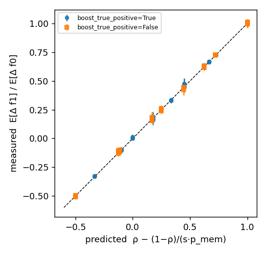
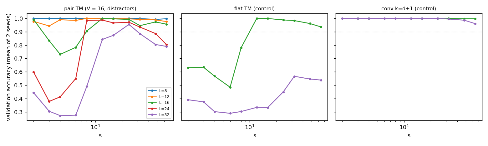

# Positional encoding and attention for Tsetlin machines: report

Generated by `python -m experiments.transformer_concepts.code.report` from `results/**/*.json` (rule C2: no hand-typed numbers in the tables). Plan: `torchtsetlin_plans/experiments/transformer_concepts/PROOF_PLAN.md`; theory: `THEORY.md`.

## Summary

- **Formal claims:** 13/13 exact checks pass, with the library as the object under test (hand-built clauses loaded into real models, CPU and CUDA) or by exhaustive computation. New exact results: Proposition A3b, Proposition D1, tightness of B6.2, and Conjecture B7.3 (6/6 instances).
- **Learning dynamics:** the Type Ia drift formula fits 96/96 measurement cells after one correction (the first run, 19/48, used the textbook memorisation probability; the library boosts true positives by default). The dilution prediction (C2) holds in direction, not in size.
- **Attention, where a relation between two tokens decides the label:** co-occurrence T5 at L = 32: pair TM 100.0 % vs best baseline 62.7 %; order T1 at L = 32: 99.98 % vs 96.40 %. Both gains vanish without the cross-token pairs (A2-self).
- **Ties, as predicted:** needle T4 at L = 32: pair TM 99.44 %, flat TM 99.95 %, conv kernel d+1 100.00 %. Controls T6/T7: no cost.
- **Not solved:** recall T2 at L = 17 (chance 25 %): pair TM 32.1 %, best arm A2-abs (absolute codes) 65.3 %; repeat detection T3 at L = 16 (chance 50 %): best arm 50.9 %. Exact pair-clause solutions for both run in the library (X8). Exploratory runs (validation only) show T2 is learned with more clauses: pair TM 94.9 %, flat TM 40.5 %; T3 stays at chance.
- **Positional codes:** binary beats thermometer on T1 at L = 32 (97.0 % vs 92.9 %), the opposite of the clause-cost ranking.

## Part I — exact verification of the formal claims

Each check loads hand-built clauses into real torchtsetlin 0.7.0 models (CPU and CUDA, where CUDA prediction runs the Triton `conv_eval` kernel) or computes the claim exactly on every instance small enough to enumerate. Records: `results/exact/X*.json`.

| check | claims | result | evidence |
|---|---|---|---|
| X1 | A1, A2, A3 | pass | thermometer <=2 literals; one-hot n-|S|; binary/Gray table |
| X1b | A3b | pass | binary [1, n-2] needs exactly log2 n clauses |
| X2 | A5 | pass | any function of the symbol set: exactly 0.5; bigram set: above 0.5 |
| X3 | A6 | pass | library conv TM with its own thermometer PE + 2(L-1) clauses/class solves T1 |
| X4 | A7 | pass | no conjunction over [c(i), c(j)] covers two fooling points, any code, n<=32 |
| X5 | B1 | pass | library pair TM = exists(i,j) Q and K and R and A, symbolic reference |
| X6 | B3-scope | pass | TM vote (2) != popcount attention score (1) on 'a b c d' |
| X7 | B4.1 | pass | self-only pair TM == conv TM (kernel w) on END-padded sequence, both directions |
| X8 | B5, B6.1, B7.1, B8 | pass | hand pair clauses in the library pair TM: accuracy 1.0 everywhere |
| X9 | B6.3 | pass | library conv TM (k<=d) gives identical clause outputs on the two differently labelled needles |
| X10 | B6.2, B7.2, D.1 | pass | exact minimum positive DNFs >= the proved lower bounds |
| X11 | B9 | pass | v>0 iff C+ and not C-, whenever w- >= w+ |
| X12 | D.1 | pass | flat TM: ceil((L-1)/2) clauses decide T1 exactly (tight with the lower bound) |

**Exact minimum positive DNFs (X10).** Positive-clause flat TM, exact over the whole one-hot domain; compared with the proved lower bound and with the pair TM.

| instance | exact minimum | proved lower bound | other reference |
|---|---|---|---|
| needle L4_d1 | 3 | L − d = 3 | pair TM: 1 |
| needle L5_d1 | 4 | L − d = 4 | pair TM: 1 |
| needle L5_d2 | 3 | L − d = 3 | pair TM: 1 |
| needle L6_d2 | 4 | L − d = 4 | pair TM: 1 |
| needle L7_d3 | 4 | L − d = 4 | pair TM: 1 |
| recall n2_keys3 | 6 | n = 2 | n·min(keys, 2ⁿ) = 6; pair TM: 3 |
| recall n2_keys4 | 8 | n = 2 | n·min(keys, 2ⁿ) = 8; pair TM: 4 |
| recall n2_keys5 | 8 | n = 2 | n·min(keys, 2ⁿ) = 8; pair TM: 5 |
| recall n2_keys6 | 8 | n = 2 | n·min(keys, 2ⁿ) = 8; pair TM: 6 |
| recall n3_keys3 | 9 | n = 3 | n·min(keys, 2ⁿ) = 9; pair TM: 3 |
| recall n3_keys4 | 12 | n = 3 | n·min(keys, 2ⁿ) = 12; pair TM: 4 |
| T1 L4 | 2 | ⌈(L−1)/2⌉ = 2 | negation construction: 3; pair TM: 1 |
| T1 L5 | 2 | ⌈(L−1)/2⌉ = 2 | negation construction: 4; pair TM: 1 |
| T1 L6 | 3 | ⌈(L−1)/2⌉ = 3 | negation construction: 5; pair TM: 1 |
| T1 L7 | 3 | ⌈(L−1)/2⌉ = 3 | negation construction: 6; pair TM: 1 |

**Interval costs (X1).** Intervals that are a single clause, and the worst-case number of clauses over all intervals.

| n | thermometer | one-hot | binary | Gray |
|---|---|---|---|---|
| 4 | 10/10, max 1 | 10/10, max 1 | 7/10, max 2 | 8/10, max 2 |
| 6 | 21/21, max 1 | 21/21, max 1 | 11/21, max 3 | 14/21, max 2 |
| 8 | 36/36, max 1 | 36/36, max 1 | 15/36, max 3 | 19/36, max 3 |
| 10 | 55/55, max 1 | 55/55, max 1 | 19/55, max 4 | 26/55, max 3 |
| 12 | 78/78, max 1 | 78/78, max 1 | 23/78, max 4 | 31/78, max 3 |

## Part II — learning dynamics

### D1 — the drawn pair is uniform; the Type Ia drift has the predicted form

One clause including only an always-true feature f0, on examples with m matching columns of which r carry f1 (ρ = r/m). The clause row is reset after every library update, and the state drift of f1 is compared with that of f0. Prediction: E[Δf1]/E[Δf0] = ρ − (1−ρ)/(s·p_mem), where p_mem = 1 with `boost_true_positive=True` (the library default) and (s−1)/s without.

- **First run (prediction p_mem = (s−1)/s for the default model): 19/48 cells within 3 SE — failed.** The miss was systematic (at ρ = 0 the ratio was −1/s, not −1/(s−1)): the library memorises true literals with probability 1 by default. The theory (THEORY C2) assumed the textbook (s−1)/s and was corrected.

- **Corrected prediction: 96/96 cells within 3 SE.**

| boost_true_positive | device | mode | cells within 3 SE |
|---|---|---|---|
| False | cpu | batch | 20/20 |
| False | cpu | sequential | 4/4 |
| False | cuda | batch | 20/20 |
| False | cuda | sequential | 4/4 |
| True | cpu | batch | 20/20 |
| True | cpu | sequential | 4/4 |
| True | cuda | batch | 20/20 |
| True | cuda | sequential | 4/4 |

Consequence: with the default model a literal's mean drift is towards inclusion iff its rate on the drawn pair exceeds 1/(s+1) (1/s without boosting).

### D2 — the specificity a pair clause needs grows with the number of pairs

Needle task, d = L/4, validation accuracy after ≤ 15 epochs on 8,000 examples, mean of 2 seeds. Prediction (written before the runs, `code/exp_threshold.py`): an under-specified pair clause needs s > s_pred = 1/ρ − 1, ρ = 1/L + (1 − 1/L)·π, π the distractor rate. Last column: the grid values of s at which the mean accuracy is ≥ 0.9.

| task | V | arm | L | s_pred | s=2 | s=3 | s=4 | s=6 | s=8 | s=12 | s=16 | s=24 | s=32 | s=48 | s=64 | s with acc ≥ 0.9 |
|---|---|---|---|---|---|---|---|---|---|---|---|---|---|---|---|---|
| T4 | 6 | **A2 pair w=2** | 16 | 3.0 | 0.69 | 0.86 | 0.60 | 0.89 | 0.99 | 0.99 | 1.00 | 0.99 | 1.00 | 0.99 | 0.95 | 8, 12, 16, 24, 32, 48, 64 |
| T4 | 6 | **A2 pair w=2** | 32 | 3.4 | 0.29 | 0.40 | 0.26 | 0.26 | 0.63 | 0.91 | 0.97 | 0.97 | 0.95 | 0.64 | 0.62 | 12, 16, 24, 32 |
| T4 | 16 | **A2 pair w=2** | 8 | 4.5 | 1.00 | 1.00 | 1.00 | 1.00 | 1.00 | 1.00 | 1.00 | 1.00 | 1.00 | 0.99 | 1.00 | 2, 3, 4, 6, 8, 12, 16, 24, 32, 48, 64 |
| T4 | 16 | **A2 pair w=2** | 12 | 5.9 | 0.98 | 0.94 | 0.99 | 0.98 | 1.00 | 1.00 | 1.00 | 1.00 | 0.99 | 0.99 | 0.98 | 2, 3, 4, 6, 8, 12, 16, 24, 32, 48, 64 |
| T4 | 16 | **A2 pair w=2** | 16 | 7.0 | 0.99 | 0.83 | 0.73 | 0.78 | 0.91 | 1.00 | 1.00 | 0.99 | 0.95 | 0.97 | 0.96 | 2, 8, 12, 16, 24, 32, 48, 64 |
| T4 | 16 | **A2 pair w=2** | 24 | 8.5 | 0.60 | 0.38 | 0.41 | 0.55 | 0.98 | 0.99 | 0.97 | 0.97 | 0.93 | 0.89 | 0.80 | 8, 12, 16, 24, 32 |
| T4 | 16 | **A2 pair w=2** | 32 | 9.4 | 0.44 | 0.31 | 0.27 | 0.28 | 0.49 | 0.84 | 0.87 | 0.96 | 0.89 | 0.80 | 0.79 | 24 |
| T4 | 16 | B0 flat TM | 16 | – | 0.63 | 0.63 | 0.57 | 0.49 | 0.78 | 1.00 | 1.00 | 0.99 | 0.98 | 0.96 | 0.94 | 12, 16, 24, 32, 48, 64 |
| T4 | 16 | B0 flat TM | 32 | – | 0.39 | 0.38 | 0.30 | 0.29 | 0.30 | 0.33 | 0.33 | 0.45 | 0.57 | 0.55 | 0.54 | none |
| T4 | 16 | B3 conv k=d+1 | 16 | – | 1.00 | 1.00 | 1.00 | 1.00 | 1.00 | 1.00 | 1.00 | 1.00 | 1.00 | 1.00 | 1.00 | 2, 3, 4, 6, 8, 12, 16, 24, 32, 48, 64 |
| T4 | 16 | B3 conv k=d+1 | 32 | – | 1.00 | 1.00 | 1.00 | 1.00 | 1.00 | 1.00 | 1.00 | 1.00 | 1.00 | 0.99 | 0.96 | 2, 3, 4, 6, 8, 12, 16, 24, 32, 48, 64 |
| T4 | 48 | **A2 pair w=2** | 16 | 11.1 | 0.98 | 0.99 | 0.96 | 0.97 | 0.98 | 1.00 | 0.99 | 0.96 | 0.96 | 0.94 | 0.85 | 2, 3, 4, 6, 8, 12, 16, 24, 32, 48 |
| T4 | 48 | **A2 pair w=2** | 32 | 18.3 | 0.61 | 0.54 | 0.56 | 0.69 | 0.71 | 0.81 | 0.88 | 0.76 | 0.74 | 0.67 | 0.61 | none |
| T4n | 16 | **A2 pair w=2** | 8 | 7.0 | 1.00 | 1.00 | 1.00 | 1.00 | 1.00 | 1.00 | 1.00 | 1.00 | 1.00 | 1.00 | 1.00 | 2, 3, 4, 6, 8, 12, 16, 24, 32, 48, 64 |
| T4n | 16 | **A2 pair w=2** | 12 | 11.0 | 1.00 | 1.00 | 1.00 | 1.00 | 1.00 | 1.00 | 1.00 | 1.00 | 1.00 | 1.00 | 1.00 | 2, 3, 4, 6, 8, 12, 16, 24, 32, 48, 64 |
| T4n | 16 | **A2 pair w=2** | 16 | 15.0 | 1.00 | 1.00 | 1.00 | 1.00 | 1.00 | 1.00 | 1.00 | 1.00 | 1.00 | 1.00 | 1.00 | 2, 3, 4, 6, 8, 12, 16, 24, 32, 48, 64 |
| T4n | 16 | **A2 pair w=2** | 24 | 23.0 | 1.00 | 1.00 | 1.00 | 1.00 | 1.00 | 1.00 | 1.00 | 1.00 | 1.00 | 1.00 | 1.00 | 2, 3, 4, 6, 8, 12, 16, 24, 32, 48, 64 |
| T4n | 16 | **A2 pair w=2** | 32 | 31.0 | 1.00 | 1.00 | 1.00 | 1.00 | 1.00 | 1.00 | 1.00 | 1.00 | 1.00 | 1.00 | 1.00 | 2, 3, 4, 6, 8, 12, 16, 24, 32, 48, 64 |
| T4n | 16 | B3 conv k=d+1 | 8 | – | 1.00 | 1.00 | 1.00 | 1.00 | 1.00 | 1.00 | 1.00 | 1.00 | 1.00 | 1.00 | 1.00 | 2, 3, 4, 6, 8, 12, 16, 24, 32, 48, 64 |
| T4n | 16 | B3 conv k=d+1 | 12 | – | 1.00 | 1.00 | 1.00 | 1.00 | 1.00 | 1.00 | 1.00 | 1.00 | 1.00 | 1.00 | 1.00 | 2, 3, 4, 6, 8, 12, 16, 24, 32, 48, 64 |
| T4n | 16 | B3 conv k=d+1 | 16 | – | 1.00 | 1.00 | 1.00 | 1.00 | 1.00 | 1.00 | 1.00 | 1.00 | 1.00 | 1.00 | 0.99 | 2, 3, 4, 6, 8, 12, 16, 24, 32, 48, 64 |
| T4n | 16 | B3 conv k=d+1 | 24 | – | 1.00 | 1.00 | 1.00 | 1.00 | 1.00 | 1.00 | 1.00 | 1.00 | 1.00 | 0.99 | 0.99 | 2, 3, 4, 6, 8, 12, 16, 24, 32, 48, 64 |
| T4n | 16 | B3 conv k=d+1 | 32 | – | 1.00 | 1.00 | 1.00 | 1.00 | 1.00 | 1.00 | 1.00 | 1.00 | 0.99 | 0.99 | 0.99 | 2, 3, 4, 6, 8, 12, 16, 24, 32, 48, 64 |

T4n = no distractors (degenerate, see DECISIONS D13): one literal [k0 = b] solves it.

## Part III — the empirical hypotheses (torchtsetlin_plans/experiments/transformer_concepts/PLAN.md H1–H5)

Search: s ∈ [5.0, 15.0, 40.0] at L = 32 (T2: 33), seed 7, validation only; frozen 2026-11-08T23:41:42 (`results/frozen_experiment.json`). Finals: seeds [23, 29, 31, 37, 41], 20,000 train / 5,000 validation / 10,000 test, M = 100 clauses per class, T = 25, weighted, batch 32, ≤ 40 epochs with patience 8. Accuracy is on the test set, mean ± SD over seeds (n = seeds available).

### T1 ordered pair

| arm | s | L = 16 | L = 32 |
|---|---|---|---|
| B0 flat TM | 40 | 99.97 ± 0.03 (n=5) | 95.47 ± 0.92 (n=5) |
| B1 conv k=1 | 15 | 49.74 ± 0.00 (n=5) | 51.02 ± 0.49 (n=5) |
| B2 conv k=3 + PE | 40 | 99.99 ± 0.01 (n=5) | 96.40 ± 0.66 (n=5) |
| B4 graph chain (depth 2) | 40 | 66.69 ± 7.78 (n=5) | 51.72 ± 1.80 (n=5) |
| A1 pair w=1 | 15 | 100.00 ± 0.00 (n=5) | 99.98 ± 0.02 (n=5) |
| **A2 pair w=2** | 15 | 100.00 ± 0.00 (n=5) | 99.98 ± 0.03 (n=5) |
| A3 pair, bucketed | 5 | 99.99 ± 0.01 (n=5) | 100.00 ± 0.00 (n=5) |
| A4 graph complete (depth 2) | 5 | 67.71 ± 9.74 (n=5) | 54.35 ± 2.54 (n=5) |
| A2-self (i=j only) | 40 | 63.07 ± 1.18 (n=5) | 56.25 ± 2.11 (n=5) |
| A2-norel | 40 | 64.59 ± 1.88 (n=5) | 56.33 ± 0.97 (n=5) |
| A2-abs (absolute codes) | 40 | 99.94 ± 0.07 (n=5) | 97.63 ± 0.72 (n=5) |
| A2-shuf (shuffled rel.) | 40 | 62.88 ± 1.38 (n=5) | 52.07 ± 2.02 (n=5) |
| P one-hot PE | 40 | 98.88 ± 0.31 (n=5) | 84.90 ± 3.56 (n=5) |
| P thermometer PE | 40 | 98.99 ± 0.48 (n=5) | 92.91 ± 1.18 (n=5) |
| P binary PE | 5 | 99.14 ± 0.51 (n=5) | 97.03 ± 1.04 (n=5) |
| P Gray PE | 5 | 95.87 ± 1.41 (n=5) | 93.00 ± 1.07 (n=5) |

### T2 associative recall

| arm | s | L = 17 | L = 33 |
|---|---|---|---|
| B0 flat TM | 40 | 37.94 ± 1.49 (n=5) | 28.80 ± 1.18 (n=5) |
| B1 conv k=1 | 5 | 25.66 ± 0.29 (n=5) | 24.68 ± 0.48 (n=5) |
| B2 conv k=3 + PE | 15 | 32.81 ± 1.75 (n=5) | 27.08 ± 0.78 (n=5) |
| B4 graph chain (depth 2) | 15 | 27.65 ± 1.27 (n=5) | 25.86 ± 0.56 (n=5) |
| A1 pair w=1 | 15 | 31.27 ± 1.04 (n=5) | 26.22 ± 0.92 (n=5) |
| **A2 pair w=2** | 15 | 32.07 ± 1.35 (n=5) | 26.40 ± 0.85 (n=5) |
| A3 pair, bucketed | 40 | 57.18 ± 5.60 (n=5) | 40.08 ± 4.41 (n=5) |
| A4 graph complete (depth 2) | 5 | 28.76 ± 0.59 (n=5) | 27.85 ± 0.17 (n=5) |
| A2-self (i=j only) | 40 | 30.31 ± 0.93 (n=5) | 26.90 ± 0.81 (n=5) |
| A2-norel | 40 | 51.86 ± 7.16 (n=5) | 30.41 ± 4.55 (n=5) |
| A2-abs (absolute codes) | 40 | 65.26 ± 10.19 (n=5) | 32.74 ± 5.04 (n=5) |
| A2-shuf (shuffled rel.) | 5 | 28.98 ± 0.98 (n=5) | 25.94 ± 1.01 (n=5) |

### T3 repeat detection

| arm | s | L = 16 | L = 32 |
|---|---|---|---|
| B0 flat TM | 40 | 49.86 ± 0.92 (n=5) | 50.14 ± 0.34 (n=5) |
| B1 conv k=1 | 40 | 49.83 ± 0.24 (n=5) | 51.00 ± 0.32 (n=5) |
| B2 conv k=3 + PE | 15 | 49.88 ± 0.72 (n=5) | 50.51 ± 0.42 (n=5) |
| B4 graph chain (depth 2) | 5 | 50.51 ± 0.71 (n=5) | 50.45 ± 0.36 (n=5) |
| A1 pair w=1 | 40 | 50.55 ± 0.88 (n=5) | 50.45 ± 0.51 (n=5) |
| **A2 pair w=2** | 40 | 50.37 ± 0.39 (n=5) | 50.47 ± 0.55 (n=5) |
| A3 pair, bucketed | 40 | 50.29 ± 1.00 (n=5) | 50.74 ± 0.43 (n=5) |
| A4 graph complete (depth 2) | 15 | 49.98 ± 0.39 (n=5) | 50.08 ± 0.51 (n=5) |
| A2-self (i=j only) | 5 | 50.50 ± 0.33 (n=5) | 50.59 ± 0.74 (n=5) |
| A2-norel | 15 | 50.88 ± 0.55 (n=5) | 50.44 ± 0.75 (n=5) |
| A2-abs (absolute codes) | 40 | 50.79 ± 0.67 (n=5) | 50.23 ± 0.83 (n=5) |
| A2-shuf (shuffled rel.) | 5 | 50.09 ± 0.84 (n=5) | 50.93 ± 0.54 (n=5) |

### T4 needle (d = L/4)

| arm | s | L = 16 | L = 32 |
|---|---|---|---|
| B0 flat TM | 40 | 99.96 ± 0.07 (n=5) | 99.95 ± 0.02 (n=5) |
| B1 conv k=1 | 15 | 36.65 ± 1.05 (n=5) | 27.49 ± 1.52 (n=5) |
| B2 conv k=3 + PE | 15 | 47.67 ± 1.78 (n=5) | 31.04 ± 1.38 (n=5) |
| B4 graph chain (depth 2) | 5 | 41.88 ± 2.43 (n=5) | 30.57 ± 0.94 (n=5) |
| A1 pair w=1 | 15 | 99.99 ± 0.02 (n=5) | 99.87 ± 0.21 (n=5) |
| **A2 pair w=2** | 40 | 99.94 ± 0.06 (n=5) | 99.44 ± 0.74 (n=5) |
| A3 pair, bucketed | 15 | 99.99 ± 0.01 (n=5) | 52.99 ± 5.22 (n=5) |
| A4 graph complete (depth 2) | 5 | 33.34 ± 2.33 (n=5) | 27.93 ± 0.90 (n=5) |
| A2-self (i=j only) | 5 | 35.37 ± 2.23 (n=5) | 26.79 ± 1.58 (n=5) |
| A2-norel | 15 | 42.25 ± 0.85 (n=5) | 28.83 ± 0.77 (n=5) |
| A2-abs (absolute codes) | 40 | 58.34 ± 4.39 (n=5) | 31.52 ± 1.33 (n=5) |
| A2-shuf (shuffled rel.) | 40 | 41.59 ± 1.45 (n=5) | 28.91 ± 0.78 (n=5) |
| B3 conv k=d+1 | 5 | 99.99 ± 0.03 (n=5) | 100.00 ± 0.00 (n=5) |
| P one-hot PE | 40 | 40.80 ± 2.13 (n=5) | 27.26 ± 0.62 (n=5) |
| P thermometer PE | 15 | 45.74 ± 1.51 (n=5) | 29.16 ± 1.24 (n=5) |
| P binary PE | 5 | 51.92 ± 1.12 (n=5) | 35.14 ± 2.32 (n=5) |
| P Gray PE | 5 | 51.86 ± 0.89 (n=5) | 33.99 ± 1.72 (n=5) |

### T5 co-occurrence (0 and 1 both present)

| arm | s | L = 16 | L = 32 |
|---|---|---|---|
| B0 flat TM | 15 | 49.70 ± 0.33 (n=5) | 50.17 ± 0.53 (n=5) |
| B1 conv k=1 | 40 | 67.37 ± 9.19 (n=5) | 62.65 ± 7.44 (n=5) |
| B2 conv k=3 + PE | 5 | 52.99 ± 5.14 (n=5) | 53.14 ± 5.01 (n=5) |
| B4 graph chain (depth 2) | 5 | 53.00 ± 2.46 (n=5) | 52.20 ± 2.20 (n=5) |
| A1 pair w=1 | 5 | 100.00 ± 0.00 (n=5) | 100.00 ± 0.00 (n=5) |
| **A2 pair w=2** | 5 | 100.00 ± 0.00 (n=5) | 100.00 ± 0.00 (n=5) |
| A3 pair, bucketed | 5 | 100.00 ± 0.00 (n=5) | 100.00 ± 0.01 (n=5) |
| A4 graph complete (depth 2) | 40 | 49.66 ± 0.50 (n=5) | 50.19 ± 0.12 (n=5) |
| A2-self (i=j only) | 5 | 58.23 ± 5.79 (n=5) | 52.64 ± 2.80 (n=5) |
| A2-norel | 5 | 100.00 ± 0.01 (n=5) | 100.00 ± 0.00 (n=5) |
| A2-abs (absolute codes) | 5 | 100.00 ± 0.00 (n=5) | 100.00 ± 0.00 (n=5) |
| A2-shuf (shuffled rel.) | 5 | 100.00 ± 0.00 (n=5) | 100.00 ± 0.00 (n=5) |

### T6 absolute position (control)

| arm | s | L = 16 | L = 32 |
|---|---|---|---|
| B0 flat TM | 5 | 100.00 ± 0.00 (n=5) | 100.00 ± 0.00 (n=5) |
| B1 conv k=1 | 40 | 38.55 ± 1.04 (n=5) | 27.64 ± 1.23 (n=5) |
| B2 conv k=3 + PE | 5 | 99.99 ± 0.03 (n=5) | 100.00 ± 0.00 (n=5) |
| B4 graph chain (depth 2) | 5 | 40.48 ± 1.46 (n=5) | 32.31 ± 1.09 (n=5) |
| A1 pair w=1 | 5 | 100.00 ± 0.00 (n=5) | 99.99 ± 0.01 (n=5) |
| **A2 pair w=2** | 5 | 100.00 ± 0.00 (n=5) | 99.99 ± 0.01 (n=5) |
| A3 pair, bucketed | 40 | 57.76 ± 2.90 (n=5) | 40.75 ± 3.39 (n=5) |
| A4 graph complete (depth 2) | 5 | 31.51 ± 2.11 (n=5) | 24.89 ± 1.01 (n=5) |
| A2-self (i=j only) | 40 | 40.29 ± 1.78 (n=5) | 28.32 ± 1.09 (n=5) |
| A2-norel | 15 | 41.71 ± 0.93 (n=5) | 29.31 ± 2.10 (n=5) |
| A2-abs (absolute codes) | 5 | 100.00 ± 0.00 (n=5) | 99.99 ± 0.02 (n=5) |
| A2-shuf (shuffled rel.) | 15 | 40.52 ± 1.04 (n=5) | 29.24 ± 0.38 (n=5) |
| P one-hot PE | 5 | 100.00 ± 0.00 (n=5) | 100.00 ± 0.00 (n=5) |
| P thermometer PE | 5 | 100.00 ± 0.00 (n=5) | 100.00 ± 0.00 (n=5) |
| P binary PE | 5 | 100.00 ± 0.00 (n=5) | 100.00 ± 0.00 (n=5) |
| P Gray PE | 5 | 100.00 ± 0.00 (n=5) | 100.00 ± 0.00 (n=5) |

### T7 presence of symbol 0 (control)

| arm | s | L = 16 | L = 32 |
|---|---|---|---|
| B0 flat TM | 40 | 99.99 ± 0.01 (n=5) | 65.09 ± 2.70 (n=5) |
| B1 conv k=1 | 5 | 100.00 ± 0.00 (n=5) | 100.00 ± 0.00 (n=5) |
| B2 conv k=3 + PE | 5 | 100.00 ± 0.00 (n=5) | 100.00 ± 0.00 (n=5) |
| B4 graph chain (depth 2) | 5 | 100.00 ± 0.00 (n=5) | 81.97 ± 24.86 (n=5) |
| A1 pair w=1 | 5 | 100.00 ± 0.00 (n=5) | 100.00 ± 0.00 (n=5) |
| **A2 pair w=2** | 5 | 100.00 ± 0.00 (n=5) | 100.00 ± 0.00 (n=5) |
| A3 pair, bucketed | 5 | 100.00 ± 0.00 (n=5) | 100.00 ± 0.00 (n=5) |
| A4 graph complete (depth 2) | 5 | 99.99 ± 0.02 (n=5) | 100.00 ± 0.00 (n=5) |
| A2-self (i=j only) | 5 | 100.00 ± 0.00 (n=5) | 100.00 ± 0.00 (n=5) |
| A2-norel | 5 | 100.00 ± 0.00 (n=5) | 100.00 ± 0.00 (n=5) |
| A2-abs (absolute codes) | 5 | 100.00 ± 0.00 (n=5) | 100.00 ± 0.00 (n=5) |
| A2-shuf (shuffled rel.) | 5 | 100.00 ± 0.00 (n=5) | 100.00 ± 0.00 (n=5) |

### Decision rules (torchtsetlin_plans/experiments/transformer_concepts/PLAN.md §5)

Supported = all paired seed differences positive, mean gap ≥ 0.5 pp and above twice the larger seed SD, McNemar p < 0.05 on ≥ 80 % of seeds. Gap = first arm − second arm, test accuracy, pp.

| task | L | comparison | mean gap (pp) | 95 % CI | McNemar p<0.05 | verdict |
|---|---|---|---|---|---|---|
| T1 | 16 | **A2 pair w=2** vs B0 flat TM | +0.03 | [+0.02, +0.05] | 1/5 | inconclusive |
| T1 | 16 | **A2 pair w=2** vs B1 conv k=1 | +50.26 | [+49.32, +51.28] | 5/5 | supported |
| T1 | 16 | **A2 pair w=2** vs B2 conv k=3 + PE | +0.00 | [-0.00, +0.01] | 0/5 | inconclusive |
| T1 | 16 | **A2 pair w=2** vs B4 graph chain (depth 2) | +33.31 | [+32.72, +33.87] | 5/5 | supported |
| T1 | 16 | **A2 pair w=2** vs A2-self (i=j only) | +36.93 | [+36.10, +37.83] | 5/5 | supported |
| T1 | 16 | **A2 pair w=2** vs A2-norel | +35.40 | [+34.77, +36.06] | 5/5 | supported |
| T1 | 16 | **A2 pair w=2** vs A2-abs (absolute codes) | +0.06 | [+0.04, +0.08] | 2/5 | inconclusive |
| T1 | 16 | **A2 pair w=2** vs A2-shuf (shuffled rel.) | +37.12 | [+36.46, +37.81] | 5/5 | supported |
| T1 | 16 | P thermometer PE vs P one-hot PE | +0.11 | [-0.00, +0.22] | 3/5 | inconclusive |
| T1 | 16 | P thermometer PE vs P binary PE | -0.16 | [-0.26, -0.05] | 5/5 | inconclusive |
| T1 | 16 | P thermometer PE vs P Gray PE | +3.12 | [+2.86, +3.36] | 5/5 | supported |
| T1 | 32 | **A2 pair w=2** vs B0 flat TM | +4.51 | [+4.28, +4.75] | 5/5 | supported |
| T1 | 32 | **A2 pair w=2** vs B1 conv k=1 | +48.96 | [+48.01, +49.89] | 5/5 | supported |
| T1 | 32 | **A2 pair w=2** vs B2 conv k=3 + PE | +3.58 | [+3.36, +3.81] | 5/5 | supported |
| T1 | 32 | **A2 pair w=2** vs B4 graph chain (depth 2) | +48.27 | [+47.70, +48.81] | 5/5 | supported |
| T1 | 32 | **A2 pair w=2** vs A2-self (i=j only) | +43.74 | [+43.18, +44.31] | 5/5 | supported |
| T1 | 32 | **A2 pair w=2** vs A2-norel | +43.66 | [+43.21, +44.14] | 5/5 | supported |
| T1 | 32 | **A2 pair w=2** vs A2-abs (absolute codes) | +2.35 | [+2.18, +2.52] | 5/5 | supported |
| T1 | 32 | **A2 pair w=2** vs A2-shuf (shuffled rel.) | +47.92 | [+47.46, +48.37] | 5/5 | supported |
| T1 | 32 | P thermometer PE vs P one-hot PE | +8.01 | [+7.68, +8.35] | 5/5 | supported |
| T1 | 32 | P thermometer PE vs P binary PE | -4.12 | [-4.44, -3.82] | 5/5 | reverse supported |
| T1 | 32 | P thermometer PE vs P Gray PE | -0.08 | [-0.40, +0.25] | 4/5 | inconclusive |
| T2 | 17 | **A2 pair w=2** vs B0 flat TM | -5.87 | [-6.51, -5.23] | 5/5 | reverse supported |
| T2 | 17 | **A2 pair w=2** vs B1 conv k=1 | +6.41 | [+5.75, +7.12] | 5/5 | supported |
| T2 | 17 | **A2 pair w=2** vs B2 conv k=3 + PE | -0.74 | [-1.32, -0.17] | 1/5 | inconclusive |
| T2 | 17 | **A2 pair w=2** vs B4 graph chain (depth 2) | +4.42 | [+3.90, +4.93] | 5/5 | supported |
| T2 | 17 | **A2 pair w=2** vs A2-self (i=j only) | +1.76 | [+1.16, +2.37] | 3/5 | inconclusive |
| T2 | 17 | **A2 pair w=2** vs A2-norel | -19.79 | [-20.34, -19.18] | 5/5 | reverse supported |
| T2 | 17 | **A2 pair w=2** vs A2-abs (absolute codes) | -33.19 | [-33.79, -32.61] | 5/5 | reverse supported |
| T2 | 17 | **A2 pair w=2** vs A2-shuf (shuffled rel.) | +3.09 | [+2.56, +3.62] | 5/5 | supported |
| T2 | 33 | **A2 pair w=2** vs B0 flat TM | -2.40 | [-2.94, -1.81] | 3/5 | inconclusive |
| T2 | 33 | **A2 pair w=2** vs B1 conv k=1 | +1.71 | [+1.18, +2.27] | 5/5 | supported |
| T2 | 33 | **A2 pair w=2** vs B2 conv k=3 + PE | -0.68 | [-1.15, -0.26] | 2/5 | inconclusive |
| T2 | 33 | **A2 pair w=2** vs B4 graph chain (depth 2) | +0.53 | [-0.06, +1.14] | 1/5 | inconclusive |
| T2 | 33 | **A2 pair w=2** vs A2-self (i=j only) | -0.50 | [-1.00, +0.02] | 2/5 | inconclusive |
| T2 | 33 | **A2 pair w=2** vs A2-norel | -4.02 | [-4.53, -3.50] | 3/5 | inconclusive |
| T2 | 33 | **A2 pair w=2** vs A2-abs (absolute codes) | -6.35 | [-6.86, -5.81] | 3/5 | inconclusive |
| T2 | 33 | **A2 pair w=2** vs A2-shuf (shuffled rel.) | +0.45 | [+0.05, +0.88] | 1/5 | inconclusive |
| T3 | 16 | **A2 pair w=2** vs B0 flat TM | +0.51 | [-0.05, +1.12] | 0/5 | inconclusive |
| T3 | 16 | **A2 pair w=2** vs B1 conv k=1 | +0.54 | [-0.05, +1.12] | 0/5 | inconclusive |
| T3 | 16 | **A2 pair w=2** vs B2 conv k=3 + PE | +0.49 | [-0.07, +1.07] | 0/5 | inconclusive |
| T3 | 16 | **A2 pair w=2** vs B4 graph chain (depth 2) | -0.14 | [-0.71, +0.42] | 0/5 | inconclusive |
| T3 | 16 | **A2 pair w=2** vs A2-self (i=j only) | -0.13 | [-0.71, +0.43] | 0/5 | inconclusive |
| T3 | 16 | **A2 pair w=2** vs A2-norel | -0.51 | [-1.17, +0.12] | 0/5 | inconclusive |
| T3 | 16 | **A2 pair w=2** vs A2-abs (absolute codes) | -0.42 | [-0.99, +0.18] | 0/5 | inconclusive |
| T3 | 16 | **A2 pair w=2** vs A2-shuf (shuffled rel.) | +0.28 | [-0.44, +0.98] | 1/5 | inconclusive |
| T3 | 32 | **A2 pair w=2** vs B0 flat TM | +0.33 | [-0.16, +0.83] | 0/5 | inconclusive |
| T3 | 32 | **A2 pair w=2** vs B1 conv k=1 | -0.53 | [-1.02, -0.04] | 1/5 | inconclusive |
| T3 | 32 | **A2 pair w=2** vs B2 conv k=3 + PE | -0.04 | [-0.57, +0.51] | 0/5 | inconclusive |
| T3 | 32 | **A2 pair w=2** vs B4 graph chain (depth 2) | +0.02 | [-0.44, +0.49] | 0/5 | inconclusive |
| T3 | 32 | **A2 pair w=2** vs A2-self (i=j only) | -0.12 | [-0.62, +0.38] | 2/5 | inconclusive |
| T3 | 32 | **A2 pair w=2** vs A2-norel | +0.03 | [-0.49, +0.58] | 1/5 | inconclusive |
| T3 | 32 | **A2 pair w=2** vs A2-abs (absolute codes) | +0.24 | [-0.38, +0.87] | 0/5 | inconclusive |
| T3 | 32 | **A2 pair w=2** vs A2-shuf (shuffled rel.) | -0.46 | [-0.90, -0.00] | 0/5 | inconclusive |
| T4 | 16 | **A2 pair w=2** vs B0 flat TM | -0.02 | [-0.05, +0.01] | 2/5 | inconclusive |
| T4 | 16 | **A2 pair w=2** vs B1 conv k=1 | +63.29 | [+62.81, +63.77] | 5/5 | supported |
| T4 | 16 | **A2 pair w=2** vs B2 conv k=3 + PE | +52.27 | [+51.72, +52.84] | 5/5 | supported |
| T4 | 16 | **A2 pair w=2** vs B4 graph chain (depth 2) | +58.06 | [+57.48, +58.65] | 5/5 | supported |
| T4 | 16 | **A2 pair w=2** vs A2-self (i=j only) | +64.57 | [+64.08, +65.04] | 5/5 | supported |
| T4 | 16 | **A2 pair w=2** vs A2-norel | +57.68 | [+57.17, +58.20] | 5/5 | supported |
| T4 | 16 | **A2 pair w=2** vs A2-abs (absolute codes) | +41.60 | [+41.05, +42.13] | 5/5 | supported |
| T4 | 16 | **A2 pair w=2** vs A2-shuf (shuffled rel.) | +58.35 | [+57.84, +58.84] | 5/5 | supported |
| T4 | 16 | **A2 pair w=2** vs B3 conv k=d+1 | -0.05 | [-0.07, -0.03] | 2/5 | inconclusive |
| T4 | 16 | P thermometer PE vs P one-hot PE | +4.94 | [+4.30, +5.59] | 5/5 | supported |
| T4 | 16 | P thermometer PE vs P binary PE | -6.18 | [-6.80, -5.54] | 5/5 | reverse supported |
| T4 | 16 | P thermometer PE vs P Gray PE | -6.12 | [-6.74, -5.48] | 5/5 | reverse supported |
| T4 | 32 | **A2 pair w=2** vs B0 flat TM | -0.51 | [-0.58, -0.45] | 3/5 | inconclusive |
| T4 | 32 | **A2 pair w=2** vs B1 conv k=1 | +71.95 | [+71.44, +72.47] | 5/5 | supported |
| T4 | 32 | **A2 pair w=2** vs B2 conv k=3 + PE | +68.40 | [+67.94, +68.89] | 5/5 | supported |
| T4 | 32 | **A2 pair w=2** vs B4 graph chain (depth 2) | +68.87 | [+68.43, +69.33] | 5/5 | supported |
| T4 | 32 | **A2 pair w=2** vs A2-self (i=j only) | +72.65 | [+72.26, +73.01] | 5/5 | supported |
| T4 | 32 | **A2 pair w=2** vs A2-norel | +70.61 | [+70.12, +71.07] | 5/5 | supported |
| T4 | 32 | **A2 pair w=2** vs A2-abs (absolute codes) | +67.92 | [+67.46, +68.42] | 5/5 | supported |
| T4 | 32 | **A2 pair w=2** vs A2-shuf (shuffled rel.) | +70.53 | [+70.08, +70.95] | 5/5 | supported |
| T4 | 32 | **A2 pair w=2** vs B3 conv k=d+1 | -0.56 | [-0.62, -0.50] | 3/5 | inconclusive |
| T4 | 32 | P thermometer PE vs P one-hot PE | +1.90 | [+1.34, +2.50] | 4/5 | inconclusive |
| T4 | 32 | P thermometer PE vs P binary PE | -5.98 | [-6.60, -5.40] | 5/5 | reverse supported |
| T4 | 32 | P thermometer PE vs P Gray PE | -4.83 | [-5.39, -4.28] | 4/5 | reverse supported |
| T5 | 16 | **A2 pair w=2** vs B0 flat TM | +50.30 | [+49.82, +50.79] | 5/5 | supported |
| T5 | 16 | **A2 pair w=2** vs B1 conv k=1 | +32.63 | [+32.14, +33.13] | 5/5 | supported |
| T5 | 16 | **A2 pair w=2** vs B2 conv k=3 + PE | +47.01 | [+46.34, +47.64] | 5/5 | supported |
| T5 | 16 | **A2 pair w=2** vs B4 graph chain (depth 2) | +47.00 | [+46.34, +47.64] | 5/5 | supported |
| T5 | 16 | **A2 pair w=2** vs A2-self (i=j only) | +41.77 | [+41.16, +42.37] | 5/5 | supported |
| T5 | 16 | **A2 pair w=2** vs A2-norel | +0.00 | [+0.00, +0.01] | 0/5 | inconclusive |
| T5 | 16 | **A2 pair w=2** vs A2-abs (absolute codes) | +0.00 | [+0.00, +0.00] | 0/5 | inconclusive |
| T5 | 16 | **A2 pair w=2** vs A2-shuf (shuffled rel.) | +0.00 | [+0.00, +0.00] | 0/5 | inconclusive |
| T5 | 32 | **A2 pair w=2** vs B0 flat TM | +49.82 | [+49.38, +50.24] | 5/5 | supported |
| T5 | 32 | **A2 pair w=2** vs B1 conv k=1 | +37.34 | [+36.92, +37.77] | 5/5 | supported |
| T5 | 32 | **A2 pair w=2** vs B2 conv k=3 + PE | +46.86 | [+46.46, +47.23] | 5/5 | supported |
| T5 | 32 | **A2 pair w=2** vs B4 graph chain (depth 2) | +47.80 | [+47.52, +48.10] | 5/5 | supported |
| T5 | 32 | **A2 pair w=2** vs A2-self (i=j only) | +47.36 | [+46.91, +47.84] | 5/5 | supported |
| T5 | 32 | **A2 pair w=2** vs A2-norel | -0.00 | [-0.01, +0.00] | 0/5 | inconclusive |
| T5 | 32 | **A2 pair w=2** vs A2-abs (absolute codes) | -0.00 | [-0.01, +0.00] | 0/5 | inconclusive |
| T5 | 32 | **A2 pair w=2** vs A2-shuf (shuffled rel.) | -0.00 | [-0.01, +0.00] | 0/5 | inconclusive |
| T6 | 16 | **A2 pair w=2** vs B0 flat TM | -0.00 | [-0.01, +0.00] | 0/5 | inconclusive |
| T6 | 16 | **A2 pair w=2** vs B1 conv k=1 | +61.44 | [+60.68, +62.15] | 5/5 | supported |
| T6 | 16 | **A2 pair w=2** vs B2 conv k=3 + PE | +0.01 | [+0.00, +0.02] | 1/5 | inconclusive |
| T6 | 16 | **A2 pair w=2** vs B4 graph chain (depth 2) | +59.51 | [+58.98, +60.00] | 5/5 | supported |
| T6 | 16 | **A2 pair w=2** vs A2-self (i=j only) | +59.71 | [+59.21, +60.17] | 5/5 | supported |
| T6 | 16 | **A2 pair w=2** vs A2-norel | +58.29 | [+57.74, +58.79] | 5/5 | supported |
| T6 | 16 | **A2 pair w=2** vs A2-abs (absolute codes) | -0.00 | [-0.01, +0.00] | 0/5 | inconclusive |
| T6 | 16 | **A2 pair w=2** vs A2-shuf (shuffled rel.) | +59.48 | [+58.98, +59.99] | 5/5 | supported |
| T6 | 16 | P thermometer PE vs P one-hot PE | +0.00 | [+0.00, +0.00] | 0/5 | inconclusive |
| T6 | 16 | P thermometer PE vs P binary PE | +0.00 | [+0.00, +0.00] | 0/5 | inconclusive |
| T6 | 16 | P thermometer PE vs P Gray PE | +0.00 | [+0.00, +0.00] | 0/5 | inconclusive |
| T6 | 32 | **A2 pair w=2** vs B0 flat TM | -0.01 | [-0.01, +0.00] | 0/5 | inconclusive |
| T6 | 32 | **A2 pair w=2** vs B1 conv k=1 | +72.35 | [+71.96, +72.71] | 5/5 | supported |
| T6 | 32 | **A2 pair w=2** vs B2 conv k=3 + PE | -0.01 | [-0.01, +0.00] | 0/5 | inconclusive |
| T6 | 32 | **A2 pair w=2** vs B4 graph chain (depth 2) | +67.69 | [+67.19, +68.23] | 5/5 | supported |
| T6 | 32 | **A2 pair w=2** vs A2-self (i=j only) | +71.67 | [+71.17, +72.20] | 5/5 | supported |
| T6 | 32 | **A2 pair w=2** vs A2-norel | +70.68 | [+70.25, +71.14] | 5/5 | supported |
| T6 | 32 | **A2 pair w=2** vs A2-abs (absolute codes) | +0.00 | [-0.01, +0.02] | 0/5 | inconclusive |
| T6 | 32 | **A2 pair w=2** vs A2-shuf (shuffled rel.) | +70.75 | [+70.35, +71.13] | 5/5 | supported |
| T6 | 32 | P thermometer PE vs P one-hot PE | +0.00 | [+0.00, +0.00] | 0/5 | inconclusive |
| T6 | 32 | P thermometer PE vs P binary PE | +0.00 | [+0.00, +0.00] | 0/5 | inconclusive |
| T6 | 32 | P thermometer PE vs P Gray PE | +0.00 | [+0.00, +0.00] | 0/5 | inconclusive |
| T7 | 16 | **A2 pair w=2** vs B0 flat TM | +0.01 | [+0.00, +0.02] | 0/5 | inconclusive |
| T7 | 16 | **A2 pair w=2** vs B1 conv k=1 | +0.00 | [+0.00, +0.00] | 0/5 | inconclusive |
| T7 | 16 | **A2 pair w=2** vs B2 conv k=3 + PE | +0.00 | [+0.00, +0.00] | 0/5 | inconclusive |
| T7 | 16 | **A2 pair w=2** vs B4 graph chain (depth 2) | +0.00 | [+0.00, +0.00] | 0/5 | inconclusive |
| T7 | 16 | **A2 pair w=2** vs A2-self (i=j only) | +0.00 | [+0.00, +0.00] | 0/5 | inconclusive |
| T7 | 16 | **A2 pair w=2** vs A2-norel | +0.00 | [+0.00, +0.00] | 0/5 | inconclusive |
| T7 | 16 | **A2 pair w=2** vs A2-abs (absolute codes) | +0.00 | [+0.00, +0.00] | 0/5 | inconclusive |
| T7 | 16 | **A2 pair w=2** vs A2-shuf (shuffled rel.) | +0.00 | [+0.00, +0.00] | 0/5 | inconclusive |
| T7 | 32 | **A2 pair w=2** vs B0 flat TM | +34.90 | [+34.45, +35.34] | 5/5 | supported |
| T7 | 32 | **A2 pair w=2** vs B1 conv k=1 | -0.00 | [-0.01, +0.00] | 0/5 | inconclusive |
| T7 | 32 | **A2 pair w=2** vs B2 conv k=3 + PE | +0.00 | [-0.01, +0.01] | 0/5 | inconclusive |
| T7 | 32 | **A2 pair w=2** vs B4 graph chain (depth 2) | +18.02 | [+17.75, +18.31] | 2/5 | inconclusive |
| T7 | 32 | **A2 pair w=2** vs A2-self (i=j only) | -0.00 | [-0.01, +0.00] | 0/5 | inconclusive |
| T7 | 32 | **A2 pair w=2** vs A2-norel | -0.00 | [-0.01, +0.00] | 0/5 | inconclusive |
| T7 | 32 | **A2 pair w=2** vs A2-abs (absolute codes) | -0.00 | [-0.01, +0.00] | 0/5 | inconclusive |
| T7 | 32 | **A2 pair w=2** vs A2-shuf (shuffled rel.) | -0.00 | [-0.01, +0.00] | 0/5 | inconclusive |

### Verdicts

- **T1, L = 16**: A2 beats every baseline: **no** (beats B1_conv_k1, B4_graph_chain; loses to none). Cross-token pairs needed (A2 vs A2-self): **supported**; relative code needed (A2 vs A2-norel): **supported**.
- **T1, L = 32**: A2 beats every baseline: **yes** (beats B0_flat, B1_conv_k1, B2_conv_k3_pe, B4_graph_chain; loses to none). Cross-token pairs needed (A2 vs A2-self): **supported**; relative code needed (A2 vs A2-norel): **supported**.
- **T2, L = 17**: A2 beats every baseline: **no** (beats B1_conv_k1, B4_graph_chain; loses to B0_flat). Cross-token pairs needed (A2 vs A2-self): **inconclusive**; relative code needed (A2 vs A2-norel): **reverse supported**.
- **T2, L = 33**: A2 beats every baseline: **no** (beats B1_conv_k1; loses to none). Cross-token pairs needed (A2 vs A2-self): **inconclusive**; relative code needed (A2 vs A2-norel): **inconclusive**.
- **T3, L = 16**: A2 beats every baseline: **no** (beats none; loses to none). Cross-token pairs needed (A2 vs A2-self): **inconclusive**; relative code needed (A2 vs A2-norel): **inconclusive**.
- **T3, L = 32**: A2 beats every baseline: **no** (beats none; loses to none). Cross-token pairs needed (A2 vs A2-self): **inconclusive**; relative code needed (A2 vs A2-norel): **inconclusive**.
- **T4, L = 16**: A2 beats every baseline: **no** (beats B1_conv_k1, B2_conv_k3_pe, B4_graph_chain; loses to none). Cross-token pairs needed (A2 vs A2-self): **supported**; relative code needed (A2 vs A2-norel): **supported**.
- **T4, L = 32**: A2 beats every baseline: **no** (beats B1_conv_k1, B2_conv_k3_pe, B4_graph_chain; loses to none). Cross-token pairs needed (A2 vs A2-self): **supported**; relative code needed (A2 vs A2-norel): **supported**.
- **T5, L = 16**: A2 beats every baseline: **yes** (beats B0_flat, B1_conv_k1, B2_conv_k3_pe, B4_graph_chain; loses to none). Cross-token pairs needed (A2 vs A2-self): **supported**; relative code needed (A2 vs A2-norel): **inconclusive**.
- **T5, L = 32**: A2 beats every baseline: **yes** (beats B0_flat, B1_conv_k1, B2_conv_k3_pe, B4_graph_chain; loses to none). Cross-token pairs needed (A2 vs A2-self): **supported**; relative code needed (A2 vs A2-norel): **inconclusive**.
- **T6, L = 16**: A2 beats every baseline: **no** (beats B1_conv_k1, B4_graph_chain; loses to none). Cross-token pairs needed (A2 vs A2-self): **supported**; relative code needed (A2 vs A2-norel): **supported**.
- **T6, L = 32**: A2 beats every baseline: **no** (beats B1_conv_k1, B4_graph_chain; loses to none). Cross-token pairs needed (A2 vs A2-self): **supported**; relative code needed (A2 vs A2-norel): **supported**.
- **T7, L = 16**: A2 beats every baseline: **no** (beats none; loses to none). Cross-token pairs needed (A2 vs A2-self): **inconclusive**; relative code needed (A2 vs A2-norel): **inconclusive**.
- **T7, L = 32**: A2 beats every baseline: **no** (beats B0_flat; loses to none). Cross-token pairs needed (A2 vs A2-self): **inconclusive**; relative code needed (A2 vs A2-norel): **inconclusive**.

### Kill criterion K1 (validation, search records)

- T1 (L = 32): A2 100.00 %, A2-self 57.02 %, gap +42.98 pp.
- T2 (L = 33): A2 27.82 %, A2-self 26.96 %, gap +0.86 pp.
- T4 (L = 32): A2 100.00 %, A2-self 29.52 %, gap +70.48 pp.

### H5 — sample efficiency on T2 (L = 17)

| arm | n_train = 1,000 | 4,000 | 16,000 |
|---|---|---|---|
| **A2 pair w=2** | 31.24 ± 1.04 (n=3) | 29.91 ± 0.57 (n=3) | 32.46 ± 1.17 (n=3) |
| B0 flat TM | 33.14 ± 2.08 (n=3) | 36.48 ± 0.24 (n=3) | 36.49 ± 1.22 (n=3) |
| A2-self (i=j only) | 30.96 ± 0.94 (n=3) | 31.50 ± 0.70 (n=3) | 29.48 ± 0.58 (n=3) |

### Exploratory: are T2 and T3 a settings problem? (validation only, after the freeze)

Not part of the preregistered comparison: these runs read no test data and change settings the freeze fixed (s, M, up to 60 epochs with patience 12). Mean best validation accuracy over 3 seeds.

| task | L | arm | s=15, M=100 | s=40, M=100 | s=80, M=100 | s=40, M=300 (T=75) |
|---|---|---|---|---|---|---|
| T2 | 17 | **A2 pair w=2** | 31.9 ± 0.9 | 51.7 ± 6.2 | 61.7 ± 2.9 | 94.9 ± 3.2 |
| T2 | 17 | A2-norel | 33.2 ± 1.3 | 63.9 ± 7.4 | 58.7 ± 3.6 | 98.8 ± 0.3 |
| T2 | 17 | B0 flat TM | 37.8 ± 0.1 | 38.2 ± 0.4 | 37.4 ± 0.3 | 40.5 ± 0.4 |
| T3 | 16 | **A2 pair w=2** | 51.7 ± 0.8 | 52.4 ± 0.4 | 51.8 ± 0.5 | 51.1 ± 0.3 |
| T3 | 16 | A2-norel | 52.1 ± 1.1 | 51.3 ± 0.7 | 51.1 ± 0.3 | 51.6 ± 0.3 |
| T3 | 16 | B0 flat TM | 51.5 ± 0.2 | 51.3 ± 0.2 | 51.2 ± 0.5 | 50.9 ± 0.2 |

### H4 and interventions on the trained A2 models (test set)

Accuracy when the same trained model may only use some pairs at inference; clause composition (share of clause weight); share of the matching pairs of voting clauses that sit at the planted position (T4: offset d; T2: the query's key slot).

| task | L | all pairs | self only | |j−i| ≤ 1 | shuffled rel. | cross-token clauses | with rel. literals | planted share |
|---|---|---|---|---|---|---|---|---|
| T1 | 16 | 100.00 | 57.55 | 60.21 | 54.03 | 0.68 | 0.90 | – |
| T1 | 32 | 99.98 | 53.97 | 54.46 | 53.10 | 0.47 | 0.86 | – |
| T2 | 17 | 32.07 | 26.91 | 27.12 | 31.64 | 0.63 | 0.69 | 0.063 |
| T2 | 33 | 26.40 | 25.03 | 25.72 | 26.68 | 0.69 | 0.93 | 0.032 |
| T3 | 16 | 50.37 | 49.82 | 49.59 | 49.78 | 0.90 | 0.95 | – |
| T3 | 32 | 50.47 | 50.22 | 50.22 | 50.56 | 0.92 | 0.98 | – |
| T4 | 16 | 99.94 | 27.05 | 26.33 | 31.65 | 0.78 | 0.86 | 0.139 |
| T4 | 32 | 99.44 | 25.62 | 25.73 | 27.03 | 0.67 | 0.89 | 0.106 |
| T5 | 16 | 100.00 | 54.21 | 59.36 | 99.63 | 0.67 | 0.59 | – |
| T5 | 32 | 100.00 | 50.60 | 53.73 | 98.69 | 0.69 | 0.66 | – |
| T6 | 16 | 100.00 | 28.23 | 28.56 | 32.00 | 0.55 | 0.80 | – |
| T6 | 32 | 99.99 | 25.04 | 24.89 | 25.64 | 0.48 | 0.88 | – |
| T7 | 16 | 100.00 | 99.20 | 99.54 | 99.99 | 0.65 | 0.86 | – |
| T7 | 32 | 100.00 | 88.11 | 96.99 | 99.97 | 0.54 | 0.93 | – |

## What the evidence does to THEORY.md

| claim | before tonight | after |
|---|---|---|
| A1, A2 (interval costs: thermometer ≤ 2 literals, one-hot $n - \lvert S\rvert$) | proved, checked $n \le 10$ | proved, checked $n \le 12$ (X1) |
| A3 (binary / Gray) | values only, no lower bound | **new Proposition A3b**: binary $[1, n-2]$ needs exactly $\log_2 n$ clauses (proof via strongly connected digraphs; X1b) |
| A5 (T1 at chance for token sets) | proved | exact Bayes accuracy 0.5 confirmed; bigram sets beat chance (X2) |
| A6 (conv + thermometer PE solves T1 with $2(L-1)$ voting clauses) | proved | confirmed through the library's own position bits (X3) |
| A7 (no absolute code gives cheap relative position) | proved, checked $n \le 6$ | separation computed for all four codes up to $n = 32$ (X4). **Empirically**: relative codes beat absolute ones on T1 (L = 32) and T4, tie on T5/T6, and lose on T2 (see Part III) |
| B1 (pair clause = $\exists(i,j)\,Q \land K \land R \land A$) | proved | the library's pair TM matches a symbolic evaluator on 800 random clauses per code, CPU and CUDA (X5) |
| B3 scope (popcount ≠ vote) | remark | explicit counterexample (X6) |
| B4.1 (self-only pair TM = conv TM on END-padded sequence) | proved | identical clause outputs both directions, $w = 1..3$ (X7) |
| B5, B6.1, B7.1, B8 (hand pair constructions) | proved (B5, B7.1 tested) | accuracy 1.0 in the library on exhaustive and random inputs, CPU and CUDA (X8) |
| B6.2 (flat needle ≥ $L - d$) | proved | **tight**: exact minimum $= L - d$ on 5 instances (X10) |
| B6.3 (conv $k \le d$ cannot solve T4) | proof corrected in the review | the separating pair gives identical library outputs (X9) |
| B7.2 (flat recall ≥ $n$) | proved | exact minima are larger: **new Conjecture B7.3**, $n \cdot \min(\lvert\Sigma_K\rvert, 2^n)$, fits 6/6 instances (X10) |
| D.1 (flat cost of T1) | construction with $L - 1$ clauses | **new Proposition D1**: exactly $\lceil (L-1)/2 \rceil$ (fooling-set lower bound + construction; X10, X12) |
| B9 (polarity exclusion) | proved | truth tables match in the library (X11) |
| C1 (drawn pair uniform; conv feedback unchanged) | proved by construction | measured: the Type Ia drift is linear in the share of matching pairs with the predicted slope (D1) |
| C2 drift formula | $p_\text{mem} = (s-1)/s$ (**wrong for the library default**) | corrected to $p_\text{mem} = 1$ (`boost_true_positive=True`); 96/96 cells within 3 SE (D1) |
| C2 dilution ($s$ must grow with the number of pairs) | prediction | **direction confirmed** in $L$ and in the distractor rate, with a no-dilution control; **magnitude off** by up to ≈ 2.5× at $L = 32$; the flat TM shows the same effect (D2) |

## Answers to the research questions

**Does the theory hold?** Every formal statement that was marked proved survived an exact or
library-level check (13/13), and three new exact results came out of the checks (A3b, D1, and the
tightness of B6.2). One learning-theory formula was wrong because it assumed the textbook feedback
probability rather than the library's default; the corrected formula fits every measurement. The
dilution heuristic predicts the *direction* of the specificity requirement correctly and its
*size* only roughly.

**Does attention help a Tsetlin machine?** Where the label is a relation between two tokens at
content-dependent positions, yes, decisively: co-occurrence (T5) is solved only by pair clauses,
and order (T1) is solved more accurately by pair clauses than by every baseline at $L = 32$. The
gain comes from the cross-token pairs (A2-self fails), and for order/offset tasks also from the
relative code (A2-norel and A2-shuf fail; A2-abs is worse on T1 and fails on T4), exactly as
Theorem A7 predicts. Where a fixed window or fixed positions suffice (T4 needle, T6), the flat TM
and the right conv kernel tie with attention, also as predicted (B6.4). The controls (T6, T7) show
no cost for attention.

**Where it fails, and why.** Expressivity is not the bottleneck on recall (T2) and repeat
detection (T3): exact pair-clause solutions exist and run in the library (X8). In the
preregistered finals no arm learned T2 well. The exploratory runs (validation only, after the
freeze) show that this was the **settings**: with $M = 300$ clauses per class and $s = 40$ the
pair TM reaches 94.9 % and A2-norel 98.8 % on T2 at $L = 17$, while the flat TM
stays at 40.5 % under every setting tried. So recall is the clearest case for attention
in this programme, but it rests on exploratory runs and needs a preregistered confirmation. T3
stays at chance for every arm and setting tried (52.4 % at best). Each repeat-detection clause
$[q = a] \land [k_0 = a] \land [j - i > 0]$ fires on only a $1/V$ share of the positives, which by
the C2 argument is a very weak signal. The graph-TM arms (depth 2, chain and complete) were weak
everywhere except T7; they used one untuned configuration (hashed messages, shared clauses), so
this is not evidence against the graph TM in general.

**Positional encodings (H1).** The clause-cost ranking of A1–A3 (thermometer best) does *not*
predict learned accuracy: binary and Gray codes ($\lceil \log_2 L \rceil$ bits) beat thermometer
on T1 at $L = 32$ and on T4, and all codes tie on T6. Cheap clauses are not the same as
learnable clauses; fewer input bits seem to matter more under TM feedback. This is an empirical
finding without a theory here.

## Limitations

- Synthetic tasks only; no real dataset was run (PLAN P6 needs the user's choice).
- One search seed and a three-value $s$ grid; for T2 the selection at $L = 33$ (where nothing
  learned) made the chosen $s$ close to arbitrary for $L = 17$.
- Batch feedback only (no sequential-mode rows), weighted clauses only, $M = 100$ per class in the
  finals. The exploratory T2 runs show that $M$ matters a great deal for recall.
- The graph arms used one configuration.
- D2 used 8,000 examples and ≤ 15 epochs; $s^\star$ depends on that budget.
- Lower bounds are for positive-clause DNFs; nothing is proved for thresholds with negative clauses.

## Library gaps

LG-1 (Triton kernels on a non-current CUDA device) — see `LIBRARY_GAPS.md`. The library was not
modified.

## Deviations

D10–D14 in `DECISIONS.md` (GPU pinning, search grid, T5 reclassified and T7 added before the freeze,
the degenerate no-distractor D2 variant, extended exact checks).

## Next steps

1. Confirm the recall result with a preregistered run ($M = 300$, $s \in \{40, 80\}$, A2 / A2-norel /
   flat, 5 seeds, test set). Study repeat detection separately: the clauses exist, but the
   learner does not find them.
2. A theory for why fewer input bits beat cheaper clauses (H1), probably through the same
   drawn-literal dilution as C2 applied to position bits.
3. One real dataset (IMDB or MIT-BIH, PLAN §2) with A2 vs the flat and conv TMs.
4. Fix LG-1 in the library when allowed.
