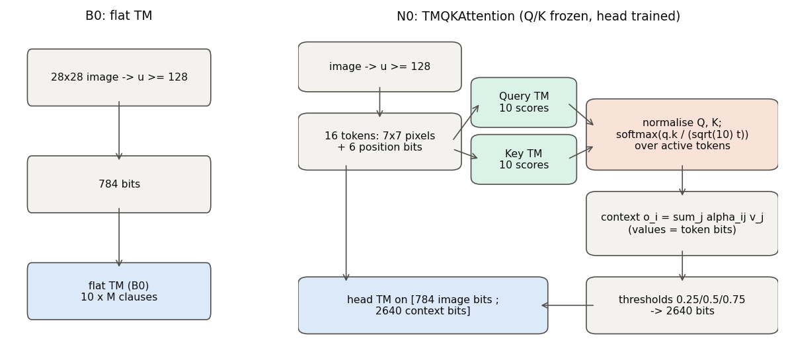
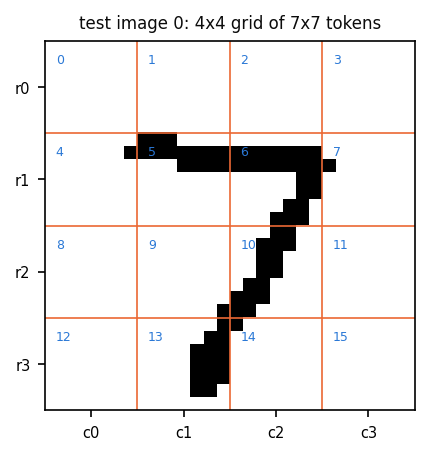
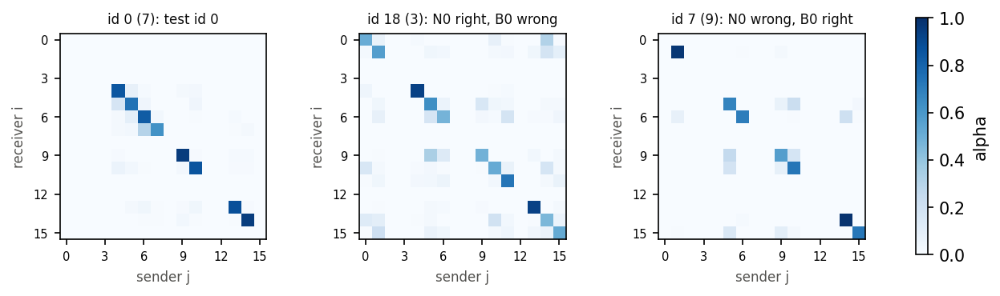
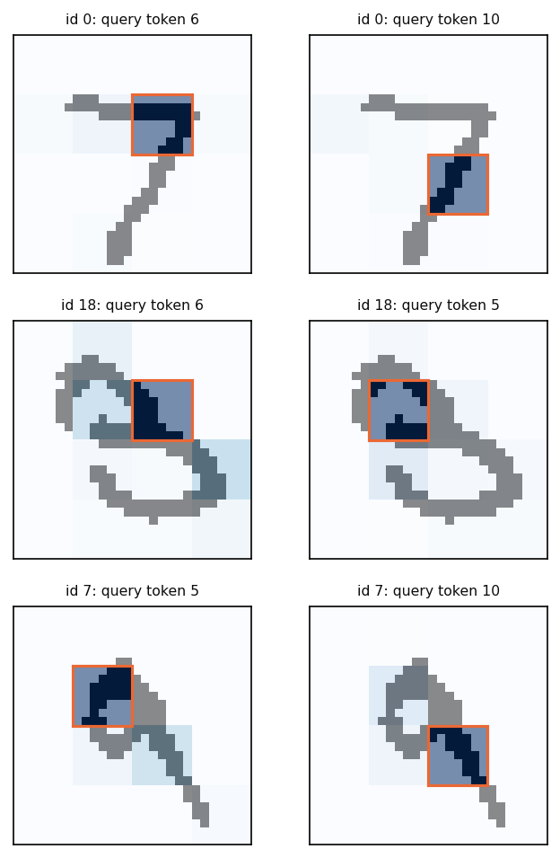
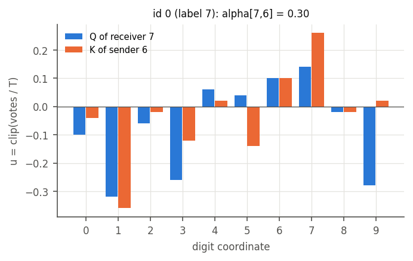
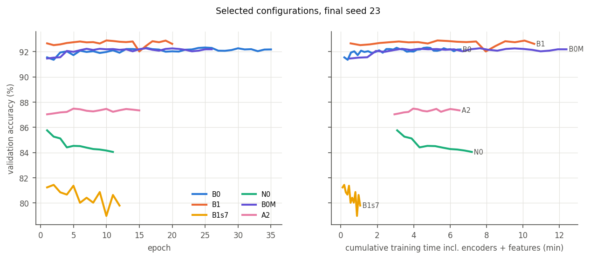
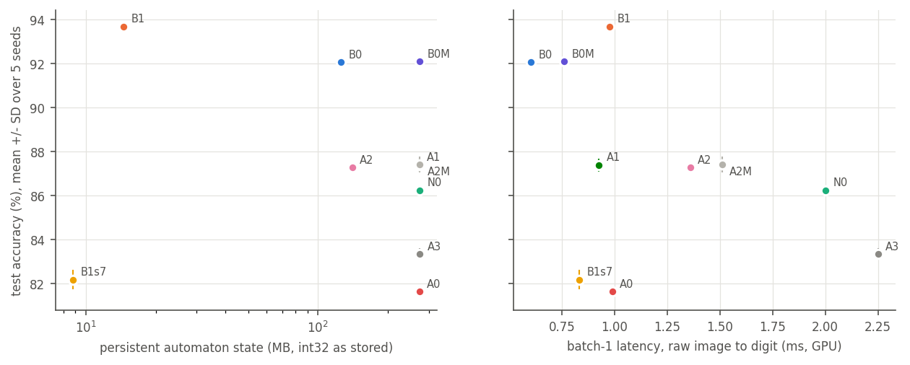
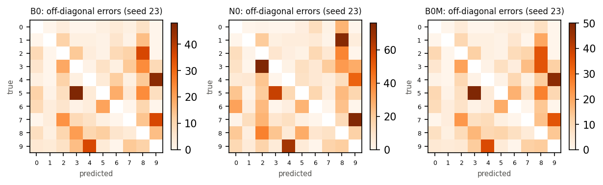
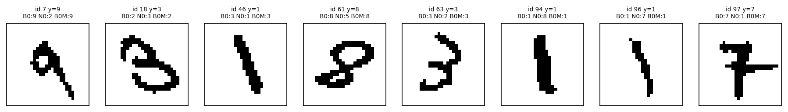

# TM query-key attention on MNIST: results

Generated by `python -m experiments.transformer_like.code.report` from `results/**/*.json`. Every number below is read from a record; nothing is hand-typed (rule C2). Spec: `tm-query-key-attention-mnist-implementation-plan.md`; plan: `PLAN.md`; deviations: `DECISIONS.md`.

## Status

- Frozen protocol: `results/frozen_experiment.json` (frozen 2026-10-16T21:01:48).
- Final runs completed: 50 of 50 planned (arm, seed) pairs.
- Incomplete: none.
- Failed records: none.
- Test-set accesses logged: 110 (`results/test_access_log.jsonl`).

## Answer to the question

TMQKAttention (N0) reaches 86.25 ± 0.22 % test accuracy over 5 seeds. The table applies the preregistered rule to each comparison. "Supported" needs all five paired differences positive, a mean gap of at least 0.25 points that exceeds the seed noise band, and McNemar p < 0.05 on at least four seeds. "Reverse" means the same rule holds in the other direction.

| Question | N0 − X, mean pp (per-seed) | bootstrap 95% CI (pp) | McNemar p < 0.05 | Verdict |
|---|---|---|---|---|
| Q1: beats the flat TM | -5.81 (-5.70, -5.92, -5.75, -5.94, -5.73) | [-6.26, -5.33] | 5/5 | **reverse supported** (X better) |
| Q2: beats the conv TM (stride 1) | -7.44 (-7.02, -7.54, -7.59, -7.76, -7.28) | [-7.96, -6.87] | 5/5 | **reverse supported** (X better) |
| Q6: beats the stride-7 conv TM (same tokens, OR pooling) | +4.07 (+4.73, +4.33, +4.03, +3.19, +4.05) | [+3.44, +4.72] | 5/5 | **supported** |
| Q3: beats the flat TM at matched automata | -5.85 (-5.47, -5.76, -6.09, -6.16, -5.75) | [-6.32, -5.35] | 5/5 | **reverse supported** (X better) |
| Q4: beats direct Q/K features | -1.03 (-0.86, -0.95, -1.01, -1.08, -1.27) | [-1.38, -0.68] | 5/5 | **reverse supported** (X better) |
| Q4: beats direct Q/K features at matched automata | -1.17 (-0.91, -1.17, -1.24, -0.85, -1.67) | [-1.52, -0.81] | 5/5 | **reverse supported** (X better) |
| Q5: beats uniform attention | +4.61 (+4.61, +4.61, +4.68, +4.57, +4.56) | [+4.09, +5.12] | 5/5 | **supported** |
| Q5: beats self-only attention | -1.14 (-1.00, -1.48, -1.22, -0.82, -1.17) | [-1.39, -0.90] | 5/5 | **reverse supported** (X better) |
| Q5: beats shuffled keys | +2.90 (+3.22, +2.58, +3.06, +2.99, +2.65) | [+2.48, +3.34] | 5/5 | **supported** |

Spec completion criterion "attention contributes beyond additional features" (Q3, Q4 and Q5 all supported): **not met**.

## Interpretation

Observed results are in the tables below; this section reads them. Every number here is computed from the records.

- **N0 does not improve on the flat TM or the convolutional TM.** In the primary comparison N0 is 5.81 points below B0 and 7.44 below B1. The same ordering holds in the equal-grid secondary S3 (N0 91.54 % vs B0 92.06 %) and with weighted clauses in S1 (N0 96.59 % vs B0 97.07 % and B1 98.87 %).
- **The attention step is what costs accuracy.** A head trained on self-only context (A1, 87.39 %) and a head trained on the Q/K class evidence without attention (A2, 87.28 %) both beat N0, in the primary, S3 and S1 regimes alike.
- **QK attention is close to self-attention.** On average 69 % of each receiver's weight stays on itself. Replacing N0's attention by self-only attention at inference changes its test accuracy by +0.15 points, while uniform attention costs 38.5 points. The head therefore uses the context bits, but the small cross-patch share that QK adds carries no usable information here.
- **QK selection beats arbitrary mixing.** N0 beats uniform attention (A0) and shuffled keys (A3) in the primary and S3 regimes (S1 did not train A0/A3), so the learned Q/K scores pick better senders than chance. They do not pick senders worth more than the token itself.
- **Capacity is not the explanation.** The flat TM at N0's automaton budget (B0-M, 92.10 %) scores about the same as B0 (92.06 %), so more automata do not help the flat TM, and N0's extra automata do not account for its gap in either direction.
- **The settings matter more than the architecture.** The spec's T = M/2 for the head and its unweighted clauses cost the attention model and the flat TM 5–10 points (S3, S1). None of the three regimes changes the ranking.

## Main results (official test set, 5 seeds)

Accuracy is mean ± sample SD over seeds. Bytes are the automaton state as stored (int32); the logical 8-bit size is the automaton count. Training time includes encoder fitting and feature generation where the arm needs them. Latency and throughput are the full raw-image pipeline on the RTX 3090 (median over seeds).

| Arm | Model | Test acc % | Errors | Macro-F1 | Δ vs B0 pp | Automata | State MB | Literals/image | Train min | Batch-1 ms (p95) | Batch-256 img/s |
|---|---|---|---|---|---|---|---|---|---|---|---|
| B0 | Flat TM | 92.06 ± 0.17 | 794 | 0.9198 | – | 31,360,000 | 125.4 | 31,360,000 | 4.2 | 0.60 (0.61) | 187802 |
| B1 | Conv TM 7x7, stride 1 | 93.69 ± 0.11 | 631 | 0.9364 | +1.63 ± 0.21 | 3,640,000 | 14.6 | 1,761,760,000 | 10.1 | 0.98 (0.99) | 3077 |
| B1s7 | Conv TM 7x7, stride 7 (plan addition) | 82.18 ± 0.43 | 1782 | 0.8201 | -9.87 ± 0.51 | 2,200,000 | 8.8 | 35,200,000 | 1.8 | 0.83 (0.84) | 41486 |
| N0 | TMQKAttention | 86.25 ± 0.22 | 1375 | 0.8618 | -5.81 ± 0.11 | 68,700,000 | 274.8 | 72,000,000 | 7.4 | 2.00 (2.03) | 75114 |
| A0 | Uniform attention | 81.64 ± 0.23 | 1836 | 0.8150 | -10.41 ± 0.11 | 68,480,000 | 273.9 | 68,480,000 | 11.2 | 0.99 (1.00) | 108733 |
| A1 | Self-only attention | 87.39 ± 0.29 | 1261 | 0.8734 | -4.67 ± 0.27 | 68,480,000 | 273.9 | 68,480,000 | 4.8 | 0.93 (0.94) | 111081 |
| A2 | Direct Q/K features | 87.28 ± 0.21 | 1272 | 0.8719 | -4.77 ± 0.19 | 35,100,000 | 140.4 | 38,400,000 | 5.7 | 1.36 (1.38) | 116945 |
| A2M | Direct Q/K features, matched automata | 87.42 ± 0.36 | 1258 | 0.8734 | -4.64 ± 0.38 | 68,724,320 | 274.9 | 72,024,320 | 8.2 | 1.51 (1.53) | 85361 |
| A3 | Shuffled keys | 83.35 ± 0.25 | 1665 | 0.8333 | -8.71 ± 0.25 | 68,700,000 | 274.8 | 72,000,000 | 7.6 | 2.25 (2.30) | 69929 |
| B0M | Flat TM, matched automata | 92.10 ± 0.15 | 790 | 0.9201 | +0.04 ± 0.24 | 68,709,760 | 274.8 | 68,709,760 | 12.2 | 0.76 (0.77) | 104448 |

CPU secondary timing (seed 23, 8 threads):

| Arm | Batch-1 ms | Batch-256 img/s |
|---|---|---|
| B0 | 6.64 | 4424 |
| B1 | 23.75 | 47 |
| B1s7 | 1.31 | 2279 |
| N0 | 11.89 | 2325 |
| A0 | 11.17 | 2676 |
| A1 | 11.17 | 2402 |
| A2 | 6.79 | 4199 |
| A2M | 12.38 | 1899 |
| A3 | 12.09 | 2320 |
| B0M | 14.18 | 1649 |

### Per-seed test accuracy (%)

| Arm | seed 23 | seed 41 | seed 59 | seed 83 | seed 101 |
|---|---|---|---|---|---|
| B0 | 92.33 | 92.06 | 91.88 | 92.03 | 91.99 |
| B1 | 93.65 | 93.68 | 93.72 | 93.85 | 93.54 |
| B1s7 | 81.90 | 81.81 | 82.10 | 82.90 | 82.21 |
| N0 | 86.63 | 86.14 | 86.13 | 86.09 | 86.26 |
| A0 | 82.02 | 81.53 | 81.45 | 81.52 | 81.70 |
| A1 | 87.63 | 87.62 | 87.35 | 86.91 | 87.43 |
| A2 | 87.49 | 87.09 | 87.14 | 87.17 | 87.53 |
| A2M | 87.54 | 87.31 | 87.37 | 86.94 | 87.93 |
| A3 | 83.41 | 83.56 | 83.07 | 83.10 | 83.61 |
| B0M | 92.10 | 91.90 | 92.22 | 92.25 | 92.01 |

### Paired comparisons in detail

| N0 vs | seeds | mean ± SD pp | noise band pp | rule 1 / 2 / 3 | McNemar (N0-only, X-only, p) per seed |
|---|---|---|---|---|---|
| B0 | 5 | -5.81 ± 0.11 | 0.22 | N/N/Y | 123,693,3.9e-97; 115,707,1.1e-104; 132,707,9.7e-96; 115,709,3.7e-105; 98,671,8.3e-106 |
| B1 | 5 | -7.44 ± 0.29 | 0.22 | N/N/Y | 167,869,5.8e-115; 162,916,3.4e-128; 169,928,2.5e-127; 159,935,3.5e-134; 194,922,6.8e-114 |
| B1s7 | 5 | +4.07 ± 0.57 | 0.43 | Y/Y/Y | 944,471,8.9e-37; 973,540,4.9e-29; 942,539,7.7e-26; 862,543,1.6e-17; 963,558,2e-25 |
| B0M | 5 | -5.85 ± 0.28 | 0.22 | N/N/Y | 123,670,7.2e-92; 117,693,2.6e-100; 120,729,4.1e-107; 123,739,8e-108; 94,669,1e-107 |
| A2 | 5 | -1.03 ± 0.15 | 0.22 | N/N/Y | 283,369,0.00086; 268,363,0.00018; 280,381,9.8e-05; 277,385,3.1e-05; 299,426,2.7e-06 |
| A2M | 5 | -1.17 ± 0.33 | 0.36 | N/N/Y | 279,370,0.0004; 274,391,6.5e-06; 270,394,1.7e-06; 288,373,0.0011; 263,430,2.4e-10 |
| A0 | 5 | +4.61 ± 0.05 | 0.23 | Y/Y/Y | 713,252,1.3e-51; 760,299,7.6e-47; 747,279,6.9e-50; 745,288,3.1e-47; 747,291,8.6e-47 |
| A1 | 5 | -1.14 ± 0.25 | 0.29 | N/N/Y | 146,246,5e-07; 147,295,1.7e-12; 157,279,5.5e-09; 165,247,6.3e-05; 167,284,4e-08 |
| A3 | 5 | +2.90 ± 0.27 | 0.25 | Y/Y/Y | 621,299,1.1e-26; 580,322,6.9e-18; 596,290,4.1e-25; 599,300,1.1e-23; 571,306,2.6e-19 |

The bootstrap interval resamples test images with the five seeds' predictions held fixed. It is conditional on these trained models and does not capture training-seed variation.

## Inference interventions on trained N0 (no retraining)

The trained N0 head is evaluated with its attention replaced at inference time. A drop shows the head uses the QK-selected context; it is not what a head retrained on that context would do (see A0/A1/A3).

| Seed | N0 test % | uniform % | self-only % | shuffled keys % |
|---|---|---|---|---|
| 23 | 86.63 | 47.53 | 86.52 | 32.37 |
| 41 | 86.14 | 48.28 | 86.20 | 35.25 |
| 59 | 86.13 | 46.96 | 86.73 | 31.42 |
| 83 | 86.09 | 46.87 | 86.10 | 33.09 |
| 101 | 86.26 | 49.20 | 86.44 | 33.71 |
| mean drop pp | | +38.48 | -0.15 | +53.08 |

## Attention diagnostics (N0, test set)

| Diagnostic | seed 23 | seed 41 | seed 59 | seed 83 | seed 101 |
|---|---|---|---|---|---|
| valid-row entropy (nats) | 0.854 | 0.889 | 0.874 | 0.844 | 0.876 |
| effective senders exp(H) | 2.557 | 2.652 | 2.616 | 2.532 | 2.616 |
| active tokens per image | 8.429 | 8.429 | 8.429 | 8.429 | 8.429 |
| self-attention mass | 0.696 | 0.683 | 0.691 | 0.705 | 0.690 |
| max weight per row | 0.699 | 0.688 | 0.694 | 0.708 | 0.694 |
| TV distance from uniform | 0.675 | 0.664 | 0.669 | 0.676 | 0.667 |
| cross-image SD of alpha | 0.057 | 0.059 | 0.057 | 0.057 | 0.057 |
| Q per-token SD of u | 0.171 | 0.167 | 0.168 | 0.166 | 0.168 |
| K per-token SD of u | 0.167 | 0.164 | 0.168 | 0.166 | 0.164 |
| Q clipping saturation | 0.000 | 0.000 | 0.000 | 0.000 | 0.000 |
| Q zero-variance token rate | 0.000 | 0.000 | 0.000 | 0.000 | 0.000 |
| K zero-variance token rate | 0.000 | 0.000 | 0.000 | 0.000 | 0.000 |
| constant context bits (train) | 0.046 | 0.061 | 0.057 | 0.049 | 0.052 |
| images with one active token | 0 | 0 | 0 | 0 | 0 |

Rows of images with more than one active token (first seed): entropy 0.854, self mass 0.696. For reference, uniform attention over m senders has entropy ln m and self mass 1/m.

Uniform / self-only / shuffled-keys controls, for comparison (test set, first seed):

| Arm | entropy | self mass | TV from uniform |
|---|---|---|---|
| N0 | 0.854 | 0.696 | 0.675 |
| A0 | 2.160 | 0.119 | 0.000 |
| A1 | 0.000 | 1.000 | 0.881 |
| A3 | 0.854 | 0.069 | 0.675 |

## Q/K encoders (fixed validation patch sample)

Weak patch labels: each patch carries its parent image's digit. Chance patch accuracy is 10 %. These diagnostics select nothing (spec §8).

| Seed | Q patch acc | K patch acc | Q token SD of u | K token SD of u | Q saturation | Q train s | K train s |
|---|---|---|---|---|---|---|---|
| 101 | 33.3 | 32.9 | 0.169 | 0.164 | 0.000 | 78 | 77 |
| 17 | 33.3 | 33.0 | 0.166 | 0.167 | 0.000 | 78 | 77 |
| 23 | 33.5 | 33.5 | 0.171 | 0.167 | 0.000 | 81 | 80 |
| 41 | 32.7 | 34.4 | 0.168 | 0.164 | 0.000 | 77 | 77 |
| 59 | 33.1 | 32.6 | 0.169 | 0.168 | 0.000 | 78 | 78 |
| 83 | 33.1 | 33.5 | 0.167 | 0.167 | 0.000 | 78 | 77 |

## Secondary experiments (plan additions, separate from the primary comparison)

### S1: weighted clauses (seeds 23, 41, 59, primary selected configurations; A1/A2/B0-M added by D23)

| Arm | weighted test % (mean ± SD) | unweighted test %, same seeds |
|---|---|---|
| B0 | 97.07 ± 0.17 (n=3) | 92.09 ± 0.23 |
| B1 | 98.87 ± 0.08 (n=3) | 93.68 ± 0.04 |
| N0 | 96.59 ± 0.17 (n=3) | 86.30 ± 0.29 |
| A1 | 97.18 ± 0.07 (n=3) | 87.53 ± 0.16 |
| A2 | 97.06 ± 0.04 (n=3) | 87.24 ± 0.22 |
| B0M | 97.42 ± 0.02 (n=3) | 92.07 ± 0.16 |

S1 paired differences, N0 − X (pp per seed; 3 seeds, so the 5-seed decision rule cannot apply):

| X | per-seed | mean | McNemar p per seed |
|---|---|---|---|
| B0 | -0.50, -0.25, -0.70 | -0.48 | 0.0026, 0.14, 2.4e-05 |
| B1 | -2.22, -2.24, -2.39 | -2.28 | 7.3e-40, 2.7e-41, 5.6e-46 |
| A1 | -0.37, -0.57, -0.82 | -0.59 | 0.026, 0.00053, 4.6e-07 |
| A2 | -0.34, -0.45, -0.61 | -0.47 | 0.048, 0.009, 0.00055 |
| B0M | -0.68, -0.77, -1.05 | -0.83 | 1.7e-05, 1.3e-06, 3.9e-11 |

S1 interventions on weighted N0 (test %, mean): uniform 66.70, self_only 96.55, shuffled_keys 50.96 vs N0 96.59.

### S2: batch-32 vs sequential feedback (B0 selected config, 5,000-image subset, 10 epochs, validation)

| Feedback | best val acc % | best epoch | head train min |
|---|---|---|---|
| batch | 90.96 | 10 | 0.3 |
| sequential | 90.99 | 10 | 7.6 |

### S3: equal-grid comparison (head T/M = 0.25 allowed for the N0 family; D22)

Selected over all 24 N0 trials: `N0_M250_r0.25_s3.0_t0.5_seed17` (validation 91.63 %). B0, B1 and B1-s7 are the primary runs; their grids already contained T/M = 0.25. The same decision rules apply.

| Arm | Test acc % (mean ± SD) | automata |
|---|---|---|
| N0 (S3) | 91.54 ± 0.21 | 17,340,000 |
| A0 (S3) | 90.14 ± 0.17 | 17,120,000 |
| A1 (S3) | 92.34 ± 0.09 | 17,120,000 |
| A2 (S3) | 92.45 ± 0.16 | 8,940,000 |
| A2M (S3) | 92.48 ± 0.16 | 17,311,200 |
| A3 (S3) | 90.88 ± 0.15 | 17,340,000 |
| B0M (S3) | 92.09 ± 0.11 | 17,342,080 |

| Question | N0 − X, mean pp (per-seed) | bootstrap 95% CI (pp) | McNemar p < 0.05 | Verdict |
|---|---|---|---|---|
| Q1: beats the flat TM | -0.52 (-0.51, -0.57, -0.43, -0.76, -0.31) | [-0.77, -0.26] | 4/5 | **reverse supported** (X better) |
| Q2: beats the conv TM (stride 1) | -2.15 (-1.83, -2.19, -2.27, -2.58, -1.86) | [-2.57, -1.71] | 5/5 | **reverse supported** (X better) |
| Q6: beats the stride-7 conv TM (same tokens, OR pooling) | +9.36 (+9.92, +9.68, +9.35, +8.37, +9.47) | [+8.74, +9.99] | 5/5 | **supported** |
| Q3: beats the flat TM at matched automata | -0.55 (-0.15, -0.52, -0.61, -0.90, -0.56) | [-0.80, -0.29] | 4/5 | **reverse supported** (X better) |
| Q4: beats direct Q/K features | -0.91 (-0.74, -1.05, -0.84, -0.98, -0.92) | [-1.18, -0.60] | 5/5 | **reverse supported** (X better) |
| Q4: beats direct Q/K features at matched automata | -0.94 (-0.95, -0.92, -0.96, -1.10, -0.76) | [-1.23, -0.63] | 5/5 | **reverse supported** (X better) |
| Q5: beats uniform attention | +1.40 (+1.62, +1.23, +1.50, +1.28, +1.36) | [+1.07, +1.72] | 5/5 | **supported** |
| Q5: beats self-only attention | -0.79 (-0.58, -0.72, -0.91, -1.01, -0.75) | [-1.01, -0.58] | 5/5 | **reverse supported** (X better) |
| Q5: beats shuffled keys | +0.66 (+0.86, +0.66, +0.60, +0.59, +0.60) | [+0.36, +0.96] | 5/5 | **supported** |

S3 interventions on trained N0 (test %, mean over seeds): uniform 42.97, self_only 91.42, shuffled_keys 23.77 vs N0 91.54.

## Validation search ledger (tuning seed 17)

52 trials recorded, 52 completed. Selection key: validation accuracy, then smaller stored state, then earlier best epoch, then run id.

| Trial | status | val acc % | best epoch | epochs run | head train min | selected |
|---|---|---|---|---|---|---|
| B0_M2000_r0.25_s3.0_seed17 | completed | 92.35 | 12 | 22 | 7.0 | **yes** |
| B0_M1000_r0.25_s3.0_seed17 | completed | 92.29 | 18 | 28 | 5.8 |  |
| B0_M500_r0.25_s3.0_seed17 | completed | 92.14 | 17 | 27 | 2.4 |  |
| B0_M2000_r0.25_s5.0_seed17 | completed | 91.66 | 14 | 24 | 9.1 |  |
| B0_M1000_r0.25_s5.0_seed17 | completed | 91.41 | 26 | 36 | 10.4 |  |
| B0_M500_r0.25_s5.0_seed17 | completed | 91.21 | 11 | 21 | 3.9 |  |
| B0_M2000_r0.5_s5.0_seed17 | completed | 87.37 | 1 | 11 | 5.4 |  |
| B0_M2000_r0.5_s3.0_seed17 | completed | 87.23 | 1 | 11 | 4.6 |  |
| B0_M1000_r0.5_s3.0_seed17 | completed | 87.12 | 1 | 11 | 2.4 |  |
| B0_M500_r0.5_s3.0_seed17 | completed | 86.96 | 1 | 11 | 1.3 |  |
| B0_M1000_r0.5_s5.0_seed17 | completed | 86.68 | 1 | 11 | 2.4 |  |
| B0_M500_r0.5_s5.0_seed17 | completed | 86.01 | 1 | 11 | 1.0 |  |
| B0M_M4382_r0.25_s3.0_seed17 | completed | 92.22 | 10 | 20 | 13.1 | **yes** |
| B0M_M4382_r0.25_s5.0_seed17 | completed | 91.63 | 15 | 25 | 18.4 |  |
| B0M_M4382_r0.5_s5.0_seed17 | completed | 87.93 | 1 | 11 | 11.8 |  |
| B0M_M4382_r0.5_s3.0_seed17 | completed | 87.09 | 1 | 11 | 9.6 |  |
| B1_M2000_r0.25_s3.0_seed17 | completed | 92.97 | 3 | 13 | 11.8 | **yes** |
| B1_M1000_r0.25_s3.0_seed17 | completed | 92.88 | 30 | 40 | 21.2 |  |
| B1_M500_r0.25_s3.0_seed17 | completed | 92.54 | 6 | 16 | 4.9 |  |
| B1_M2000_r0.25_s5.0_seed17 | completed | 91.42 | 1 | 11 | 10.1 |  |
| B1_M1000_r0.25_s5.0_seed17 | completed | 91.04 | 11 | 21 | 11.4 |  |
| B1_M500_r0.25_s5.0_seed17 | completed | 90.58 | 13 | 23 | 6.2 |  |
| B1_M2000_r0.5_s3.0_seed17 | completed | 89.00 | 1 | 11 | 10.0 |  |
| B1_M2000_r0.5_s5.0_seed17 | completed | 88.97 | 1 | 11 | 10.2 |  |
| B1_M1000_r0.5_s3.0_seed17 | completed | 88.37 | 7 | 17 | 8.9 |  |
| B1_M1000_r0.5_s5.0_seed17 | completed | 88.24 | 1 | 11 | 5.0 |  |
| B1_M500_r0.5_s3.0_seed17 | completed | 87.96 | 4 | 14 | 4.2 |  |
| B1_M500_r0.5_s5.0_seed17 | completed | 87.33 | 1 | 11 | 3.0 |  |
| B1s7_M2000_r0.25_s5.0_seed17 | completed | 82.20 | 6 | 16 | 2.1 | **yes** |
| B1s7_M500_r0.25_s5.0_seed17 | completed | 82.11 | 3 | 13 | 0.9 |  |
| B1s7_M1000_r0.25_s3.0_seed17 | completed | 82.09 | 3 | 13 | 2.4 |  |
| B1s7_M2000_r0.25_s3.0_seed17 | completed | 81.72 | 9 | 19 | 2.7 |  |
| B1s7_M1000_r0.25_s5.0_seed17 | completed | 81.65 | 3 | 13 | 1.0 |  |
| B1s7_M500_r0.25_s3.0_seed17 | completed | 81.48 | 3 | 13 | 5.1 |  |
| B1s7_M1000_r0.5_s5.0_seed17 | completed | 78.03 | 3 | 13 | 1.2 |  |
| B1s7_M2000_r0.5_s5.0_seed17 | completed | 77.90 | 6 | 16 | 2.2 |  |
| B1s7_M500_r0.5_s5.0_seed17 | completed | 76.85 | 6 | 16 | 1.8 |  |
| B1s7_M2000_r0.5_s3.0_seed17 | completed | 75.02 | 8 | 18 | 2.6 |  |
| B1s7_M1000_r0.5_s3.0_seed17 | completed | 73.89 | 7 | 17 | 4.0 |  |
| B1s7_M500_r0.5_s3.0_seed17 | completed | 72.23 | 3 | 13 | 0.9 |  |
| N0_M1000_r0.5_s3.0_t0.5_seed17 | completed | 85.73 | 1 | 11 | 11.7 | **yes** |
| N0_M500_r0.5_s3.0_t0.5_seed17 | completed | 85.51 | 1 | 11 | 6.0 |  |
| N0_M1000_r0.5_s5.0_t0.5_seed17 | completed | 84.99 | 1 | 11 | 9.6 |  |
| N0_M250_r0.5_s3.0_t0.5_seed17 | completed | 84.88 | 1 | 11 | 2.2 |  |
| N0_M1000_r0.5_s3.0_t1.0_seed17 | completed | 84.55 | 1 | 11 | 11.7 |  |
| N0_M500_r0.5_s3.0_t1.0_seed17 | completed | 84.39 | 1 | 11 | 6.0 |  |
| N0_M250_r0.5_s3.0_t1.0_seed17 | completed | 83.95 | 1 | 11 | 2.4 |  |
| N0_M500_r0.5_s5.0_t0.5_seed17 | completed | 83.86 | 1 | 11 | 4.8 |  |
| N0_M1000_r0.5_s5.0_t1.0_seed17 | completed | 83.66 | 1 | 11 | 9.6 |  |
| N0_M500_r0.5_s5.0_t1.0_seed17 | completed | 82.78 | 1 | 11 | 4.8 |  |
| N0_M250_r0.5_s5.0_t0.5_seed17 | completed | 82.61 | 1 | 11 | 2.8 |  |
| N0_M250_r0.5_s5.0_t1.0_seed17 | completed | 82.04 | 1 | 11 | 3.7 |  |

Total head/baseline training time in the search: 5.3 GPU-hours (plus one tuning encoder pair).

Selected configurations and memory matching:

| Arm | M | s | T/M | temperature |
|---|---|---|---|---|
| B0 | 2000 | 3.0 | 0.25 | 1.0 |
| B1 | 2000 | 3.0 | 0.25 | 1.0 |
| B1s7 | 2000 | 5.0 | 0.25 | 1.0 |
| N0 | 1000 | 3.0 | 0.5 | 0.5 |
| B0M | 4382 | 3.0 | 0.25 | 1.0 |
| A0 | 1000 | 3.0 | 0.5 | 0.5 |
| A1 | 1000 | 3.0 | 0.5 | 0.5 |
| A3 | 1000 | 3.0 | 0.5 | 0.5 |
| A2 | 1000 | 3.0 | 0.5 | 0.5 |
| A2M | 1964 | 3.0 | 0.5 | 0.5 |

N0 total automata 68,700,000; B0-M 68,709,760 (M = 4382); A2-M 68,724,320 (M = 1964).

## Figures

**Figure 1. B0 and N0 architectures**

**Figure 2. Token grid (test id 0)**

**Figure 3. Attention matrices (N0, seed 23); rows are receivers, columns senders**

**Figure 4. Senders for the two most-inked query tokens (box)**

**Figure 5. Q and K digit-score profiles for the strongest off-diagonal pair**

**Figure 6. Validation accuracy against epoch and cumulative training time**

**Figure 7. Test accuracy against stored state and batch-1 latency**

**Figure 8a. Confusion matrices, off-diagonal (seed 23)**

**Figure 8b. First eight test images (by id) where B0, N0 and B0-M disagree**

## Spec §21 hand-off checklist

- [x] All trainable modules use the documented TM backend and ordinary feedback: `backend_contract.md`, `code/tm_adapter.py`
- [x] Q/K have aligned digit coordinates and separate trained state: `code/patch_training.py`; separate seeds/streams (D13); `results/encoders/*.json`
- [x] Patch labels are described as weak supervision: this report, Q/K encoder section
- [x] Forward equations, masks, quantisation and tensor dimensions match the code: `tests/test_attention.py`, `tests/test_features.py`
- [x] Standard TM baseline works before the new model is interpreted: B0/B1 rows; `results/smoke_*`, `results/probe`
- [x] Unit/integration tests and raw-image save/load inference pass: `pytest experiments/transformer_like/tests` (65 tests, CPU+CUDA)
- [x] All fitting restricted to training image ids: `tests/test_data.py`, `tests/test_isolation.py`; manifests
- [x] Validation selection, seed list and test protocol frozen before test: `results/frozen_experiment.json` (commit `5322fb0`), `results/test_access_log.jsonl`
- [x] B0, N0, A0–A3, A2-M and B0-M evaluated across five seeds: Status section above
- [x] B1 evaluated: B1 and B1-s7 rows
- [x] Encoder, feature-generation and complete inference costs included: main table; `results/timing/`
- [x] Actual memory and clause/state counts accompany accuracy: main table; `sizes` in every record
- [x] Attention diagnostics, interventions and failure examples included: sections above; Figures 3–5, 8b
- [x] No invented scores and no unsupported superiority claims: all numbers generated from records (rule C2)
- [x] Commands reproduce the work; incomplete runs identified: `README.md`; Status section

## Limitations

- Training is staged: Q/K are trained on weak patch labels, frozen, and never receive feedback from the head. This is not end-to-end optimisation.
- The Q/K coordinates are digit-class evidence. This is class-guided patch similarity, not general contextual representation learning.
- All fits use batched feedback at batch 32 (D2), not the per-example algorithm; S2 measures the difference on a subset.
- MNIST only, one binarisation threshold, five seeds. Five seeds cannot resolve differences of a few test images.
- Encoders are fitted on the same training images whose features train the head; training accuracy is not evidence of generalisation.
- Timing is on one machine (RTX 3090, CUDA 12.8) and depends on this library's kernels.
