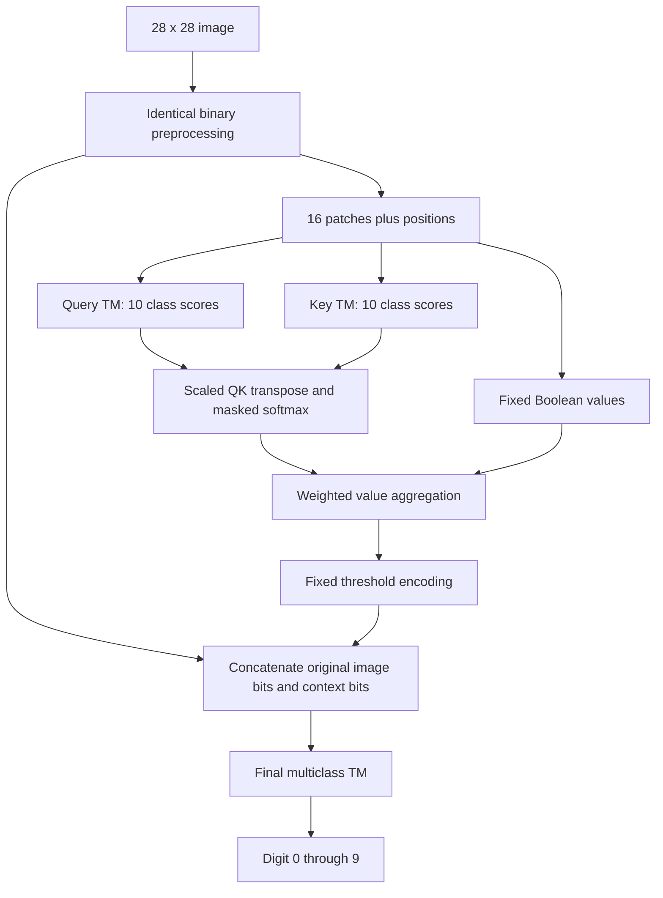

# TM Query-Key Attention: MNIST Implementation and Evaluation Plan

Version: 1.0 | Prepared: 15 October 2026

## 1. Assignment for the coding agent

Implement and evaluate a Tsetlin Machine system with explicit query (Q), key (K), and value (V) operations, starting with MNIST classification. Reuse an existing, verified TM implementation for learning. Compare the new model with a traditional flat multiclass TM, a convolutional TM, and controls that isolate attention from extra model capacity.

This document is an implementation specification and proposed experiment. It contains no measured MNIST results. Do not fill result tables with literature numbers, estimates, or invented outcomes. A negative experimental result is a valid completion.

The mandatory deliverable is a reproducible one-layer, one-head model named `TMQKAttention`, its tests, trained checkpoints, and a comparison report. Implement the optional Boolean variant only after this first experiment is complete. Multiple heads, deeper stacks, language generation, and a new end-to-end learning algorithm are later research tasks.

Work in a dedicated project directory. Preserve existing files and obey the repository's instructions. If this document is used in the DADAP mirror, everything under `sources/` is read-only. No prior conversation or PDF is needed to implement this specification.

### Completion criteria

- The traditional TM and new TM both actually train and predict on MNIST.
- Q and K are separately learned TM outputs, compared through a genuine token-to-token QK operation.
- The final output is a normally trained TM classifier.
- Unit, integration, serialization, and data-isolation tests pass.
- A fixed validation protocol selects configurations before the test set is evaluated.
- Results include accuracy, run-to-run variation, complete inference time, complete training time, and memory.
- Required ablations and a memory-matched flat TM are evaluated.
- Reports clearly state the architecture's limitations and whether attention contributes beyond additional features.

## 2. Design decision: an implementable first model

Use ordinary TMs to learn Q and K. Their signed class votes become real-valued query/key coordinates. Apply scaled dot-product attention, quantize the resulting context features back to bits, and train a final ordinary TM.

All learned parameters in this first version are TM automaton states. Attention uses floating-point arithmetic but has no trainable neural projection matrices. There is no backpropagation, surrogate gradient, neural teacher, or assumed deep-TM feedback rule.

This is a **Transformer-inspired TM architecture**, not an implementation of the complete Transformer. It has explicit Q/K matching, normalized value aggregation, and an input-preserving connection. It initially omits a learned V projection, feed-forward neural sublayers, trainable normalization, and joint optimization.

### Why the Q/K coordinates are digit-class scores

Two independently learned collections of arbitrary clauses do not automatically have aligned coordinates. Clause 7 in one collection need not mean the same thing as clause 7 in the other. Taking their dot product without alignment would be an unjustified design choice.

For MNIST, define exactly 10 Q/K coordinates in the fixed order `0,1,...,9`. Train both encoders to predict the parent image's digit from a patch and its position. Coordinate `c` in both encoders then represents evidence for digit class `c`.

These are **weak patch labels**: a patch from a digit 8 is assigned label 8 even if that patch alone is ambiguous. They are a practical auxiliary task, not annotations of patch meaning. This task may produce poor attention features; the experiment must measure that possibility.

Q and K have separate parameters, seeds, and patch samples. Their roles differ at inference: Q describes the receiving patch; K describes candidate sending patches. Shared class coordinates make comparison meaningful without claiming that either vector is a calibrated probability distribution.

### Relationship to the earlier logical routing idea

The earlier proposal evaluated a TM on a concatenated receiver/sender pair and thresholded its score. This specification replaces that operation with separately evaluated Q and K encoders and a dot product. Do not implement the earlier pairwise gate and merely rename it QK attention.

## 3. Overview



The original image is retained so that aggregation does not destroy all spatial information. This also makes it possible for the final TM to ignore attention, which is why attention-specific controls are mandatory.

## 4. Software and backend contract

Prefer the project's existing original TM implementation. Otherwise use a pinned version or commit of [TMU](https://github.com/cair/tmu). Record the exact revision, Python version, dependencies, compiler, operating system, device, and thread counts.

Use CPU as the portable reference backend. Add CUDA only after CPU correctness is established and only where the selected backend supports it. An Apple GPU is not a CUDA device. Do not invent backend support or silently substitute another model.

TMU's inspected classifier source exposes a multiclass classifier and a route to class sums. Its implementation can change, so verify the pinned revision rather than assuming this specification is an API guarantee. Relevant source: [TMU vanilla classifier](https://github.com/cair/tmu/blob/main/tmu/models/classification/vanilla_classifier.py).

Build a narrow adapter with these project-defined methods:

```python
class TMAdapter:
    def fit_epoch(self, X_bits, y, *, shuffle=True): ...
    def predict(self, X_bits): ...
    def class_scores(self, X_bits): ...  # [examples, 10], raw signed sums
    def clause_outputs(self, X_bits): ...  # diagnostic, optional batch limit
    def state_manifest(self): ...
    def save(self, path): ...
    @classmethod
    def load(cls, path): ...
```

Adapter obligations:

1. Map score columns to the explicit class order `0..9`.
2. Distinguish raw inference votes from votes clipped for learning feedback.
3. Confirm whether the backend's clause-count parameter means clauses per class or total clauses. This plan uses **clauses per class**, including both polarities.
4. Preserve the backend's literal ordering, feature negation, empty-clause semantics, and Type I/II learning behavior.
5. Use contiguous binary arrays in the backend's required dtype. TMU currently expects `uint32` training arrays containing 0/1, rather than user-packed bit strings.
6. Do not replace ordinary TM feedback with gradient descent or a guessed update table.
7. Verify initialization covers all 10 classes. Stratified small datasets must still contain every class.
8. Test repeated `fit_epoch` calls actually continue learning rather than resetting the model.
9. Serialize enough configuration and state for identical predictions after loading. Test continued-training reproducibility separately; do not assume a backend serializes every native RNG state.

For a traditional baseline, disable weighted clauses, Type III feedback, clause/literal dropout, and other optional modifications. Enable positive and negated literals and ordinary Type I/II feedback. Use the same settings for the Q TM, K TM, and output TM unless an explicitly labelled secondary experiment changes them.

Keep the inspected native class-sum reconstruction in a small adapter test. Do not copy or rewrite the entire native learner.

## 5. Dataset and leakage controls

Use the official MNIST split: 60,000 training images and 10,000 test images, each 28 by 28 with labels 0 through 9. Dataset dimensions and ranges are documented by [Keras MNIST](https://keras.io/api/datasets/mnist/).

From the official training set, create one reproducible stratified split:

| Partition | Images | Permitted use |
|---|---:|---|
| Training | 50,000 | All model fitting, patch sampling, feature fitting |
| Validation | 10,000 | Configuration selection and output-TM checkpoint selection |
| Official test | 10,000 | Final evaluation after the experiment is frozen |

Use split seed `314159`; save image indices, source checksums, class counts, and a split manifest. Reuse these exact indices for every architecture and random seed. Model randomness must not change the dataset split.

Use an existing verified data cache or a trusted MNIST loader. Do not install TensorFlow solely to read MNIST if a lighter loader is available. Record the actual download source and checksums. Detect duplicate IDs across partitions; report identical-image-content duplicates separately without silently changing the official protocol.

Always split at the **image** level before extracting patches. Patches from a validation/test image must never enter Q/K training. Labels are arguments to fitting and evaluation, never to `transform(images)` or `predict(images)`.

The main experiment keeps the 50,000/10,000 split even for final seed runs. Do not retrain on all 60,000 images after tuning in the primary comparison. Such a retraining can be a separate, clearly labelled later experiment.

## 6. MNIST tokenization and binary features

### 6.1 Identical primary preprocessing

For original pixel intensity `u` in `[0,255]`, set:

\[
x_{r,c}=\mathbf{1}[u_{r,c}\ge128].
\]

The flat baseline sees these 784 bits. Every other primary model is derived from the same binary image. Do not give only the new model extra grayscale levels, augmentation, or external representations.

A later grayscale experiment may use thresholds `[64,128,192]`, but must rerun all relevant baselines with the same information. It is not part of the initial search.

### 6.2 Patch tokens

Use non-overlapping 7 by 7 patches with stride 7. This produces a 4 by 4 grid: `n=16` tokens. Define token index `i=4*r+c`, where `r,c` range from 0 to 3. Flatten pixels within a patch in row-major order.

Each token contains 49 pixel bits and six fixed position bits:

\[
p(r,c)=
[\mathbf1[r\ge1],\mathbf1[r\ge2],\mathbf1[r\ge3],
 \mathbf1[c\ge1],\mathbf1[c\ge2],\mathbf1[c\ge3]].
\]

\[
b_i=[\operatorname{patch}_i(x);p(r_i,c_i)]\in\{0,1\}^{55}.
\]

This avoids a vocabulary-sized one-hot representation. A patch is represented by its actual pixels; it is not assigned an arbitrary compact token ID.

Define activity using **only the 49 pixel bits**:

\[
a_i=\mathbf1\!\left[\sum_{f=1}^{49}\operatorname{patch}_{i,f}>0\right].
\]

A blank patch can still have nonzero position bits; those bits must not make it active. Retain all 16 grid slots in tensors and output features, including inactive slots.

## 7. Exact forward model

All definitions below are proposed design decisions. The coding agent must not silently replace them with nearest-neighbor matching, a neural attention layer, OR aggregation, or a different quantizer.

### 7.1 Query and key scores

For encoder `E` in `{Q,K}`, digit coordinate `c`, and token `b_i`:

\[
s^E_{i,c}=\sum_{m=1}^{M_E}\pi_m C^E_{c,m}(b_i),
\qquad \pi_m\in\{-1,+1\}.
\]

The native TM learns the clauses. Use its raw class scores at inference. Define fixed clipping and normalization:

\[
u^E_{i,c}=\operatorname{clip}(s^E_{i,c}/T_E,-1,1),
\]

\[
\mu^E_i=\frac1{10}\sum_c u^E_{i,c},\qquad
\sigma^{2,E}_i=\frac1{10}\sum_c(u^E_{i,c}-\mu^E_i)^2,
\]

\[
q_{i,c}=\frac{u^Q_{i,c}-\mu^Q_i}{\sqrt{\sigma^{2,Q}_i+10^{-6}}},
\qquad
k_{i,c}=\frac{u^K_{i,c}-\mu^K_i}{\sqrt{\sigma^{2,K}_i+10^{-6}}}.
\]

Centering removes a shared all-class offset from a token's vote vector. Normalization is per token and per encoder; it fits no statistics on validation or test data. A constant score vector maps to zeros. Do not call these vectors probabilities.

### 7.2 Compatibility and attention weights

With `d_k=10` and attention temperature `temperature > 0`:

\[
S_{ij}=\frac{q_i^\top k_j}{\sqrt{10}\,\mathrm{temperature}}.
\]

MNIST classification is bidirectional. The allowed mask is:

\[
M_{ij}=a_i a_j.
\]

Self-attention is permitted in the primary model. There is no causal mask, distance bias, or class-dependent mask. Use a separate variable name for this mask; `V` below means values.

For a row with allowed senders `J_i={j:M_ij=1}`:

\[
\alpha_{ij}=
\begin{cases}
\displaystyle\frac{\exp(S_{ij}-\max_{r\in J_i}S_{ir})}
{\sum_{r\in J_i}\exp(S_{ir}-\max_{s\in J_i}S_{is})}, & j\in J_i,\\
0, & j\notin J_i.
\end{cases}
\]

If `J_i` is empty, set the entire row to zero. Handle this case before softmax so that an all-masked row never produces NaNs. Use max subtraction for numerical stability.

`alpha[i,j]` always means **sender j contributes to receiver i**. Normalize over the sender axis, not the receiver axis.

### 7.3 Values and context

The first value map is fixed:

\[
v_j=b_j\in\{0,1\}^{55},\qquad
o_i=\sum_{j=0}^{15}\alpha_{ij}v_j\in[0,1]^{55}.
\]

Coordinates of `o_i` describe weighted pixel/position features across selected patches. They are not a reconstructed image patch at the receiver's location. This aggregation can lose sender identity; retain position features and measure whether the model benefits despite that loss.

Do not OR binary token IDs. Do not interpret aggregated position bits as an exact single sender coordinate.

### 7.4 Return to Boolean features

For `beta=[0.25,0.50,0.75]`, encode:

\[
z_{i,f,t}=\mathbf1[o_{i,f}\ge\beta_t].
\]

Thresholds are fixed for the main experiment. The comparison at equality is `>=`. For example, `0.60 -> [1,1,0]` and `0.25 -> [1,0,0]`.

The final feature vector is:

\[
g(x)=[\operatorname{vec}(x);\operatorname{vec}(z)]
\in\{0,1\}^{784+16\cdot55\cdot3}
=\{0,1\}^{3424}.
\]

Flatten context in token, feature, threshold order. Train the output TM on `g(x)` and the image digit label. Use its normal class-vote argmax, with the backend's documented tie convention.

### 7.5 Required tensor shapes

| Object | Shape for batch size B | Logical dtype |
|---|---|---|
| Raw images | `[B,28,28]` | uint8 intensity |
| Binary images | `[B,28,28]` | Boolean/0-1 |
| Tokens | `[B,16,55]` | Boolean/0-1 |
| Active mask | `[B,16]` | Boolean |
| Raw Q/K votes | `[B,16,10]` each | signed integer |
| Normalized Q/K | `[B,16,10]` each | float32 |
| Compatibility / attention | `[B,16,16]` each | float32 |
| Values / context | `[B,16,55]` each | binary / float32 |
| Context threshold bits | `[B,16,55,3]` | Boolean/0-1 |
| Final TM input | `[B,3424]` | native adapter dtype |
| Final class votes | `[B,10]` | signed integer |

Use float64 in a tiny mathematical reference implementation and float32 in the main implementation. Compare values with tolerance before quantization. Test threshold boundaries explicitly; do not introduce an undocumented epsilon into the threshold rule.

## 8. Training procedure: no missing credit-assignment step

### Stage A: learn and freeze Q and K

Default encoder settings, per encoder:

- 100 clauses per class, with equal positive/negative counts.
- `T=50`, `s=5.0`, 8 automaton-state bits.
- 10 fixed encoder epochs; no encoder checkpoint search in the primary experiment.
- At each epoch, draw four active patches per training image. Sample without replacement when possible; use replacement if fewer than four active patches exist. Skip an all-blank image for this auxiliary task and record its count.
- Give each sampled patch its parent image's digit label.
- Use different deterministic RNG streams for Q sampling, K sampling, Q initialization, and K initialization.
- Include every digit class in each training stream; validate this before native initialization.

The maximum is 200,000 patch examples per encoder epoch for the 50,000-image training split. Record the actual number and repeated samples. A baseline epoch and an encoder epoch are not equal amounts of work.

Train Q and K with the backend's ordinary multiclass feedback. Then freeze them. Their labels are derived only from training images; no extra annotation is required.

Compute diagnostic patch accuracy and score statistics on a fixed validation patch sample. These are diagnostics only in the primary experiment; do not secretly select encoder epochs, patch definitions, or temperatures using them.

### Stage B: train the output TM

1. Use the frozen encoders to transform all training images into `g(x)`.
2. Transform validation images using the same frozen encoders and fixed preprocessing.
3. Train the output TM for at most 50 epochs.
4. Evaluate validation accuracy after each completed epoch.
5. Keep the earliest checkpoint attaining the best validation accuracy.
6. Stop after 10 successive epochs without a strictly higher validation accuracy.
7. Retain the best checkpoint, not the last epoch.

Using supervised encoders fitted on the training split to transform that same split is deliberate staged representation learning. It can overfit, so training accuracy is not evidence of generalization. Validation/test images must remain unseen by every fitted encoder. An optional cross-fitting study can investigate stacking overfit later; it must not be silently mixed with this protocol.

Q/K parameters receive **no feedback from the final classifier** in this first version. If encoders are changed, invalidate all feature caches and retrain the output TM. Do not continue updating Q/K behind a frozen feature cache.

### Fixed values and normalization

V, the score normalizer, and the context quantizer have no fitted parameters in the primary experiment. A future learned V module requires a separately specified target or learning rule. Do not invent one during implementation.

## 9. Forward and training pseudocode

These are project-level algorithms, not claims about an existing library API.

```python
def encode_images(images_uint8):
    image_bits = images_uint8 >= 128
    pixel_patches = nonoverlapping_patches(image_bits, size=7, stride=7)
    # row-major patch order; row-major pixels within each patch
    active = pixel_patches.sum(axis=-1) > 0
    tokens = concat(pixel_patches, fixed_grid_position_bits(), axis=-1)
    return image_bits, tokens, active

def normalize_votes(scores, T):
    u = clip(scores.astype(float32) / T, -1, 1)
    centered = u - mean(u, axis=-1, keepdims=True)
    variance = mean(centered * centered, axis=-1, keepdims=True)
    return centered / sqrt(variance + 1e-6)

def transform(images, q_tm, k_tm, temperature, mode="qk"):
    image_bits, tokens, active = encode_images(images)
    values = tokens.astype(float32)
    allowed = active[:, :, None] & active[:, None, :]
    q, k = None, None
    if mode in ("qk", "shuffled_keys"):
        q = normalize_votes(q_tm.class_scores(flatten_tokens(tokens)), q_tm.T)
        k = normalize_votes(k_tm.class_scores(flatten_tokens(tokens)), k_tm.T)
        q = reshape(q, [len(images), 16, 10])
        k = reshape(k, [len(images), 16, 10])
    # uniform/self_only operate on allowed alone; A2 has a separate transform
    alpha = attention_for_mode(q, k, allowed, temperature, mode)
    context = batch_matmul(alpha, values)
    context_bits = context[..., None] >= array([0.25, 0.50, 0.75])
    return concat(flatten_images(image_bits), flatten_context(context_bits))

def fit_encoders(train_images, train_labels, seed):
    q_tm = new_tm(clauses_per_class=100, T=50, s=5, seed=derive(seed, "q"))
    k_tm = new_tm(clauses_per_class=100, T=50, s=5, seed=derive(seed, "k"))
    for epoch in range(10):
        q_x, q_y = sample_training_patches(train_images, train_labels,
                                         count_per_image=4,
                                         rng=stream(seed, "q-patches", epoch))
        k_x, k_y = sample_training_patches(train_images, train_labels,
                                         count_per_image=4,
                                         rng=stream(seed, "k-patches", epoch))
        q_tm.fit_epoch(q_x, q_y)
        k_tm.fit_epoch(k_x, k_y)
    freeze(q_tm)
    freeze(k_tm)
    return q_tm, k_tm

def fit_candidate(train, validation, config, seed, frozen_encoders):
    train_features = cached_transform(train.images, frozen_encoders, config)
    validation_features = cached_transform(validation.images, frozen_encoders, config)
    head = new_tm_from_head_config(config, seed=derive(seed, "head"))
    best_accuracy = -1
    stale_epochs = 0
    for epoch in range(config.max_head_epochs):
        head.fit_epoch(train_features, train.labels)
        accuracy = evaluate(head, validation_features, validation.labels)
        if accuracy > best_accuracy:
            save_checkpoint(head, frozen_encoders, config, epoch)
            best_accuracy = accuracy
            stale_epochs = 0
        else:
            stale_epochs += 1
        if stale_epochs >= config.patience:
            break
    return load_best_checkpoint()
```

For `uniform` and `self_only`, bypass Q/K computation entirely where it is not needed. Their reported deployment costs must reflect the actual model, not deliberately wasted encoder calls.

Cache keys must include image-ID checksum, split, preprocessing, patch order, encoder checkpoint hashes, mask policy, attention mode, temperature, value definition, thresholds, and code version. A cache from another encoder seed is invalid.

## 10. Required comparison models

| ID | Model | Purpose |
|---|---|---|
| B0 | Flat original multiclass TM on 784 bits | Requested traditional baseline |
| B1 | Convolutional TM with 7x7 patch size | Stronger TM baseline for spatial weight sharing |
| N0 | Learned `TMQKAttention` | Proposed architecture |
| A0 | Uniform attention plus the same output-feature definition | Tests aggregation without QK selection |
| A1 | Self-only attention plus the same output-feature definition | Tests duplicated/local features without cross-patch exchange |
| A2 | Direct Q/K features plus a final TM, no attention | Tests whether extra learned class evidence explains the gain |
| A3 | Shuffled-key attention | Tests whether correct key/value correspondence matters |
| B0-M | Flat TM matched to N0's automaton-state memory | Tests the model-capacity explanation |

B1 is a normal convolutional TM from the chosen backend. Its sliding-window stride, coordinate encoding, and clause pooling may differ from N0's non-overlapping tokenizer; record those details. Do not claim the two patch operations are identical. If backend support is unavailable, report B1 as unavailable and complete B0/N0 and the required controls; never relabel N0 as a CTM baseline.

### Exact ablation definitions

**A0, uniform:** for each active receiver, assign `1 / number_of_active_senders` to every active sender. Inactive rows are zero. Preserve values, quantizer, residual bits, and feature order. Q/K models are absent.

**A1, self-only:** set `alpha[i,i]=1` for active tokens and all other entries to zero. Inactive rows are zero. The three thresholds repeat binary value features, so this is deliberately a capacity/representation control. Q/K models are absent.

**A2, direct features:** obtain the clipped, unnormalized Q/K vote vectors `u` from section 7.1; threshold each at `[-0.5,0,0.5]`. Zero these token-derived bits for inactive tokens. Concatenate the original 784 bits with all Q bits and all K bits, in that order. Dimension is `784 + 16*2*10*3 = 1744`. Reuse the N0 encoders. There is no value mixing. This exposes their learned information without attention.

**A3, shuffled keys:** for each image, list active patch indices in row-major order and cyclically shift their K vectors by one active slot. Keep Q, values, and position slots unchanged. Use the identity permutation when fewer than two patches are active. Apply the same rule in training and evaluation and train a fresh head. This is a reproducible misalignment control, not a claim that all relationships become statistically independent.

Also evaluate the trained N0 checkpoint with attention replaced by A0/A1/A3 at inference, without retraining. Label these results **interventions**, because feature-distribution shift makes them different from the trained ablations.

Do not claim that an accuracy gain over B0 alone demonstrates attention's usefulness. The model also adds learned feature extraction, parameters, preprocessing stages, and training work.

## 11. Configurations and bounded search

### Default full model

```yaml
experiment: tm_qk_mnist_v1
data:
  split_seed: 314159
  train_size: 50000
  validation_size: 10000
  pixel_threshold: 128
tokenizer:
  patch_size: 7
  stride: 7
  position_encoding: grid_thermometer
  active_pixel_minimum: 1
encoder:
  classes: 10
  clauses_per_class: 100
  T: 50
  s: 5.0
  state_bits: 8
  epochs: 10
  sampled_patches_per_image_per_epoch: 4
  weighted_clauses: false
attention:
  heads: 1
  layers: 1
  temperature: 1.0
  normalization_epsilon: 1.0e-6
  mask_blank_queries: true
  mask_blank_keys: true
  allow_self: true
  value_map: pixel_and_position_bits
  output_thresholds: [0.25, 0.50, 0.75]
  mode: qk
head:
  clauses_per_class: 500
  T: 250
  s: 5.0
  state_bits: 8
  max_epochs: 50
  patience: 10
  weighted_clauses: false
runtime:
  backend: cpu
  feature_batch_size: 256
  seed: 23
```

Reject configurations with odd clause counts, nonpositive T/temperature, invalid thresholds, unsupported backends, or incompatible dimensions. Explicitly initialize every RNG; do not derive seeds with Python's process-randomized `hash()`.

Whenever T is specified by a ratio, resolve the integer as `T=max(1, floor(M*ratio+0.5))` and save that resolved value. Do not pass a fractional voting margin after memory matching changes M.

### Validation search

Use tuning seed `17`; this seed is not one of the final five seeds. Run at most these predeclared configurations, with the same 50-epoch cap and patience rule for each classifier:

| Family | Configuration grid | Trials |
|---|---|---:|
| B0 | M=`[500,1000,2000]`; s=`[3,5]`; T/M=`[0.25,0.5]` | 12 |
| B1 | Same grid as B0; patch size fixed at 7 | 12 |
| N0 | Head M=`[250,500,1000]`; head s=`[3,5]`; temperature=`[0.5,1.0]`; head T=M/2 | 12 |

For N0, train one fixed Q/K pair for tuning seed 17 and reuse it across the 12 head trials. This is computational reuse, not 12 independently trained encoders. Account for it honestly in total search cost.

Select by highest validation accuracy, then smaller actual persistent model bytes, then earlier best epoch, then lexicographic config ID. Freeze the selected configuration independently for B0, B1, and N0. Do not add search trials because N0 loses.

For A0/A1/A3, use N0's selected head settings and temperature where relevant. For A2, run both the same head-clause setting and a head size adjusted to N0's total automaton-state budget; keep the same s and T/M. This avoids dismissing A2 simply because its input has fewer features and therefore fewer automata at the same clause count. Mark both controls clearly.

For B0-M, determine M from the selected N0 memory budget, then tune only s=`[3,5]` and T/M=`[0.25,0.5]` using seed 17. These four additional trials form a separate capacity-controlled comparison and must be included in the search ledger.

Finally, rerun all selected models and required ablations from fresh initialization with seeds `[23,41,59,83,101]`. For each seed, train a fresh Q/K pair; reuse that pair only among N0/A2/A3 for that same seed. Use paired head-initialization streams where shapes permit.

The primary budget compares equal search counts for B0/B1/N0, not equal wall time. Report this distinction. In addition, plot validation performance against cumulative training time for the selected runs; any strictly equal-time benchmark must use a predeclared time cap and charge encoder fitting and feature generation to N0.

## 12. Resource accounting and memory matching

For a dense multiclass TM with C classes, M clauses per class, F Boolean features, and `b` state bits, a useful packed-state estimate is:

\[
\operatorname{TAbytes}(C,M,F,b)
=CM\left(32\left\lceil\frac{2F}{32}\right\rceil\right)\frac{b}{8}.
\]

The factor `2F` represents features and their negations. Padding to 32 is an example of a common packed layout; verify the actual backend allocation. This estimate excludes weights, caches, code, scratch arrays, allocator overhead, and unused auxiliary state arrays.

For the default settings under this layout:

| Component | Estimated TA-state bytes |
|---|---:|
| B0, M=500, F=784 | 7,840,000 |
| Query TM, M=100, F=55 | 128,000 |
| Key TM, M=100, F=55 | 128,000 |
| N0 output TM, M=500, F=3424 | 34,240,000 |
| N0 total | **34,496,000** |
| B0-M, M=2200, F=784 | **34,496,000** |

Thus identical output clause counts do not imply identical memory. Recalculate the matching count after model selection and verify using actual state allocation. Choose the closest valid even M; report the mismatch rather than hiding padding differences. Use the same method for A2's capacity-matched version. Never assert total process memory is equal merely because these state counts match.

Attention's dense score computation is `O(B*n^2*d_k)` and value mixing is `O(B*n^2*d_v)`. Here `n=16`, `d_k=10`, and `d_v=55`. Q/K TM evaluation and the larger output TM may dominate runtime. Do not infer speedup from bit operations alone.

At B=256 the attention matrix has 65,536 float32 entries, about 256 KiB. Cached training features contain 171,200,000 logical bits; a dense uint32 `[50000,3424]` array occupies 684,800,000 bytes before backend expansion. Store logical caches as uint8, packed bits, or memory maps where useful, but convert correctly at the adapter boundary. Account for peak conversion and native encoding memory. Never materialize unnecessary full-dataset clause-output tensors.

## 13. Step-by-step implementation milestones

### Milestone 0: environment and backend audit

- Inspect the repository and existing implementations.
- Create an isolated environment and lock dependencies or source revisions.
- Implement `TMAdapter` and a tiny 10-class smoke fixture.
- Verify class sums, clause counts, input dtype, repeat-fit behavior, and serialization.
- Write `environment.json` and `backend_contract.md`.

Exit condition: an ordinary TM can fit, score, save, and reload without requiring attention code.

### Milestone 1: data and tokenization

- Download/verify MNIST, create the fixed split, and save manifests.
- Implement thresholding, reversible patch extraction, positions, and active masks.
- Add image/patch visualizations with labelled row/column coordinates.
- Run data-isolation and shape tests.

Exit condition: recombining pixel patches exactly reproduces the binary image and no image crosses partitions.

### Milestone 2: establish B0, then B1

- Implement the baseline training loop, validation checkpointing, metrics, and timing.
- Run B0 on a stratified small training subset before full tuning.
- Add B1 using the same infrastructure and preprocessing.
- Save a baseline report even if it exposes backend or optimization problems.

Exit condition: baseline training meaningfully exceeds chance on held-out validation examples. If it remains near 10%, debug the backend/data pipeline before interpreting N0.

### Milestone 3: implement attention without training

- Implement score normalization, scaled QK, masked softmax, value mixing, and quantization.
- Check the numerical fixture and invariants in section 15.
- Add `uniform`, `self_only`, and `shuffled_keys` modes.
- Implement batch processing and an inspectable intermediate-output path.

Exit condition: the NumPy reference and main implementation agree, including all-masked rows.

### Milestone 4: learn Q/K and inspect them

- Implement deterministic weakly labelled patch streams.
- Train the two encoders with fixed settings and freeze them.
- Report patch accuracy, per-class score spread, zero-variance rate, and clipping saturation.
- Save encoder checkpoints, sample manifests, and a few patch-score examples.

Exit condition: encoders train using only the allowed images, serialize correctly, and produce finite 10-dimensional vectors. Poor patch accuracy is a finding, not permission to inject validation labels or a neural teacher.

### Milestone 5: train N0 end to end as a pipeline

- Build/cache Boolean context features.
- Train the output TM using the standard loop.
- Run complete raw-image-to-digit inference from a saved checkpoint.
- Verify masks, attention orientation, and per-image independence.

Exit condition: the complete staged pipeline works reproducibly. Do not describe this as end-to-end joint optimization.

### Milestone 6: controls and bounded validation search

- Implement A0-A3, memory accounting, and B0-M.
- Execute the declared search and save every trial, including failures and timeouts.
- Freeze a machine-readable experiment manifest containing selected configurations, seed list, metrics, checkpoint rules, and test procedure.

Exit condition: the benchmark protocol is fixed before reading test labels for evaluation.

### Milestone 7: five-seed evaluation and report

- Train fresh selected models for all five seeds.
- Evaluate the official test set only after configurations are frozen.
- Generate tables, plots, paired prediction files, timing and memory results.
- State whether gains survive the controls and resource comparison.

Exit condition: another person can rerun the experiment from the README and inspect all underlying results.

## 14. Suggested project organization and commands

The following paths and commands are implementation targets to create, not existing software claimed by this document.

```text
tm_qk_mnist/
  README.md
  pyproject.toml
  dependency-lock-or-pinned-revisions.txt
  configs/
    smoke.yaml
    tm_flat.yaml
    tm_conv.yaml
    tm_qk.yaml
    search.yaml
  src/tm_qk_mnist/
    data.py
    tokenization.py
    tm_adapter.py
    patch_training.py
    attention.py
    features.py
    models.py
    training.py
    search.py
    evaluation.py
    resources.py
    visualization.py
    cli.py
  tests/
    test_data.py
    test_tokenization.py
    test_tm_adapter.py
    test_attention.py
    test_features.py
    test_pipeline.py
    test_isolation.py
  data/                 # cached dataset and split manifests
  runs/                 # configs, checkpoints, logs, predictions
  reports/              # final readable report, tables, figures
```

Required CLI capabilities:

```bash
python -m tm_qk_mnist.cli prepare-data --config configs/tm_qk.yaml
python -m pytest -q
python -m tm_qk_mnist.cli smoke --config configs/smoke.yaml
python -m tm_qk_mnist.cli search --config configs/search.yaml
python -m tm_qk_mnist.cli freeze-experiment --run-dir runs/search
python -m tm_qk_mnist.cli benchmark --manifest runs/frozen_experiment.json
python -m tm_qk_mnist.cli report --manifest runs/frozen_experiment.json
```

The smoke profile uses 1,000 stratified training images, 200 validation images, small even clause counts, one encoder epoch, and two head epochs. It must not load the test set or be presented as a benchmark. Use the same mathematical forward definition as the full model.

`benchmark` must refuse an unfrozen manifest. `report` must read recorded results instead of triggering model selection. Support resumable completed seed runs, but never quietly reuse a checkpoint from a different config or split.

## 15. Required tests

### 15.1 Data and tokenization

1. Pixel threshold: 127 maps to 0; 128 maps to 1.
2. Patch round trip reconstructs the original binary image exactly.
3. A single active pixel appears in the correct token and within-patch coordinate.
4. Position encoding gives `(0,0)->000000` and `(3,3)->111111`.
5. Blank patches remain inactive even when their position encoding is nonzero.
6. Training/validation/test image IDs are disjoint; patch lineage stays in its image's partition.
7. Fixed split manifests and sampling streams reproduce with the same seeds.

### 15.2 Backend contract

8. Raw class scores match a manual signed sum over native inference clause outputs on a tiny fixture.
9. Score columns retain class order 0 through 9.
10. Native predictions agree with the documented vote argmax/tie convention.
11. Consecutive fit calls preserve and update existing states.
12. Save/load preserves class votes and predictions exactly on CPU.
13. Changing the input data cannot return stale cached encodings from a previous call.

### 15.3 Attention mathematics

14. Nonempty valid rows sum to 1; invalid entries are exactly zero.
15. All-masked rows produce zeros and no NaNs/infinities.
16. Adding a constant to every allowed score in one row leaves its softmax unchanged.
17. QK orientation matches receiver rows and sender columns.
18. Equal keys produce uniform weights over allowed senders.
19. Constant class-score vectors normalize to zero.
20. Output context remains in `[0,1]`, up to numerical tolerance.
21. Jointly permuting sender K, V, and their masks preserves a receiver's context. Permuting K alone is generally different; test with a deliberately nondegenerate fixture.
22. Consistently permuting all token slots and carrying their position features permutes the contextual outputs. The full flattened classifier is not claimed to be permutation invariant.
23. Vectorized and loop reference implementations agree on random tiny inputs, including masks.

Use this explicit aggregation fixture before connecting any TM:

```text
first query q = [1, 0]
keys K       = [[1,0], [0,1], [1,1]]
values V     = [[1,0], [0,1], [1,1]]
all senders allowed; d_k=2; temperature=1

scores = [1/sqrt(2), 0, 1/sqrt(2)]
let a = exp(1/sqrt(2)); denominator = 2*a + 1
weights = [a, 1, a] / denominator
context = [2*a, 1+a] / denominator
```

Expected context is approximately `[0.802224, 0.598888]`. At thresholds `[0.25,0.50,0.75]`, the two coordinates encode as `[1,1,1]` and `[1,1,0]`. This fixture directly tests the attention operator, so its Q/K need not come from the score normalizer.

### 15.4 Features and pipeline integrity

24. Quantization at 0, 0.25, 0.50, 0.75, and 1 obeys `>=` exactly for representable fixtures.
25. N0 has exactly 3424 features; A2 has exactly 1744; feature order matches the manifest.
26. Inactive query context bits are zero for every attention mode.
27. Q/K states are unchanged during output-TM training and inference.
28. Transforming an image does not depend on another image in its batch or on batch size, within floating-point tolerance before quantization.
29. Test values away from quantization thresholds give identical final bits across the reference and optimized path. Record near-threshold numerical sensitivity rather than masking it.
30. All-black and all-white images produce finite scores and valid digit outputs.
31. The complete pipeline gives identical predictions after save/load.
32. Test-set access before experiment freezing is rejected by the orchestration layer.
33. Cache invalidation occurs when an encoder checkpoint, temperature, or feature definition changes.

### 15.5 Learning checks

34. Fit a small deterministic Boolean classification fixture with the backend before MNIST.
35. Check that encoder state hashes change during fitting, and that outputs are not constant merely because of a disconnected code path.
36. Overfit a stratified 100-image MNIST diagnostic subset with increased head capacity. Failure to achieve high training accuracy is a debugging signal, not a reason to use the test set.
37. Run a label-shuffle control using only small training/validation subsets. Validation performance should not become suspiciously high. This is a leakage diagnostic, not a mathematical requirement that a particular finite run equals exactly 10%.

Do not write a unit test requiring N0 to beat B0. That is the research question. Do not use stochastic accuracy assertions in fast deterministic unit tests.

## 16. Evaluation and reporting

### Primary metric and variation

Report test accuracy for each seed, then mean and sample standard deviation across the five seeds. Also report error count, macro-F1, confusion matrix, and per-class accuracy. The small difference between high MNIST accuracies can represent only a few dozen images, so show counts as well as percentages.

For each seed pair, compute:

\[
\Delta_s=\operatorname{accuracy}(N0_s)-\operatorname{accuracy}(B0_s).
\]

Report all five paired differences and their mean/sample standard deviation. Repeat against B0-M and the required controls. Do not treat five evaluations of the same test images as 50,000 independent examples.

Optionally add a paired bootstrap interval across test-image IDs while retaining paired model predictions and averaging over the five seeds. Label it as conditional on these trained models; it does not fully quantify training-seed uncertainty. Five seeds are too few for strong statistical claims from a tiny difference.

### Timing and memory

Report separately:

- Q training, K training, feature generation, and output-TM training time.
- Total per-model training time, plus total hyperparameter-search cost.
- Inference from raw images through preprocessing, Q/K, attention, quantization, and the head.
- Batch-1 latency and batch-256 throughput after the fixed warmup below, on the same hardware and thread settings.
- Persistent model state, checkpoint bytes, feature-cache bytes, peak host RSS, and device memory if applicable.

Do not report inference on precomputed context features as N0's complete inference speed. Synchronize accelerator work before timing. Record failed/OOM/timeout trials. Shared encoders among ablations may reduce experiment wall time, but each deployable model's cost still includes the components it needs.

Timing protocol: use 100 validation images for batch-1 warmup, then time the same first 1,000 test IDs individually for each model; report median and 95th-percentile latency. For throughput, warm up on five validation batches of 256, then time five full passes through the 10,000 test images in batches of 256, including the smaller last batch and counting actual images processed. Report the median images/second across passes. Timing begins only after protocol freeze. Model loading and dataset download are excluded; image preprocessing and all model operations are included. Record native caching behavior and keep it consistent. Cached final features or cached Q/K outputs are prohibited in these timing runs.

### Attention diagnostics

Measure on validation and then the frozen final test evaluation:

- Mean valid-row entropy `-sum(alpha * log(alpha))`, ignoring masked entries and empty rows.
- Diagonal/self-attention mass, maximum weight, and effective sender count `exp(entropy)`.
- Deviation from uniform attention and cross-image attention variability.
- Per-coordinate Q/K variance, clipping saturation, and zero-variance token rate.
- Fraction of context threshold bits that are constant across training images.
- Accuracy changes under the A0/A1/A3 inference interventions.

One active token necessarily produces self-attention; distinguish those images from multi-token cases. A trained QK encoder is not evidence of useful attention if almost every row stays uniform or self-only.

### Required figures

1. Side-by-side architecture diagram for B0 and N0.
2. MNIST image with its 4x4 patch grid.
3. A 16x16 attention heatmap with labelled receiver rows and sender columns.
4. For fixed query patches, overlays showing which image patches send information.
5. Q and K digit-score profiles for selected patch pairs.
6. Validation accuracy against epoch and cumulative elapsed training time.
7. Final accuracy against actual model bytes and complete inference latency.
8. Confusion matrices and example disagreements between B0, N0, and B0-M.

Choose representative figure IDs by a documented deterministic rule; include both successes and failures. Attention weights show the routing computation and are not automatically causal explanations of a digit prediction. Use the interventions to examine contribution.

### Main results table template

| Model | Test accuracy mean +/- SD | Paired difference vs B0 | Model bytes | Total train time | Batch-1 latency | Batch-256 images/s |
|---|---|---|---|---|---|---|
| B0 | Not run | -- | Not run | Not run | Not run | Not run |
| B1 | Not run | Not run | Not run | Not run | Not run | Not run |
| N0 | Not run | Not run | Not run | Not run | Not run | Not run |
| A0 / A1 / A2 / A3 | Separate rows after execution | | | | | |
| B0-M | Not run | Not run | Not run | Not run | Not run | Not run |

The final report must distinguish observed performance from interpretation. If N0 beats B0 but not B0-M, report a capacity trade-off. If A2 matches N0, report that learned auxiliary features may explain the gain. If N0 loses, retain the result and diagnose it; do not change the frozen protocol to manufacture an improvement.

## 17. Run artifacts and reproducibility

Every run directory must include:

```text
resolved_config.yaml
environment.json
dataset_manifest.json
seed_manifest.json
metrics_by_epoch.csv
training_costs.json
resource_usage.json
model_state_manifest.json
checkpoint/
predictions_validation.csv
predictions_test.csv           # only after protocol freeze
diagnostics.json
status.json                   # completed / failed / timed_out
```

Prediction rows contain image ID, true label, predicted label, and all 10 final scores. Do not include labels inside saved feature arrays consumed by prediction. Separate test prediction files from tuning logs.

The complete checkpoint includes Q/K/head states, all hyperparameters, class order, patch/feature order, threshold and mask conventions, and dependency revision. Include checksums for caches and model components. A bare output-TM checkpoint is insufficient to reproduce N0.

If the available machine cannot finish the full matrix, preserve completed results and resumable commands, report the exact incomplete runs, and do not claim the benchmark is complete. Runtime difficulty is not permission to omit baselines silently.

## 18. Expected failure modes and responses

| Observation | Possible cause | Next diagnostic within the fixed design |
|---|---|---|
| All models near chance | Data labels, class order, backend, or feature corruption | Verify B0 and tiny Boolean fixture first |
| Q/K votes nearly constant | Weak patch task is uninformative, encoders underfit, or adapter returns labels instead of scores | Inspect raw 10-class scores and native state changes |
| Attention almost uniform | Similar Q/K vectors or temperature too high | Inspect already declared temperature trials and score variance |
| Attention almost entirely diagonal | Same-token similarity dominates | Compare A1 and an explicitly labelled later self-masked experiment |
| N0 training high, validation low | Feature/head capacity or encoder overfit | Compare B0-M/A2; retain the result; consider later cross-fitting |
| N0 equals flat TM despite changing attention | Output head relies on residual image bits | Run inference interventions and inspect context-feature usage |
| Large memory use | Expanded features, uint32 caches, native encoded copies | Measure allocations and batch conversion; do not silently change features |
| GPU and CPU differ near quantizer boundaries | Floating-point rounding | Report boundary sensitivity and backend; maintain canonical CPU result |
| OR over token codes seems to create tokens | Incorrect aggregation implementation | Restore the specified weighted pixel/position value operation |

The initial architecture uses class-guided patch similarity. It is not yet general-purpose contextual representation learning. Success on MNIST would justify further experiments; it would not establish language understanding, efficient long-context reasoning, or Transformer-level performance.

## 19. Optional second experiment: Boolean QK attention

Implement only after the primary benchmark and its interpretation are complete. Use the same frozen Q/K encoders and a separately trained output head. Label the model `TMQKHard`.

Create binary codes from the centered score vectors:

\[
q^b_{i,c}=\mathbf1[u^Q_{i,c}-\mu^Q_i>0],\qquad
k^b_{j,c}=\mathbf1[u^K_{j,c}-\mu^K_j>0].
\]

The strict `>0` rule maps an all-constant vector to all zeros. With integer clipped votes, comparison to the mean can be implemented without floating point by comparing `10*vote_c` with the sum of the ten clipped votes.

Use bipolar agreement:

\[
H_{ij}=2\operatorname{popcount}(\operatorname{XNOR}(q^b_i,k^b_j))-10.
\]

Mask padding bits in a packed word so only the ten valid code bits are counted. For each active receiver, select the best `min(4, active_sender_count)` allowed senders. Break ties by sender grid index. Permit self as in the primary model; inactive receivers select none. All-zero codes can tie and route largely by this deterministic rule, so measure their frequency.

For k selected senders, let `c_f` be the integer sum of their Boolean value bit f. Produce the three context bits without softmax or floating-point averaging:

```text
threshold 0.25: 4*c_f >= k
threshold 0.50: 2*c_f >= k
threshold 0.75: 4*c_f >= 3*k
```

If k=0, return zero context bits explicitly. Concatenate the same raw image bits and retrain the output TM. Q/K inference uses integer votes; routing uses comparisons, bit operations, and integer counts. This variant changes the model and needs its own results; do not present it as numerically equivalent to soft attention.

Add tests for XNOR padding, score bounds `[-10,10]`, tie order, masked selection, and equality between count thresholds and a reference arithmetic average. It is possible for hard routing to be less accurate despite using simpler arithmetic.

## 20. Later extensions, in order

1. Add a tied-QK control to check whether two separately fitted encoders are useful.
2. Try a second head with independent encoders and report head diversity and full added cost.
3. Test alternative patch sizes and matched baseline preprocessing in a new validation protocol.
4. Compare supervised patch-score coordinates with self-supervised/logical embeddings that have a defined shared coordinate system.
5. Define a learned V map with an explicit objective and measure it separately.
6. Investigate joint discrete optimization or a differentiable surrogate as a separately named learning algorithm. Neither is supplied automatically by standard TM feedback.
7. Evaluate a second dataset before extrapolating from MNIST.
8. Only then adapt the model to text, token vocabularies, causal masks, and next-token training.

Do not expand into these tasks before delivering the mandatory MNIST comparison unless the user changes the scope.

## 21. Final handoff checklist

- [ ] All trainable modules use the documented TM backend and ordinary feedback.
- [ ] Q/K have aligned digit coordinates and separate trained state.
- [ ] Patch labels are explicitly described as weak supervision.
- [ ] The forward equations, masks, quantization, and tensor dimensions match the code.
- [ ] The standard TM baseline is working before the new model is interpreted.
- [ ] Unit/integration tests and raw-image save/load inference pass.
- [ ] All model fitting is restricted to training image IDs.
- [ ] Validation selection, seed list, and test protocol are frozen and saved.
- [ ] B0, N0, A0-A3, A2's matched variant, and B0-M are actually evaluated across five seeds.
- [ ] B1 is evaluated or its concrete backend limitation is reported.
- [ ] Encoder costs, feature-generation costs, and complete inference costs are included.
- [ ] Actual memory and clause/state counts accompany accuracy.
- [ ] Attention diagnostics, interventions, and failure examples are included.
- [ ] Results contain no invented scores and no unsupported superiority claims.
- [ ] README commands reproduce the work; incomplete runs are explicitly identified.

## 22. References and scope of evidence

The references support existing components, APIs, and dataset facts. They do not establish the effectiveness or novelty of the proposed combination. Detailed equations, hyperparameters, training stages, and experiment budgets in this plan are proposed specifications.

1. [The original Tsetlin Machine](https://arxiv.org/abs/1804.01508) — background on automata, clauses, and voting.
2. [Attention Is All You Need](https://arxiv.org/abs/1706.03762) — reference for the Q/K/V attention operation; this plan supplies TM-based encoders and staged learning.
3. [The Convolutional Tsetlin Machine](https://arxiv.org/abs/1905.09688) — spatial TM comparison model.
4. [TMU repository](https://github.com/cair/tmu) and [classifier source](https://github.com/cair/tmu/blob/main/tmu/models/classification/vanilla_classifier.py) — implementation starting point; pin and verify the actual revision used.
5. [MNIST dataset documentation](https://keras.io/api/datasets/mnist/) — official split sizes, image dimensions, and ranges.
6. [GraphTM paper, revised version](https://arxiv.org/abs/2507.14874v2) and [implementation](https://github.com/cair/GraphTsetlinMachine) — related logical message-passing architecture; an optional later comparator, not a substitute for the requested flat TM baseline.

Sources inspected on 15 October 2026. No benchmark was executed while preparing this plan.
